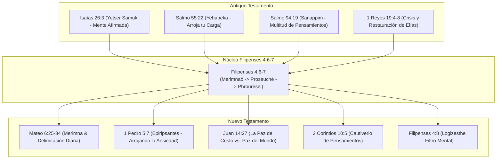
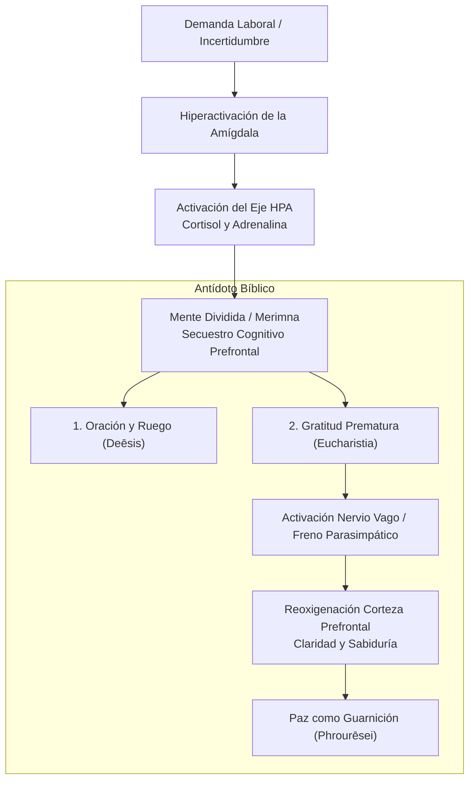

# ⛪ Actitud Espiritual y Mental ante el Estrés y la Presión Laboral
### *Estudio Exegético Profundo, Teología Bíblica de la Paz y Protocolo de Victoria para el Pastor-Ingeniero*

**Pasaje Central**: Filipenses 4:6-9 | Mateo 6:25-34  
**Pasajes Paralelos del Antiguo Testamento**: Isaías 26:3-4 | Salmo 55:22 | Salmo 94:19 | Proverbios 12:25 | 1 Reyes 19:4-8 | Salmo 46:1-11  
**Pasajes Paralelos del Nuevo Testamento**: 1 Pedro 5:7 | Juan 14:27 | 2 Corintios 10:5 | Romanos 8:6 | Colosenses 3:15  
**Área**: [[pilar-ministerial-pastorado|Área Ministerial - Pastorado]] & [[sistema-productividad-pastor-ingeniero|Productividad del Pastor-Ingeniero]]  
**Subagente**: Pastoral Assistant & Asistente Teológico  
**Propósito**: Desarticular la mecánica del estrés cognitivo y ministerial mediante el rigor exegético del texto griego y hebreo, proveyendo un marco teológico y neuroespiritual aplicable a la alta demanda técnica e intelectual.

---

## 🏛️ I. Contexto Histórico, Geográfico y Epistolar

### 1. El Prisionero en Cadenas y la Colonia Romana
- **Autor y Circunstancia**: El apóstol Pablo escribe esta epístola desde su prisión en Roma (c. 61-62 d.C.), encadenado a un soldado de la guardia pretoriana (*praetorium*, Fil 1:13). Físicamente, Pablo experimentaba el máximo estrés humano: privación de libertad, proceso legal con riesgo de pena de muerte, traición de hermanos celosos (Fil 1:15-17) e incertidumbre material.
- **La Ciudad de Filipos**: Era una *Colonia Iulia Augusta Philippensis*, poblada por veteranos del ejército romano. Sus ciudadanos disfrutaban del *ius Italicum* (derecho itálico), exentos de tributos directos y gobernados por la ley de Roma. La mentalidad filipense respiraba orden castrense, seguridad militar y orgullo imperial.
- **La Paradoja de la Carta**: La iglesia en Filipos estaba sufriendo presiones cívicas, hostilidad externa y fricciones relacionales internas entre líderes (Evodia y Síntique, Fil 4:2). Paradójicamente, no es la iglesia en libertad la que consuela a Pablo, sino el prisionero encadenado quien les ordena: **«Regocijaos en el Señor siempre»** y **«Por nada estéis afanosos»**.

---

## 🔍 II. Exégesis Lingüística Exhaustiva (Griego Bíblico & Hebreo)

### 1. El Diagnóstico del Estrés: *Merimnāte* (μεριμνᾶτε) — Filipenses 4:6
$$\text{Μηδὲν μεριμνᾶτε (Mēden merimnāte)}$$
- **Morfología**: Imperativo presente activo, 2ª persona del plural con la negación acusativa absoluta *mēden* ("por absolutamente nada").
- **Etimología**: Compuesto del verbo **μερίζω** (*merizō*, "dividir, fraccionar, cortar en partes") y la raíz **νοῦς** (*noūs*, "mente, entendimiento").
- **Fuerza Exegética**: La ansiedad bíblica no es una falta de ocupación, sino **«una mente fraccionada en pedazos»**. El estrés y la sobrecarga laboral actúan desgarrando la capacidad cognitiva en direcciones opuestas: la responsabilidad presente contra el temor a un futuro incontrolable. El sujeto ansioso intenta resolver mentalmente problemas que aún no han ocurrido, vaciando la energía del presente.
- **Correspondencia en el Antiguo Testamento**:
  - **דְּאָגָה (*De'agah*)** en **Proverbios 12:25**: *«La congoja (de'agah) en el corazón del hombre lo abate (yashchennah), mas la buena palabra lo alegra»*. La raíz hebrea *da'ag* denota un peso asfixiante que derriba el espíritu.
  - **שַׂרְעַפִּים (*Sar'appim*)** en **Salmo 94:19**: *«En la multitud de mis pensamientos (sar'appay) dentro de mí, tus consolaciones alegraban mi alma»*. *Sar'appim* describe ramas enredadas de un espino; pensamientos discursivos desbordados y entrelazados como un bucle sin salida.

---

### 2. El Antídoto Cuádruple: La Ingeniería de la Oración (Filipenses 4:6)
$$\text{ἀλλ’ ἐν παντὶ τῇ προσευχῇ καὶ τῇ δεήσει μετὰ εὐχαριστίας}$$

Pablo no propone un estoicismo pasivo, sino una sustitución dinámica mediante cuatro términos precisos:

| Término Griego | Transliteración | Significado Preciso | Aplicación en la Sobrecarga Técnica/Ministerial |
| :--- | :--- | :--- | :--- |
| **προσευχῇ** | *Proseuchē* | Oración de santuario; adoración y reconocimiento reverente del Dios soberano. | Antes de mirar el problema técnico o pastoral, alinear la perspectiva con la grandeza de Dios. |
| **δεήσει** | *Deēsis* | Súplica sentida, ruego urgente derivado de una necesidad explícita y sentida de carencia (*deō*, faltar). | Admitir la propia incapacidad humana; confesar la limitación intelectual ante la complejidad del código o del alma. |
| **αἰτήματα** | *Aitēmata* | Peticiones concretas, peticiones puntuales catalogadas ítem por ítem. | No orar en abstracto ("ayúdame con el día"); detallar la función, el bug, la reunión o el conflicto puntual. |
| **εὐχαριστίας** | *Eucharistia* | Acción de gracias pre-factual y retrospectiva (*eu*, bien + *charis*, gracia). | Agradecer **antes** de ver la resolución, fundamentado en la fidelidad pasada del Señor. Destruye el pánico. |

> [!IMPORTANT]
> **La Clave de la *Eucharistia* en la Presión**: La queja alimenta la fragmentación (*merimna*); la acción de gracias recompone la unidad de la mente porque le recuerda a la corteza prefrontal que Dios ya ha sido fiel en el pasado.

---

### 3. La Paz Sobrenatural: *Hyperechousa Panta Noun* (Filipenses 4:7)
$$\text{ἡ εἰρήνη τοῦ θεοῦ ἡ ὑπερέχουσα πάντα νοῦν}$$
- **εἰρήνη τοῦ θεοῦ (*Eirēnē tou Theou*)**: No es una paz psicológica generada por técnicas de respiración; es la **paz que posee Dios mismo**, el Shalom inconmovible de un Dios que jamás entra en pánico ni sufre crisis de recursos.
- **ὑπερέχουσα (*Hyperechousa*)**: Participio presente activo de *hyperechō* (*hyper*, por encima + *echō*, tener). Significa "trascender, sobrepasar, elevarse por encima de".
- **πάντα νοῦν (*Panta noun*)**: "Todo entendimiento, facultad analítica o cálculo humano".
- **Significado Teológico**: La paz de Dios no anula el intelecto humano ni exige desconectar la lógica; **la sobrepasa**. En medio de una arquitectura de software colapsada o una crisis ministerial severa, la mente humana calcula el desastre; la paz de Dios desciende por encima de esos cálculos y preserva la serenidad operativa.

---

### 4. La Guarnición Militar: *Phrourēsei* (φρουρήσει) — Filipenses 4:7
$$\text{φρουρήσει τὰς καρδίας ὑμῶν καὶ τὰ νοήματα ὑμῶν ἐν Χριστῷ Ἰησοῦ}$$
- **Análisis Militar**: *Phroureō* es un término castrense formal. Aludía a una **guarnición de legionarios apostados a las puertas de una ciudad amurallada** para vigilar y repeler incursiones hostiles enemigas. Para los habitantes de la colonia romana de Filipos, la imagen era viviente y cotidiana: veían a los soldados montar guardia para que la ciudad durmiera en paz.
- **Las Dos Puertas Custodiadas**:
  1. **τὰς καρδίας (*Tas kardias*) — El Corazón**: La sede de las emociones, las pasiones, el afecto y la voluntad. Dios envía Su paz para que las emociones no colapsen en desaliento, pánico o cinismo (*burnout*).
  2. **τὰ νοήματα (*Ta noēmata*) — Los Pensamientos**: Los proyectos mentales, conspiraciones cognitivas, tramas de preocupación y bucles de rumiación. La paz de Dios actúa como centinela pretoriano diciendo: *"Este pensamiento de terror o angustia no tiene pase de entrada a este templo"*.

---

## 📜 III. Red de Pasajes Paralelos (Teología Bíblica Intertextual)



### 1. El Fundamento del Antiguo Testamento

#### A. Isaías 26:3-4 — *Shalom Shalom* y la Mente Apoyada
> *«Tú guardarás en completa paz a aquel cuyo pensamiento en ti persevera; porque en ti ha confiado. Confiad en Jehová perpetuamente, porque en Jehová el Señor está la fortaleza de los siglos.»*
- **Término Clave**: **שָׁלוֹם שָׁלוֹם (*Shalom Shalom*)**. En hebreo, la repetición denota perfección absoluta: una paz doble, imperturbable y redonda.
- **La Condición**: **יֵצֶר סָמוּךְ (*Yetser Samuk*)**. *Yetser* es la imaginación, el armazón mental o diseño de pensamientos. *Samuk* es un participio pasivo que significa **"apuntalado, apoyado firmemente, recostado sobre un puntal indestructible"**. Si la mente se apoya sobre el rendimiento propio o las métricas, se desploma; si se apoya en Jehová, hereda *Shalom Shalom*.

#### B. Salmo 55:22 — La Transferencia de la Carga
> *«Echa sobre Jehová tu carga, y él te sustentará; no dejará para siempre caído al justo.»*
- **Término Clave**: **יְהָבְךָ (*Yehabeka*)**. Es un término *hápax legómenon* en el Antiguo Testamento. Se traduce como "lo que te ha sido asignado por providencia", "tu carga, tu suerte o tu porción gravosa".
- **La Acción**: El verbo es **הַשְׁלֵךְ (*Hashlek*)**, un imperativo enérgico: **¡Arrójala violentamente lejos de ti hacia Jehová!** No es una sugerencia diplomática; es la orden de soltar el fardo pesado que tu columna no fue diseñada para sostener.

#### C. 1 Reyes 19:4-8 — La Anatomía del Colapso y el Cuidado de Dios
- **El Caso Elías**: Tras la victoria aplastante en el Monte Carmelo, una amenaza de Jezabel sumerge a Elías en depresión y deseo de muerte bajo el enebro: *«Basta ya, oh Jehová, quítame la vida»* (v. 4).
- **La Terapia Divina**: Dios no lo reprende teológicamente ni le da una conferencia espiritual. Dios atiende primero el **agotamiento físico y biológico**:
  1. **Sueño reparador** (v. 5).
  2. **Comida nutritiva caliente y agua** provistas por un ángel (v. 6).
  3. **Segunda siesta reparadora** (v. 6b).
  4. La declaración divina: *«Largo camino te resta»* (v. 7).
- **Lección Pastoral**: Gran parte del estrés "espiritual" o la crisis de fe es simplemente fatiga adrenocortical y privación de sueño. El Dios que diseñó el alma diseñó también los neurotransmisores.

---

### 2. El Desarrollo en el Nuevo Testamento

#### A. Mateo 6:25-34 — La Pedagogía de Jesús contra el Afán
- **El Discurso del Maestro**: En el Sermón del Monte, Jesús usa siete veces la familia de **μεριμνάω** (*merimnaō*).
- **La Lógica de Menor a Mayor (*A Fortiori*)**:
  - Si Dios alimenta a las aves del cielo (que no siembran ni siegan) y viste a la hierba del campo (que hoy es y mañana se echa al horno), ¿cuánto más a vosotros, hombres de poca fe (*oligopistoi*)?
- **El Límite Divino del Tiempo (v. 34)**:
  > *«Así que, no os afanéis por el día de mañana, porque el día de mañana traerá su afán. Basta a cada día su propio mal (ἀρκετὸν τῇ ἡμέρᾳ ἡ κακία αὐτῆς).»*
  - **La Ley de la Gracia Diaria**: Dios reparte el maná diariamente. No otorga gracia hoy para las batallas imaginarias del próximo mes. El estrés nace de intentar cargar con la fuerza del jueves los problemas que pertenecen al viernes siguiente.

#### B. 1 Pedro 5:7 — El Despojo de la Ansiedad
> *«Echando toda vuestra ansiedad sobre él, porque él tiene cuidado de vosotros.»*
- **Término Clave**: **ἐπιρίψαντες (*Epiripsantes*)**, participio aoristo activo de *epiriptō* (*epi*, sobre + *riptō*, lanzar o tirar). Describe el acto de **lanzar una vestidura o manta pesada sobre el lomo de una bestia de carga**.
- **La Razón**: **ὅτι αὐτῷ μέλει περὶ ὑμῶν (*Hoti autō melei peri hymōn*)** — *"Porque a Él le importa profundamente todo lo que os concierne"*. La ansiedad insinúa que a Dios se le olvidó tu causa; Pedro afirma que Su radar providencial no pierde detalle de tu vida.

#### C. Juan 14:27 — La Naturaleza de la Paz de Cristo
> *«La paz os dejo, mi paz os doy; yo no os la doy como el mundo la da. No se turbe vuestro corazón, ni tenga miedo.»*
- **Paz del Mundo vs. Paz de Cristo**:
  - **La Paz del Mundo**: Depende de la ausencia de conflictos externos (cuentas bancarias llenas, servidores sin alarmas, salud perfecta). Es frágil y circunstancial.
  - **La Paz de Cristo**: Florece **en medio de la tormenta**. Es la paz del Maestro durmiendo plácidamente sobre el cabezal en la popa de la barca mientras el mar de Galilea cruje (Marcos 4:38).

#### D. Filipenses 4:8-9 — La Gimnasia Cognitiva de la Reestructuración
Pablo no deja la mente en blanco tras la oración. La ansiedad se vence sustituyendo el objeto del pensamiento:
$$\text{ταῦτα λογίζεσθε (Tauta logizesthe)}$$
- **λογίζεσθε (*Logizesthe*)**: Imperativo presente medio de *logizomai* (término contable y matemático: "computad, calculad, considerad deliberadamente").
- **Los 8 Filtros de Protección Mental**:
  1. Lo que es **verdadero** (*alēthē*): Confronte las mentiras del síndrome del impostor o las catástrofes ficticias con la verdad bíblica.
  2. Lo que es **noble / honesto** (*semna*): De porte respetable y digno.
  3. Lo que es **justo** (*dikaia*): En armonía con la justicia y rectitud de Dios.
  4. Lo que es **puro** (*hagna*): Limpio de sospechas, celos o amarguras laborales.
  5. Lo que es **amable** (*prosphilē*): Agradable, que promueve la concordia.
  6. Lo que es de **buen nombre** (*euphēma*): Digno de alabanza y no de difamación.
  7. Si hay **virtud alguna** (*aretē*): Excelencia moral operativa.
  8. Si algo digno de **alabanza** (*epainos*): Lo que honra y edifica.

---

## 🧠 IV. Neuroteología y Dimensión Psicológica/Cognitiva

El diseño biológico humano confirma la sabiduría de la revelación de Filipenses 4:



1. **El Secuestro de la Amígdala**: Ante una crisis de infraestructura, un deadline agresivo o un reclamo pastoral, la amígdala cerebral interpreta amenaza de muerte y detona el eje HPA. La sangre se desvía de la **corteza prefrontal dorsolateral** (el centro del pensamiento abstracto, lógica de programación y empatía pastoral) hacia los músculos motores. El resultado es el estado de *Merimna*: parálisis mental, visión de túnel y reactividad irritable.
2. **El Impacto Neurofisiológico de la *Eucharistia***: La neurociencia contemporánea ha demostrado que el cerebro humano no puede experimentar gratitud profunda y terror simultáneamente en las mismas redes neuronales. La gratitud deliberada activa el **núcleo accumbens** y el córtex del cíngulo anterior, estimulando la liberación de dopamina y serotonina, facilitando la desescalada del cortisol.
3. **El Efecto Centinela (*Phrourēsei*) en la Memoria de Trabajo**: Al orar con peticiones concretas (*aitēmata*), el creyente traslada la carga desde el búfer de la memoria de trabajo humana al Señor. La mente deja de ejecutar ciclos infinitos de fondo (*threads* zombis en el CPU cognitivo), recuperando su capacidad para concentrarse en la tarea asignada hoy.

---

## 📊 V. Matriz Diagnóstica: Tres Tipos de Tensión

| Dimensión | Eustrés (Estrés Funcional) | Distrés (Estrés Tóxico) | *Merimna* (Afán Bíblico) |
| :--- | :--- | :--- | :--- |
| **Origen** | Desafío técnico asumible que despierta enfoque. | Sobrecarga crónica prolongada sin descanso biológico. | Desconfianza involuntaria en la providencia soberana. |
| **Estado Mental** | Enfoque, estado de flujo (*flow*). | Agotamiento, visión de túnel, embotamiento. | Mente fragmentada, rumiación del futuro. |
| **Fisiología** | Elevación transitoria de dopamina y adrenalina. | Saturación destructiva de cortisol, insomnio, taquicardia. | Opresión en el pecho, fatiga interior profunda. |
| **Solución** | Conclusión del bloque de trabajo enfocado. | Descanso sabático, sueño, nutrición (1 Reyes 19). | Oración de descarga, gratitud y reposo filial (Fil 4:6-7). |

---

## 🛠️ VI. Protocolo Práctico para el Pastor-Ingeniero (*Protocolo Phrourēsei*)

Para Don Víctor en su doble rol de alta responsabilidad tecnológica y ministerial:

### 1. El Hábito de la Pausa de Traslado (2 minutos antes de cada bloque)
Antes de abrir el editor de código, conectarse a un servidor crítico o iniciar una reunión de alto impacto:
- **Respiración fisiológica**: 2 inhalaciones profundas por la nariz, exhalación lenta por la boca.
- **La declaración explícita**: *"Señor, este sistema / este servicio / este servidor es tuyo. Yo soy solo tu mayordomo terrenal. Te entrego el resultado; dame sabiduría y destreza técnica para este bloque"*.

### 2. El Filtro de la Gratitud Prematura (Freno de Rumiación)
Cuando salte una alarma o surja una anomalía inesperada que detone ansiedad:
- Escriba 3 hechos objetivos por los cuales dar gracias al Señor en ese momento (ej. *"Gracias por la salvación; gracias por darme capacidad de análisis; gracias porque ninguna tormenta escapa a tu trono"*).

### 3. La Delimitación de Mateo 6:34 (Cero Ansiedad del Mañana)
- Divida su jornada en bloques Time-Blocking bien delimitados.
- **Regla de Oro**: Ninguna tarea que pertenezca a la jornada de mañana tiene permiso de consumir ciclos de procesamiento cerebral hoy. *«Basta a cada día su propio mal»*.

### 4. La Higiene del Enébro (Autocuidado Pastoral y Biológico)
- Recuerde a Elías: antes de dudar de su ministerio, pregúntese:
  - *¿He dormido al menos 7 horas continuas?*
  - *¿He hidratado mi cuerpo adecuadamente?*
  - *¿He tenido un tiempo de quietud a solas sin pantallas?*

---

## 🎤 VII. Bosquejo Homilético para Enseñanza o Sermón

### **Título**: *Mente Inconmovible: Cómo Vencer la Presión y la Ansiedad en un Mundo Roto*
**Texto Base**: Filipenses 4:6-9 | Isaías 26:3  
**Proposición Central**: *«La paz que Dios nos ofrece no es una tregua pasiva con las circunstancias, sino una guardia militar divina que blinda nuestro corazón y nuestros pensamientos cuando decidimos confiarle nuestras cargas con gratitud»*.

```text
I. LA ENFERMEDAD DEL HOMBRE MODERNO: LA MENTE DIVIDIDA (v. 6a)
   A. La naturaleza del afán (Merimnaō): Una mente rota en pedazos por el mañana.
   B. El diagnóstico de la ilusión de control: Nos estresamos por lo que no podemos gobernar.
   C. La advertencia bíblica: La ansiedad jamás ha resuelto el problema de mañana, solo ha secado las fuerzas de hoy (Mateo 6:34).

II. EL REMEDIO DEL CIELO: LA INGENIERÍA DE LA ORACIÓN DESCARGADA (v. 6b)
   A. Oración (Proseuchē): Reconociendo la majestad y soberanía de Dios.
   B. Ruego específico (Deēsis y Aitēmata): Nombrando los temores sin maquillaje religioso.
   C. El ingrediente decisivo: Gratitud prematura (Eucharistia) como declaración de fe.

III. EL MILAGRO DE LA CUSTODIA PRETORIANA (v. 7)
   A. Una paz que desafía toda lógica humana (Hyperechousa panta noun).
   B. El centinela apostado en la puerta (Phrourēsei):
      1. Custodiando tus afectos del cinismo y el burnout (Kardia).
      2. Custodiando tus pensamientos de las trampas del enemigo (Noēmata).
   C. La disciplina del reemplazo mental: Computar lo verdadero, noble y puro (v. 8).
```

---

## 🔗 Referencias Cruzadas en 2brain
- [[pilar-ministerial-pastorado|Pilar Ministerial - Pastorado]]
- [[sistema-productividad-pastor-ingeniero|Sistema de Productividad del Pastor-Ingeniero]]
- [[sermon-2-la-paz-en-medio-de-la-tormenta-estudio|Sermón 2: La Paz en Medio de la Tormenta]]
- [[serie-jesus-solucion-de-todo-problema|Serie: Jesús, Solución a Todo Problema]]
- [Subagente Pastoral Assistant](../agents/pastoral_assistant.md)
