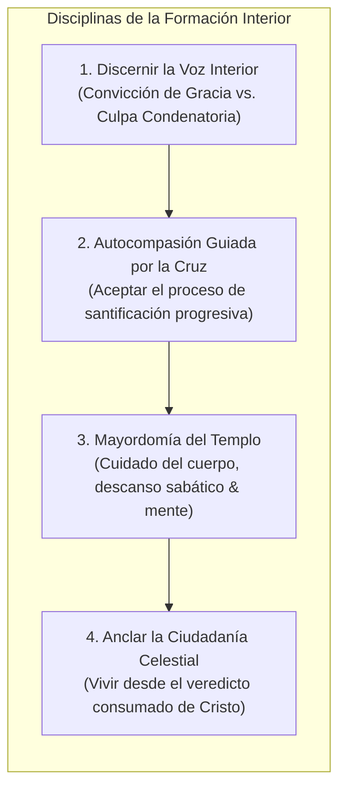

# Identidad en Cristo, Reinar en Vida y el Amor Propio Redimido
## Cómo gobernar espiritualmente en medio de nuestra humanidad caída, cultivar una ciudadanía celestial inquebrantable y amar al prójimo desde la reconciliación interior

> *"Pues si por la transgresión de uno solo reinó la muerte, mucho más reinarán en vida por uno solo, Jesucristo, los que reciben la abundancia de la gracia y del don de la justicia."*  
> — **Romanos 5:17**

> *"Amarás al Señor tu Dios con todo tu corazón, y con toda tu alma, y con toda tu mente, y con todas tus fuerzas... y a tu prójimo como a ti mismo. No hay otro mandamiento mayor que éstos."*  
> — **Marcos 12:30-31**

> *"Mas nuestra ciudadanía está en los cielos, de donde también esperamos al Salvador, al Señor Jesucristo."*  
> — **Filipenses 3:20**

---

## 🧭 Tesis Central del Estudio

El deseo legítimo del creyente de experimentar la *"vida en abundancia"* prometida por Jesús (*Juan 10:10*) suele colisionar contra dos extremos destructivos:
1. **El Perfeccionismo Legalista**: Creer que para "reinar espiritualmente" debemos alcanzar una impecabilidad inalcanzable, lo cual produce culpa neurótica, agotamiento y auto-odio cada vez que tropezamos.
2. **El Humanismo Secular de Autoayuda**: Creer que el "amor propio" consiste en inflar el ego humano, la autovalidación ciega y la autosuficiencia, lo cual colapsa en cuanto llegan el dolor, la debilidad o el fracaso moral.

La revelación del Evangelio propone una tercera vía trascendente: **La Identidad Fundamentada en la Gracia Consumada**. Reinar en vida no significa no tropezar jamás; significa que el pecado y la condenación han perdido el trono sobre nuestra conciencia, permitiéndonos trabajar en nosotros mismos como mayordomos de la imagen de Dios (*Imago Dei*) y amar al prójimo desde un corazón saciado por el amor del Padre.

---

## 1. La Palabra Viva vs. El Peligro de la Mecanización de la Fe

Existe una tentación sutil cuando estudiamos disciplinas, sistemas y hábitos modernos: intentar **mecanizar la Biblia**, tratándola como si fuera un recetario frío de fórmulas de éxito o un algoritmo de causa-efecto.

* **La Escritura es un Organismo Vivo**: En *Hebreos 4:12* se define como *zōsa kai energēs* (viva y cortante). La Biblia no es un fin en sí misma; es la revelación viva que nos une a una **Persona**: Jesucristo.
* **El lugar de los sistemas**: Los hábitos y sistemas diarios (financieros, devocionales, somáticos) no sustituyen al Espíritu Santo ni obligan a Dios a bendecirnos mecánicamente. Son **odres para el vino nuevo**. Como el altar de doce piedras que Elías ordenó meticulosamente en el Monte Carmelo (*1 Reyes 18*): el hombre ordena las piedras con diligencia y fidelidad, pero el fuego es potestad soberana del cielo.
* Operamos con sistemas para erradicar el caos de nuestra vida, de modo que el Espíritu de Dios encuentre un canal limpio, lúcido y disponible para obrar.

---

## 2. Reinar en Vida en Medio de la Fragilidad Humana (*Romanos 5:17*)

El apóstol Pablo enseña que aquellos que reciben *"la abundancia de la gracia y del don de la justicia reinarán en vida"*. Esta promesa suele malinterpretarse como una vida de invulnerabilidad triunfalista o de ausencia de conflicto.

### La Tensión: *Simul Iustus et Peccator*
Martín Lutero definió con precisión la condición del creyente en esta tierra: **simultáneamente justo y pecador**.
* En nuestro espíritu y posición legal ante Dios, hemos sido declarados justos por la sangre de Jesús (*Romanos 8:1*, *Katakrima* cancelado).
* En nuestra humanidad cotidiana, seguimos lidiando con la carne, la debilidad y la imperfección (*1 Juan 1:8*).

### ¿Qué significa entonces "Reinar en Vida"?
1. **El Pecado ya no es Rey**: *Romanos 6:14* proclama: *"El pecado no se enseñoreará de vosotros, pues no estáis bajo la ley, sino bajo la gracia"*. Reinar no significa no resbalar nunca; significa que el pecado ya no tiene el derecho legal de gobernar tu destino, definir tu identidad ni condenar tu alma.
2. **La Respuesta al Tropiezo**:
   * **El esclavo de la ley** cae y corre a esconderse en la vergüenza, confeccionando hojas de higuera de justificación propia o hundiéndose en la autoconmiseración (*Génesis 3*).
   * **El hijo que reina en vida** cae y corre de inmediato al trono de la gracia, apoyándose en su Abogado fiel: *"Hijitos míos, estas cosas os escribo para que no pequéis; y si alguno hubiere pecado, abogado tenemos para con el Padre, a Jesucristo el justo"* (*1 Juan 2:1*).
3. **Reinar sobre la Acusación**: Satanás es el *"acusador de los hermanos"* (*Apocalipsis 12:10*). Quien reina en vida aprende a silenciar la voz de la condenación recordándole a su propia mente que el veredicto favorable fue sellado eternamente en la cruz.

---

## 3. La Teología del Amor Propio Redimido (*Marcos 12:31*)

El mandamiento de Jesús es explícito: *"Amarás a tu prójimo **como a ti mismo**"*. El texto asume que existe un cuidado, consideración y aprecio fundamental por la propia vida que sirve como patrón para amar a los demás.

### Desmitificando el Amor Propio: Secular vs. Bíblico

| Dimensión | Autoayuda Secular / Ego | Amor Propio Bíblico (Redimido) |
| :--- | :--- | :--- |
| **Fundamento** | "Ámate porque eres especial, talentoso y superior". | "Me amo y me cuido porque soy hechura de Dios (*Efesios 2:10*), portador de su imagen y comprado a precio de sangre (*1 Cor. 6:20*)". |
| **Respuesta al Error** | Frustración narcisista, vergüenza tóxica o negación del fallo. | Humildad, arrepentimiento genuino y recepción del perdón divino. |
| **Enfoque** | Egocéntrico: el yo como centro del universo. | Teocéntrico: yo como un vaso sagrado para bendecir a otros. |
| **Estabilidad** | Volátil: depende del éxito, la aprobación social y la belleza física. | Inconmovible: descansa en la adopción irrevocable de Dios (*Romanos 8:15-17*). |

### La Trampa del Odio Hacia Uno Mismo
Muchos creyentes y líderes espirituales caen en la trampa del **auto-desprecio piadoso**:
* Creen falsamente que "ser humilde" significa odiar su propia mente, maltratar su cuerpo, avergonzarse de su historia o vivir con un inquisidor interno que descalifica cada logro.
* **La paradoja relacional**: Una persona que se odia a sí misma, que no se perdona sus debilidades y que vive bajo autoflagelación, es incapaz de amar al prójimo. Inevitablemente proyectará sobre su cónyuge, sus hijos y sus discípulos la misma amargura, impaciencia y perfeccionismo asfixiante que aplica sobre sí misma.
* **El principio de la vasija**: Solo quien ha permitido que la gracia sane sus propias heridas puede ser un bálsamo para las heridas ajenas.

---

## 4. Cómo Trabajar en Uno Mismo: Las 4 Disciplinas del Carácter Espiritual

Trabajar en uno mismo no es vanidad; es **mayordomía del instrumento sagrado**.

### 1. Discernir la Voz de la Convicción vs. la Voz de la Culpa
* **La Convicción del Espíritu Santo**: Apunta a una conducta concreta, produce tristeza según Dios (*2 Corintios 7:10*), quebranta con ternura y abre inmediatamente el camino de restauración: *"Hijo, esta actitud no refleja mi naturaleza en ti; ven, límpiala en mi altar y sigamos adelante"*.
* **La Culpa de la Carne / Enemigo**: Es abstracta, destructiva, ataca la identidad (*"eres un fraude, nunca cambiarás, no sirves para esto"*), busca el aislamiento y produce parálisis espiritual.

### 2. Abrazar la Santificación como un Cultivo Orgánico, no como una Fábrica
* La santificación bíblica es un proceso biológico, no manufacturero. Jesús habló de la vid y los pámpanos (*Juan 15*). Las plantas crecen con tiempo, sol, lluvia y poda; no a base de golpes.
* Tenga la madurez de un buen padre con su hijo pequeño: cuando el niño aprende a caminar y cae al suelo, el padre no lo insulta ni lo echa de la casa; lo levanta con paciencia, sacude sus rodillas y lo anima a dar el siguiente paso. Trátese a sí mismo con esa misma paternidad redimida.

### 3. La Mayordomía Integral del Ser (*1 Tesalonicenses 5:23*)
* El ser humano es espíritu, alma y cuerpo. Trabajar en uno mismo incluye:
  - **Espíritu**: Adoración íntima, Palabra viva y comunión con el Padre.
  - **Alma**: Sanar narrativas del pasado, perdonar ofensas, disciplinar los pensamientos (*Filipenses 4:8*).
  - **Cuerpo**: Nutrición responsable, ejercicio y el mandamiento del descanso (Sabbat). Descansar es un acto de fe que confiesa que el mundo sigue en manos de Dios cuando cerramos los ojos.

### 4. Vivir desde la Ciudadanía Celestial (*Filipenses 3:20*)
* Su valor como ser humano y siervo de Dios no oscila según el resultado del último proyecto, la aprobación de la multitud o el estado de su cuenta bancaria.
* Usted es ciudadano de un Reino inconmovible. Su ciudadanía le otorga derechos legales eternos en el ámbito espiritual: acceso directo al Padre, autoridad en el nombre de Jesús y la promesa inquebrantable de que *"el que comenzó en vosotros la buena obra, la perfeccionará hasta el día de Jesucristo"* (*Filipenses 1:6*).

---

## 5. Aplicación Ministerial y de Liderazgo

1. **Predicar y Liderar desde la Gracia Real**: 
   * Deje de proyectar una imagen de líder inalcanzable o invulnerable. La congregación no se inspira por la fingida perfección del predicador, sino por ver cómo un hombre real, con luchas reales, es sostenido, levantado y capacitado por un Salvador perfecto.
2. **El Amor al Prójimo como Desbordamiento**:
   * Cuando su alma está saciada en el amor incondicional del Padre, usted deja de usar a las personas para satisfacer sus necesidades de validación o ego. Ahora puede amarlas libremente, tolerar sus fallas y servirlas con desinterés.

---

## 🔗 Enlaces y Referencias en la Wiki
- [[estudio-mayordomia-sistemas-y-estatura-espiritual|Teología de la Mayordomía: Sistemas, Capacidad Interior y Estatura en Cristo]]
- [[sermon-3a-sanando-relaciones-interior-estudio|Sermón 3A: La Reconciliación Interior (Paz Conmigo Mismo y con mi Historia)]]
- [[sermon-1-el-secreto-del-contentamiento-estudio|Sermón 1: El Secreto del Contentamiento (Filipenses 4)]]
- [[pilar-ministerial-pastorado|Área Ministerial - Índice Pastoral]]
