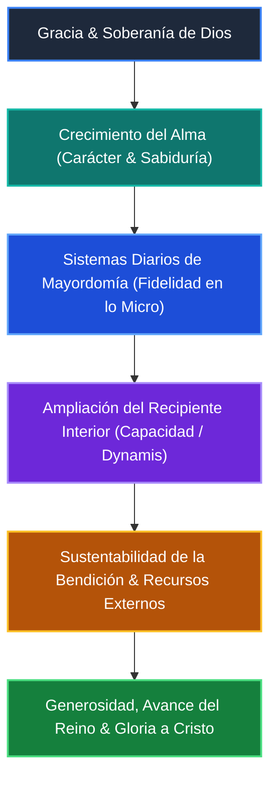
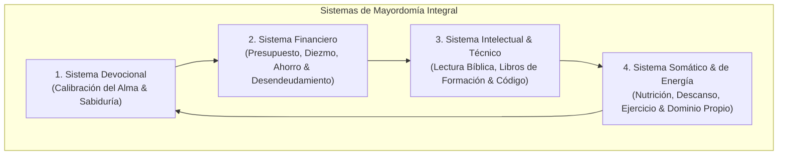

# La Teología de la Mayordomía: Sistemas, Capacidad Interior y Estatura en Cristo
## Diálogo Exegético y Pastoral entre *Hábitos Atómicos* (James Clear), *Los Secretos de la Mente Millonaria* (T. Harv Eker) y el Evangelio de Jesucristo

> *"Amado, yo deseo que tú seas prosperado en todas las cosas, y que tengas salud, así como prospera tu alma."*  
> — **3 Juan 1:2**

> *"El que es fiel en lo muy poco, también en lo más es fiel; y el que en lo muy poco es injusto, también en lo más es injusto."*  
> — **Lucas 16:10**

> *"Sé vivir humildemente, y sé tener abundancia; en todo y por todo estoy enseñado, así para estar saciado como para tener hambre, así para tener abundancia como para padecer necesidad. Todo lo puedo en Cristo que me fortalece."*  
> — **Filipenses 4:12-13**

---

## 🧭 Resumen Ejecutivo & Tesis Central

Existe una corriente popular que confunde la bendición bíblica con la acumulación desordenada de riquezas (el falso "evangelio de la prosperidad"), mientras que otra corriente cae en el pietismo pauperista, demonizando los recursos materiales y promoviendo una mentalidad de escasez y pasividad.

Este estudio desmonta ambas posturas a partir de una convergencia teológica y metodológica de alto rigor:
1. **La Ley del Recipiente Espiritual**: La riqueza material y la influencia ministerial jamás pueden superar la estatura espiritual y el carácter del mayordomo sin destruirlo (*3 Juan 1:2*, *Mateo 25:15*).
2. **Sistemas sobre Metas**: La madurez no es un evento fortuito ni una mera aspiración emocional; es el fruto de hábitos atómicos y disciplinas de fidelidad diaria (*Lucas 16:10*).
3. **El Principio Salomónico**: La verdadera riqueza es una consecuencia colateral de buscar la sabiduría y la capacidad de servir al Reino (*1 Reyes 3:5-14*).
4. **La Trascendencia Cristocéntrica**: Frente a la autosuficiencia humanista ("yo soy más grande que mis problemas"), el creyente es transformado para vivir en la suficiencia de Cristo, capacitado para gobernar los recursos sin ser gobernado por ellos (*Filipenses 4:11-13*, *1 Timoteo 6:17-19*).

---

## 1. La Ley del Recipiente: Tu Capacidad Interior Determina tu Mayordomía Exterior

En el **Archivo de Riqueza Nº 9** de *Los Secretos de la Mente Millonaria*, T. Harv Eker introduce una verdad psicológica incuestionable:
> *"La gente rica es más grande que sus problemas; la gente pobre es más pequeña que sus problemas... Tu riqueza puede crecer únicamente hasta donde lo hagas tú."*

Eker ilustra que si una persona tiene una capacidad interior de nivel 2, un problema financiero o gerencial de nivel 5 se experimenta como una catástrofe paralizante. Pero si esa persona invierte en su desarrollo, disciplina su mente y madura hasta convertirse en una persona de nivel 8, el mismo problema de nivel 5 se reduce a un trámite manejable.

### La Exégesis Bíblica: *Dynamis* y la Parábola de los Talentos
En el Evangelio según Mateo, encontramos el fundamento eterno de este principio:
> *"Y a uno dio cinco talentos, y a otro dos, y a otro uno, a cada uno conforme a su **capacidad** (κατὰ τὴν ἰδίαν δύναμιν - katà tēn idían dýnamin); y luego se fue lejos."*  
> — **Mateo 25:15**

* La palabra griega traducida como "capacidad" es **dýnamis**, que implica aptitud intrínseca, fuerza moral, capacidad administrativa y madurez operativa.
* El Señor no repartió los talentos por sorteo, favoritismo ni por "necesidad sentida", sino en estricta proporción al tamaño del recipiente de cada mayordomo.
* **La misericordia preventiva de Dios**: Cuando Dios no nos concede de inmediato la escala financiera o el alcance que pedimos en oración, no se debe a tacañería divina, sino a gracia protectora. Un aumento de recursos materiales sobre un carácter inmaduro no es bendición: es una trampa que fomenta soberbia, desorden o ruina moral (*Proverbios 1:32*: *"el sosiego de los necios los echará a perder"*).

---

## 2. Sistemas por Encima de Metas: La Fidelidad en lo Micro

En *Hábitos Atómicos*, James Clear revoluciona la productividad moderna al demostrar que:
> *"No te elevas al nivel de tus metas; caes al nivel de tus sistemas."*

Todo el mundo comparte metas similares (todos los atletas quieren la medalla de oro, todos los emprendedores quieren ganar dinero). Lo que diferencia al ganador del rezagado no es el anhelo del resultado, sino el **sistema operativo diario**: las rutinas, la respuesta a los fracasos y la identidad forjada en las pequeñas decisiones invisibles.

### La Pedagogía de Jesús en Lucas 16:10
Cristo formuló esta ley espiritual y sistémica miles de años antes:
> *"El que es fiel en lo muy poco (ἐν ἐλαχίστῳ - en elachístō), también en lo más es fiel; y el que en lo muy poco es injusto, también en lo más es injusto."*  
> — **Lucas 16:10**

* **En elachístō**: Se refiere a lo mínimo, a lo insignificante a simple vista. Administrar con pulcritud diez dólares, llevar el registro de los gastos del cuaderno, dominar el apetito por compras impulsivas, entregar el diezmo con gozo cuando el ingreso es modesto.
* Quien no tiene un **sistema de dominio propio** en lo poco, no desarrollará mágicamente disciplina cuando reciba millones; simplemente multiplicará a escala sus propios vicios de desorden.
* El fruto en el Reino de Dios es acumulativo: la fidelidad en lo micro ensancha el recipiente para que Dios pueda confiar lo macro.

---

## 3. Salomón: La Sabiduría como la Estatura que Gobierna la Bendición

El pasaje de **1 Reyes 3:5-14** es el modelo paradigmático del liderazgo y la mayordomía de Reino:

1. **La Ocasión**: Dios le ofrece a Salomón un cheque en blanco espiritual: *"Pide lo que quieras que yo te dé"*.
2. **El Diagnóstico del Líder**: Salomón no se engaña con una falsa autosuficiencia: *"Yo soy joven, y no sé cómo entrar ni salir"* (v. 7). Reconoce que el desafío es un problema "nivel 10" y su experiencia humana es apenas "nivel 2".
3. **La Petición Estratégica**: Salomón pide **Lev Shomea** (לֵב שֹׁמֵעַ): un *"corazón que escucha, un corazón entendido para juzgar y discernir entre lo bueno y lo malo"* (v. 9). Pide ser agrandado por dentro.
4. **La Respuesta Divina**: Dios se agrada porque Salomón no pidió la manifestación externa de la riqueza (oro, venganza, fama), sino la infraestructura interna (sabiduría, juicio, discernimiento). Por ende, Dios le otorga sabiduría sin igual y le añade como consecuencia colateral las riquezas y la honra (v. 11-13).

### La Advertencia Canónica: El Colapso de Salomón
El relato bíblico no es ingenuo. En **1 Reyes 11** y en el libro de **Eclesiastés**, vemos lo que sucede cuando los **sistemas de obediencia a la ley** se relajan:
* Salomón multiplicó caballos (confianza militar), oro (acumulación egocéntrica) y mujeres extranjeras (alianzas idolátricas), violando directamente la ley del rey en *Deuteronomio 17:14-20*.
* **Lección**: La sabiduría inicial atrajo la riqueza, pero la falta de fidelidad a los sistemas diarios de santidad permitió que la riqueza terminara ahogando su corazón en la vanidad.

---

## 4. Comparativa Teológica: El Humanismo Secular vs. La Mayordomía Cristocéntrica

Es vital no comprar el modelo de T. Harv Eker sin pasarlo por el tamiz del Evangelio:

| Dimensión | Enfoque Secular (*Mente Millonaria*) | Enfoque Bíblico (*Mayordomía en Cristo*) |
| :--- | :--- | :--- |
| **Fuente de la Estatura** | El ego, la fuerza de voluntad humana, decretos mentales (*"Yo soy más grande"*). | La gracia santificadora, el fruto del Espíritu y la sabiduría divina (*"Cristo en vosotros, la esperanza de gloria"*). |
| **Definición de Riqueza** | Acumulación neta, independencia personal y estilo de vida privilegiado. | Provisión para la vida, generosidad abundante e inversión en la eternidad (*1 Tim. 6:18-19*). |
| **Actitud ante el Problema** | Desafío a mi ego y a mi capacidad resolutiva. | Ocasión para perfeccionar la fe y la dependencia en Dios (*Santiago 1:2-4*). |
| **Propósito Final** | La auto-realización del individuo. | La gloria de Dios y la bendición del prójimo (*Mateo 6:33*, *Génesis 12:2*). |
| **Advertencia Vital** | El estancamiento financiero. | El amor al dinero como raíz de todos los males (*1 Timoteo 6:10*). |

---

## 5. El Modelo Paulino: El Secreto del Contentamiento y la Autoridad sobre los Recursos

En *Filipenses 4:11-13*, el apóstol Pablo revela la cumbre de la madurez cristiana:
> *"No lo digo porque tenga escasez, pues he aprendido a contentarme, cualquiera que sea mi situación. Sé vivir humildemente, y sé tener abundancia... Todo lo puedo en Cristo que me fortalece."*

* Pablo utiliza el verbo griego **memýēmai** (μεμύημαι), traducido como *"estoy enseñado"* o *"he sido iniciado en el secreto"*.
* El secreto no es la pobreza estoica ni el enriquecimiento desmedido; el secreto es que **el alma de Pablo era infinitamente más grande que las circunstancias materiales**.
* Ni la escasez extrema le robaba la paz, ni la abundancia extrema inflaba su vanidad. En ambos escenarios, su identidad estaba arraigada en Cristo. Este es el verdadero significado de *"ser más grande que los problemas"*.

---

## 6. Los Cuatro Sistemas de la Mayordomía Fiel para el Pastor-Ingeniero

Para materializar esta enseñanza en la vida cotidiana, es indispensable estructurar **4 sistemas permanentes**:

1. **Sistema Devocional (Alineación con el Creador)**:
   - Oración y meditación matutina antes del bombardeo de notificaciones.
   - Petición recurrente de *Lev Shomea* (sabiduría para discernir los tiempos).
2. **Sistema Financiero (Administración sin Fricción)**:
   - Auditoría semanal de ingresos y egresos (erradicación de fugas invisibles).
   - Primicias y generosidad sistemática (el antídoto contra el amor al dinero).
   - Fondo de reserva y prudencia en compromisos comerciales.
3. **Sistema Intelectual y Vocacional (Ensanchamiento de la Mente)**:
   - Lectura disciplinada de las Escrituras, teología reformada/bíblica y literatura de alta densidad (Clear, Eker, economía, arquitectura técnica).
   - Transformación de conceptos en ejecuciones prácticas para proyectos y ministerio.
4. **Sistema Somático y Familiar (Preservación del Templo)**:
   - Cuidado de la salud, nutrición planificada y descanso sabático.
   - Presencia de calidad en el hogar: el primer ministerio es la familia (*1 Timoteo 3:4-5*).

---

## 7. Bosquejo Homilético / Taller: "Más Grandes que el Desafío: La Estatura del Mayordomo"

Este material puede ser predicado o impartido como taller en tres movimientos:

* **Introducción**: El dilema de la lotería (por qué el 70% de los ganadores de lotería terminan en la quiebra en menos de 5 años: el dinero superó al carácter).
* **Punto 1: Dios no llena vasos que no pueden sostener el peso** (*Mateo 25:14-15* y *3 Juan 1:2*).
  - La diferencia entre pedir resultados y pedir carácter.
  - Crecer espiritualmente para que los problemas no nos empequeñezcan.
* **Punto 2: El poder silencioso de la fidelidad invisible** (*Lucas 16:10* y *Proverbios 13:11*).
  - Los hábitos atómicos del creyente: cómo la santidad y la mayordomía se construyen en lo oculto.
* **Punto 3: La sabiduría de Salomón y la fortaleza de Pablo** (*1 Reyes 3:9* y *Filipenses 4:11-13*).
  - El dinero como siervo, nunca como amo.
  - Vencer en Cristo para ser canales de bendición generacional.
* **Llamado / Altar**: Renuncia a la mentalidad de escasez y al amor al dinero; oración pidiendo ensanchamiento de capacidad y sabiduría de Dios.

---

## 🔗 Referencias Cruzadas en la Wiki
- [[pilar-ministerial-pastorado|Área Ministerial - Índice Pastoral]]
- [[pilar-finanzas-personales|Área Finanzas - Gestión Económica y Presupuesto]]
- [[devocional-mente-enfocada-dios-da-la-victoria|Devocional: Mente Enfocada sin Ver Resultados — Dios Da la Victoria]]
- [[estudio-actitud-ante-el-estres-filipenses-4|Actitud Espiritual y Mental ante el Estrés (Filipenses 4)]]
- [[plan-financiero-2026|Plan Financiero Estratégico 2026]]
