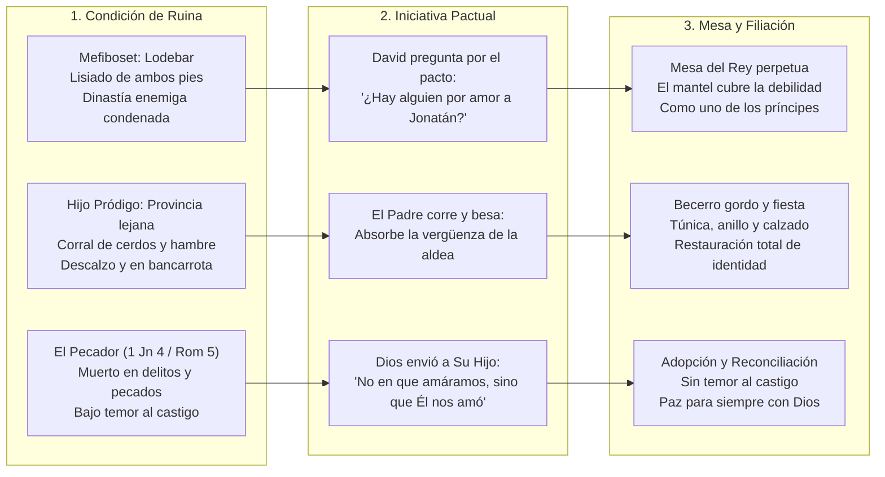

# 📖 Estudio Bíblico & Teológico Exhaustivo
## "De Lodebar a los Brazos del Padre: Mefiboset, el Hijo Pródigo y la Teología del Amor en 1 Juan 4"
### *Material Exegético, Histórico y Doctrinal para la Construcción y Desarrollo de Sermones*

> **Área**: [[pilar-ministerial-pastorado|Área Ministerial - Pastorado]]  
> **Propósito**: Proveer al Pastor el aparato crítico, exégesis en hebreo/griego, contexto histórico-cultural, tipología bíblica y conexiones teológicas para que estructure su propio mensaje de reconciliación y gracia.  
> **Pasajes Base**: 2 Samuel 9:1-13 | Lucas 15:11-24 | 1 Juan 4:7-21  
> **Pasajes Complementarios de Apoyo**: 1 Samuel 20:14-17 | 2 Samuel 4:4 | Romanos 5:6-11 | 2 Corintios 5:17-21 | Efesios 2:1-13 | Hebreos 4:16  

---

## 🏛️ I. Contexto Histórico, Cultural y Literario

### 1. El Trasfondo de 2 Samuel 9: La Costumbre Dinástica del Antiguo Cercano Oriente
- **La Práctica Oriental de Exterminio Dinástico**: En las monarquías del Antiguo Oriente Próximo, cuando una nueva dinastía derrocaba o reemplazaba a la anterior, era una regla política implacable ejecutar a todos los descendientes varones del rey depuesto. Esto erradicaba cualquier reclamo legítimo al trono y prevenía insurrecciones populares.
- **La Caída y Huida de Mefiboset (2 Samuel 4:4)**: Al llegar a Jezreel la noticia de la muerte de Saúl y Jonatán en el monte Gilboa, la nodriza de Mefiboset (entonces de 5 años) huyó despavorida. En la precipitada fuga, el niño cayó al suelo y quedó lisiado (*pisēaḥ*) de ambos pies de por vida. Creció como un fugitivo escondido, sabiendo que pertenecía a la dinastía caída y derrotada.
- **Lodebar (לוֹ דְבָר)**: Ubicado al oriente del río Jordán, cerca de Galaad. En hebreo, *Lō-Debar* significa literalmente *"sin pasto"*, *"tierra estéril"* o *"lugar de nada"*. Era una región marginal, aislada y desértica. Mefiboset vivía en el anonimato bajo la hospitalidad de Maquir hijo de Amiel, esperando el día en que la guardia real de David lo descubriera para degollarlo.

### 2. El Trasfondo de Lucas 15: La Aldea Judía y la Ceremonia de *Qetstsah*
- **La Herencia en Vida**: En la cultura semítica del siglo I, pedir la porción de bienes antes de la muerte del padre representaba el mayor insulto concebible: implicaba desear la muerte del progenitor y repudiar la comunidad familiar.
- **La Ceremonia de *Qetstsah* (קְצָצָה - El Corte o Ruptura)**: Según la ley comunitaria rabínica documentada en el Talmud (Jerusalén, *Kethuboth* 2:10), si un joven judío malgastaba la herencia patrimonial viviendo entre los gentiles paganos y se atrevía a regresar a su aldea, los ancianos y vecinos salían a la entrada de la ciudad, quebraban una vasija de barro cocido contra las piedras y proclamaban a gran voz: *"¡Quedas cortado de tu pueblo!"*. El infractor era desterrado permanentemente como un muerto viviente.
- **La Dignidad del Patriarca Oriental**: Un anciano semita respetable jamás corría en público. Hacerlo requería levantarse las faldas de la túnica larga con ambas manos, ceñirse los lomos y exhibir las piernas desnudas, lo cual constituía una afrenta bochornosa en público.

### 3. El Trasfondo de 1 Juan 4: La Naturaleza y Definición Radical del *Ágape*
- Juan escribe en un contexto donde el gnosticismo incipiente separaba la espiritualidad de la ética y del amor tangible. Juan redefine el amor: no es una emoción mística ni un mérito ascético; **Dios no solo tiene amor, Dios es Amor** (*ho Theos agapē estin*).
- El amor divino no es reactivo (no responde a nuestra santidad); es proactivo e iniciador (*"Él nos amó primero"*). Su máxima demostración histórica es la propiciación de Cristo en la Cruz, la cual erradica todo terror al castigo judicial.

---

## 🔍 II. Análisis Exegético y Lingüístico Exhaustivo

### A. Términos Hebreos Clave (2 Samuel 9 y 1 Samuel 20)

| Término Hebreo | Transliteración | Significado Literal | Peso Teológico en el Pasaje |
| :--- | :--- | :--- | :--- |
| **חֶסֶד** | ***Jesed*** (o *Chesed*) | Amor leal, fidelidad pactual, misericordia inquebrantable. | David dice: *"¿a quién haga yo misericordia [Jesed] por amor de Jonatán?"* (2 S 9:1). El *Jesed* no se basa en el mérito del receptor, sino en la fidelidad solemne del pacto previo. |
| **בְּרִית** | ***Berit*** | Pacto de sangre, alianza irrevocable. | El pacto solemne entre David y Jonatán (1 Samuel 20:14-17). Jonatán le hizo jurar a David que jamás cortaría su misericordia de su descendencia. Mefiboset es protegido por un pacto firmado antes de su tragedia. |
| **לוֹ דְבָר** | ***Lō-Debar*** | Sin pasto / Sin palabra / Nada. | Geografía de la miseria y el destierro humano: el alma que vive apartada de Dios en la aridez espiritual y el anonimato del dolor. |
| **כֶּלֶב מֵת** | ***Kéleb Met*** | Perro muerto. | Expresión de extrema humillación y auto-desprecio (2 S 9:8). Para los semitas, el perro era un animal carroñero impuro; un perro muerto representaba lo más vil, inútil y despreciable de la creación. Así se veía el hombre herido ante el Rey. |
| **פִּסֵּחַ** | ***Pisēaḥ*** | Lisiado, cojo de ambos pies. | Incapacidad física total para la marcha y la guerra (2 S 9:13). Tipología de la depravación e impotencia espiritual del hombre: incapaz de acercarse a Dios por sus propios pasos. |

---

### B. Términos Griegos Clave (Lucas 15 y 1 Juan 4)

| Término Griego | Transliteración | Significado Literal / Morfología | Peso Teológico en el Pasaje |
| :--- | :--- | :--- | :--- |
| **ἐσπλαγχνίσθη** | ***Esplangjnisthē*** | Fue conmovido en sus entrañas (Aoristo pasivo de *splagchnizomai*). | Lucas 15:20. Las entrañas (*splagchna*) eran el epicentro de la compasión más profunda y visceral. Dios no siente rechazo por el pecador arruinado; siente dolor redentor. |
| **δραμὼν** | ***Dramōn*** | Habiendo corrido (Participio aoristo activo de *trechō*). | Lucas 15:20. La única acción bíblica de Dios corriendo. El Padre se despoja de su protocolo de honra para llegar antes de la *Qetstsah* y absorber la vergüenza sobre Su cuerpo. |
| **κατεφίλησεν** | ***Katephilēsen*** | Lo besó intensamente / lo cubrió de besos (Aoristo activo de *kataphileō*). | Lucas 15:20. El prefijo *kata* intensifica la acción. No fue un beso protocolario; fue reiterado y apasionado, **antes** de que el muchacho terminara su confesión de jornalero. |
| **ἱλασμός** | ***Hilasmós*** | Propiciación / Expiación que aplaca la ira santa (1 Juan 4:10). | Sacrificio que satisface plenamente la justicia de Dios. En Cristo, la ira santa contra el pecado fue consumida en el Calvario; por tanto, Dios puede recibir al culpable en brazos de misericordia. |
| **φόβος** | ***Phobos*** | Miedo servil, terror a la condenación (1 Juan 4:18). | Miedo al castigo judicial. Proviene de una percepción de Dios como tirano inquisidor (el espíritu de esclavitud de Romanos 8:15). |
| **κόλασις** | ***Kolasis*** | Castigo, tormento retributivo (1 Juan 4:18). | El temor anticipa la retribución penal. Quien teme no ha comprendido que todo el castigo penal fue cargado por Cristo (Isaías 53:5). |
| **καταλλαγή** | ***Katallagē*** | Reconciliación, restauración de relaciones rotas (2 Cor 5:18-19). | De enemigos y fugitivos a hijos y embajadores sentados a la mesa de comunión. |

---

## ⚖️ III. Matriz Tipológica: Las Correspondencias Proféticas

Esta matriz permite al predicador visualizar y contrastar la trayectoria del redimido en las tres narrativas:



---

## 💎 IV. Cuatro Grandes Núcleos Teológicos para Desarrollar

### Núcleo 1: El Principio del «Tercero en el Pacto» (La Imputación de la Gracia)
- **El Fundamento Bíblico**: 
  - Mefiboset no fue llamado al palacio por sus logros militares, ni por su sabiduría, ni por su fuerza. Fue llamado exclusivamente por una causa ajena a él: **el pacto sellado entre David y Jonatán** (2 Samuel 9:1, 7).
  - Jonatán pagó por adelantado la gracia que Mefiboset disfrutaría años después (1 Samuel 20:14-17).
- **El Paralelo Neotestamentario**: 
  - Dios el Padre no nos llama a Su presencia porque seamos buenos, santos o merecedores. Nos recibe exclusivamente **por amor a Jesucristo y por el pacto eterno de Su sangre** (Efesios 1:6: *"nos hizo aceptos en el Amado"*).
  - **Aplicación Teológica**: La gracia no es una negociación bilateral entre tú y Dios; es un pacto entre el Padre y el Hijo en el que tú entras como beneficiario absoluto por la fe.

---

### Núcleo 2: La Anatomía del Temor vs. El Perfecto Amor (1 Juan 4:18)
- **El Síndrome del "Perro Muerto"**:
  - Cuando Mefiboset entra a palacio, se postra sobre su rostro esperando la muerte: *"¿Quién es tu siervo, para que mires a un perro muerto como yo?"* (2 S 9:8).
  - Cuando el pródigo regresa, lleva el libreto de la culpa: *"Hazme como a uno de tus jornaleros"* (Lucas 15:19).
  - En Génesis 3:10, Adán confiesa: *"Tuve miedo, porque estaba desnudo; y me escondí"*.
- **La Revelación de 1 Juan 4:18**:
  - *"En el amor no hay temor, sino que el perfecto amor echa fuera el temor; porque el temor lleva en sí castigo (kólasis)"*.
  - El temor paraliza al hombre porque la mente caída proyecta sobre Dios la imagen de un verdugo vengativo.
  - La Cruz de Cristo desmantela esta falacia: **si todo el castigo de nuestra paz fue descargado sobre Jesús en el Calvario (Isaías 53:5), ya no queda castigo pendiente para aquel que corre a Dios**. El perfecto amor echa fuera el temor porque la cuenta legal está saldada en su totalidad.

---

### Núcleo 3: La Iniciativa Absoluta — El Dios que Busca Primero
- **Mefiboset no envió cartas a David**: David mandó carruajes reales a Lodebar para buscarlo.
- **El Pródigo no llegó a golpear la puerta**: El Padre lo vio cuando aún estaba lejos y **corrió a su encuentro**.
- **1 Juan 4:10, 19**: *"En esto consiste el amor: no en que nosotros hayamos amado a Dios, sino en que él nos amó a nosotros... Nosotros le amamos a él, porque él nos amó primero"*.
- **Aplicación Teológica**: El arrepentimiento humano no es la causa que genera el amor de Dios; el arrepentimiento humano es **la respuesta** al amor y a la bondad que Dios ya manifestó (Romanos 2:4: *"la benignidad de Dios te guía al arrepentimiento"*).

---

### Núcleo 4: La Mesa del Rey y el Mantel de la Gracia (Justificación y Filiación)
- **2 Samuel 9:11, 13**:
  - David decreta: *"Comerá a mi mesa como uno de los hijos del rey"*.
  - El texto bíblico cierra con una tensión deliberada: *"comía siempre a la mesa del rey; **y estaba lisiado de ambos pies**"*.
- **La Teología del Mantel**:
  - La gracia de Dios no niega nuestra condición rota; la redime y la cubre bajo Su justicia.
  - Alrededor de la mesa de David se sentaban los guerreros y los príncipes más ilustres. Pero cuando Mefiboset ocupaba su asiento, el mantel de lino real cubría sus piernas inmóviles. Nadie en el banquete miraba hacia abajo para juzgar su defecto; todos miraban hacia arriba para honrar al Rey.
  - **Doctrina de la Justificación**: La justicia imputada de Cristo cubre toda nuestra indignidad moral (Romanos 4:7-8: *"Bienaventurados aquellos cuyas iniquidades son perdonadas, y cuyos pecados son cubiertos"*). A los ojos del Padre, somos tratados con los mismos derechos y el mismo amor que el Hijo unigénito.

---

## 🔗 V. Cadena Armónica de Referencias Cruzadas (Para Hilvanar en el Púlpito)

1. **El Pacto Previo**:
   - `1 Samuel 20:14-15`: *"Y si yo viviere, harás conmigo misericordia de Jehová... no apartarás tu misericordia de mi casa para siempre"*.
   - `Efesios 1:4-6`: Nos escogió en Cristo antes de la fundación del mundo para ser adoptados hijos suyos.
2. **La Condición de Incapacidad**:
   - `2 Samuel 4:4`: La caída que quebró los pies de Mefiboset.
   - `Romanos 5:6`: *"Porque Cristo, cuando aún éramos débiles, a su tiempo murió por los impíos"*.
3. **La Superación del Miedo y la Vergüenza**:
   - `Génesis 3:8-10`: El instinto de esconderse tras las hojas y los árboles.
   - `1 Juan 4:18`: El amor perfecto que expulsa el temor al castigo.
   - `Romanos 8:1`: *"Ahora, pues, ninguna condenación hay para los que están en Cristo Jesús"*.
4. **La Reconciliación Plena**:
   - `2 Samuel 9:7`: *"No tengas temor, porque yo a la verdad haré contigo misericordia"*.
   - `Lucas 15:24`: *"Este mi hijo muerto era, y ha revivido; se había perdido, y es hallado"*.
   - `2 Corintios 5:19-20`: *"Dios estaba en Cristo reconciliando consigo al mundo, no tomándoles en cuenta a los hombres sus pecados... Os rogamos en nombre de Cristo: Reconciliaos con Dios"*.

---

## 💡 VI. Tres Posibles Ángulos para que el Pastor Estructure su Sermón

Según la necesidad y el pulso espiritual de su congregación, este estudio le permite desarrollar tres enfoques homiléticos distintos:

```text
┌─────────────────────────────────────────────────────────────────────────────┐
│ 🎯 ÁNGULO A: EVANGELÍSTICO Y RECONCILIACIÓN                                 │
│ Enfoque: Salir de Lodebar y romper el miedo al castigo para venir a Cristo. │
│ 1. El engaño de Lodebar: vivir creyendo que Dios busca castigarte.           │
│ 2. El amor de pacto: Dios te llama por causa de Jesús (1 Juan 4:9-10).      │
│ 3. El mantel de la gracia: reconcíliate hoy y toma tu lugar a la mesa.      │
├─────────────────────────────────────────────────────────────────────────────┤
│ 🛡️ ÁNGULO B: SANIDAD INTERIOR Y LIBERACIÓN DE CULPA                         │
│ Enfoque: Para creyentes que sirven a Dios con mentalidad de "perro muerto". │
│ 1. Las caídas del pasado que nos dejaron lisiados de la identidad.         │
│ 2. La mentira del jornalero y del esclavo: el miedo que paraliza la fe.     │
│ 3. El abrazo que restituye: la adopción destruye la orfandad espiritual.    │
├─────────────────────────────────────────────────────────────────────────────┤
│ 👑 ÁNGULO C: TEOCÉNTRICO Y EXALTACIÓN DE LA GRACIA SOBERANA                 │
│ Enfoque: La magnificencia de un Dios que busca, corre y cubre al indigno.   │
│ 1. La iniciativa unilateral de Dios: Él amó primero.                       │
│ 2. La propiciación que absorbe la ira y la vergüenza pública.               │
│ 3. La comunión perpetua en la mesa del Rey de Reyes.                        │
└─────────────────────────────────────────────────────────────────────────────┘
```

---

## 📌 VII. Frases y Semillas Homiléticas (Aforismos para el Atril)

* *"Mefiboset no fue a la mesa de David por la fuerza de sus piernas, sino por el peso de un pacto."*
* *"En Lodebar vives de recuerdos dolorosos; en la mesa del Rey vives de promesas eternas."*
* *"La religión te dice: camina derecho y te dejaré sentar a la mesa. La gracia te dice: siéntate a mi mesa y mi mantel cubrirá tu debilidad mientras aprendes a caminar."*
* *"Dios no te ama porque tú seas valioso; eres infinitamente valioso porque Dios decidió amarte."*
* *"El temor te dice: 'Escóndete porque hay castigo'. El Calvario te dice: 'Corre a Sus brazos porque el castigo ya fue pagado'."*
