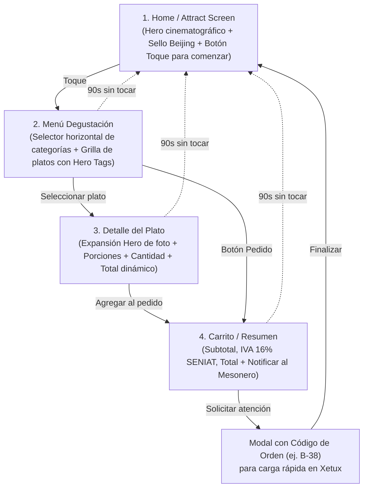

# 🥢 Beijing Restaurant — Menú Kiosco Interactivo

> **App Mobile Kiosco en Flutter** diseñada especialmente para el display táctil **APOLOSIGN SW3299T** (32" 4K UHD, Android 16, SoC Rockchip RK3576) en **orientación vertical (Portrait)**.

**Área 2brain**: [[pilar-proyectos|Área Proyectos - Software Independiente]]  
**Subagente Mobile**: [Kakashi Sensei](../../2brain-MG/agents/kakashi_sensei.md)  
**Ubicación del Código Local**: `C:\Users\vmontoyaMG\Desktop\beijing_menu`  
**Reporte Táctico Crudo**: [[2026-10-14-reporte-tactico-kiosco-beijing-kakashi|Certificación y Plan de Pruebas Kiosco Beijing]]

---

## ⚡ Certificación de Calidad (14/10/2026)

Inspeccionado y certificado por **🥷 Kakashi Sensei**:
- **Análisis Estático (`flutter analyze`)**: **100% LIMPIO** (`No issues found!`, 0 errores, 0 advertencias).
- **Pruebas Unitarias (`flutter test`)**: **6/6 pruebas aprobadas (100%)** en lógica de cálculo financiero (subtotal, IVA 16% SENIAT, total general, variantes de tamaño y código de orden para Xetux).
- **Stack**: Flutter 3.47.6 (Canal Stable), Dart 3.13.5.

---

## 🧭 Guía Rápida para Desarrolladores (Flutter vs React/TypeScript)

| Concepto en React / Next.js | Equivalente en este proyecto Flutter | Archivo en el proyecto |
|---|---|---|
| `interface Product { ... }` | `class Product { ... }` con tipos inmutables (`final`) | `lib/domain/models/menu_models.dart` |
| `tailwind.config.ts` (tokens) | `abstract final class AppColors`, `AppText`, `AppMotion` | `lib/ui/core/theme/app_theme.dart` |
| Store de Zustand / Context API | `CartViewModel extends ChangeNotifier` con `notifyListeners()` | `lib/ui/features/cart/cart_view_model.dart` |
| `useStore(state => state.cart)` | `context.watch<CartViewModel>()` | Todas las vistas |
| `useStore.getState().add()` | `context.read<CartViewModel>().add(...)` | Botones de acción / onTap |
| Next.js App Router (`/app/...`) | `GoRouter` declarativo con transiciones oscuras | `lib/app/router.dart` |
| Componentes reutilizables UI | Widgets `Pressable`, `SealLogo`, `GoldLine`, `PrimaryButton` | `lib/ui/core/widgets/brand_widgets.dart` |
| `window.setTimeout` inactividad | `InactivityDetector` (resetea carrito y vuelve a Home a los 90s) | `lib/ui/core/widgets/inactivity_detector.dart` |
| Escala visual responsiva | `DesignCanvas` (diseño base 1080px escalado con nitidez 4K) | `lib/ui/core/widgets/design_canvas.dart` |

---

## ⛩️ Las 4 Vistas Principales



### 1. `HomeView` (`lib/ui/features/home/home_view.dart`)
- **Objetivo**: Atraer al comensal que camina por el restaurante.
- **Visuales**: Fondo fotográfico oscuro con zoom lento continuo (*Ken Burns effect* de 14s), sello imperial `北京` animado, tipografía *Cormorant Garamond* y botón pulsante "TOQUE PARA EXPLORAR EL MENÚ".

### 2. `MenuView` (`lib/ui/features/menu/menu_view.dart`)
- **Objetivo**: Navegación ágil y fluida por todo el catálogo gastronómico.
- **Visuales**: Barra superior con botón de pedido y contador en tiempo real, selector horizontal de categorías (*Entradas, Sopas, Arroces, Especialidades, Bebidas, Postres*), y grilla táctil de 2 columnas con tarjetas de alta gama, tags dorados/rojos (*Recomendado/Picante*) y botón `+` de adición rápida.

### 3. `ProductDetailView` (`lib/ui/features/product_detail/product_detail_view.dart`)
- **Objetivo**: Mostrar la exquisitez del plato con todos sus detalles antes de pedir.
- **Visuales**: Transición `Hero` donde la foto del plato vuela desde la grilla y se amplía a alta resolución. Selector de porciones (*Personal / Familiar* con cálculo automático del recargo), selector táctil de cantidad con botones circulares y botón inferior flotante con precio dinámico animado.

### 4. `CartView` (`lib/ui/features/cart/cart_view.dart`)
- **Objetivo**: Confirmación clara del pedido para el comensal y el personal de sala.
- **Visuales**: Lista de platos con control de unidades y eliminación, desglose financiero transparente (**Subtotal**, **IVA 16% SENIAT**, **Total General**) y botón **"NOTIFICAR AL MESONERO"**.
- **Integración Xetux**: Al presionar el botón, despliega un diálogo imperial con un **Código de Orden en tipografía gigante (ej. `B-42`)**. El mesonero solo necesita mirar la pantalla o recibir el código para registrarlo en el sistema POS Xetux sin demoras.

---

## 🚀 Plan de Pruebas para Hoy

### 1. Prueba Inmediata en Navegador Web (Chrome)
Para verificar interacción, animaciones y diseño sin necesidad de cable:
```powershell
cd C:\Users\vmontoyaMG\Desktop\beijing_menu
flutter run -d chrome
```
*Tip:* Presionar F12 en Chrome, activar vista responsive y configurar `1080 x 1920`.

### 2. Compilación del APK Release
```powershell
cd C:\Users\vmontoyaMG\Desktop\beijing_menu
flutter build apk --release
```
*Genera:* `build\app\outputs\flutter-apk\app-release.apk`

### 3. Instalación en la Pantalla Apolosign SW3299T
- **Vía ADB (USB o Wi-Fi)**:
  ```powershell
  & "C:\Users\vmontoyaMG\AppData\Local\Android\sdk\platform-tools\adb.exe" install -r build\app\outputs\flutter-apk\app-release.apk
  ```
- **Vía Pendrive USB**: Copiar el archivo APK generado a una unidad USB, conectarla a la pantalla y ejecutar el instalador de Android.

---

## 🔗 Enlaces Relacionados en 2brain
- [[pilar-proyectos|Área Proyectos - Software Independiente]]
- [[pilar-trabajo-xetux|Área Trabajo - Analista IT y Soporte Xetux]]
- [[2026-10-14-reporte-tactico-kiosco-beijing-kakashi|Reporte Táctico: Certificación Kiosco Beijing]]
