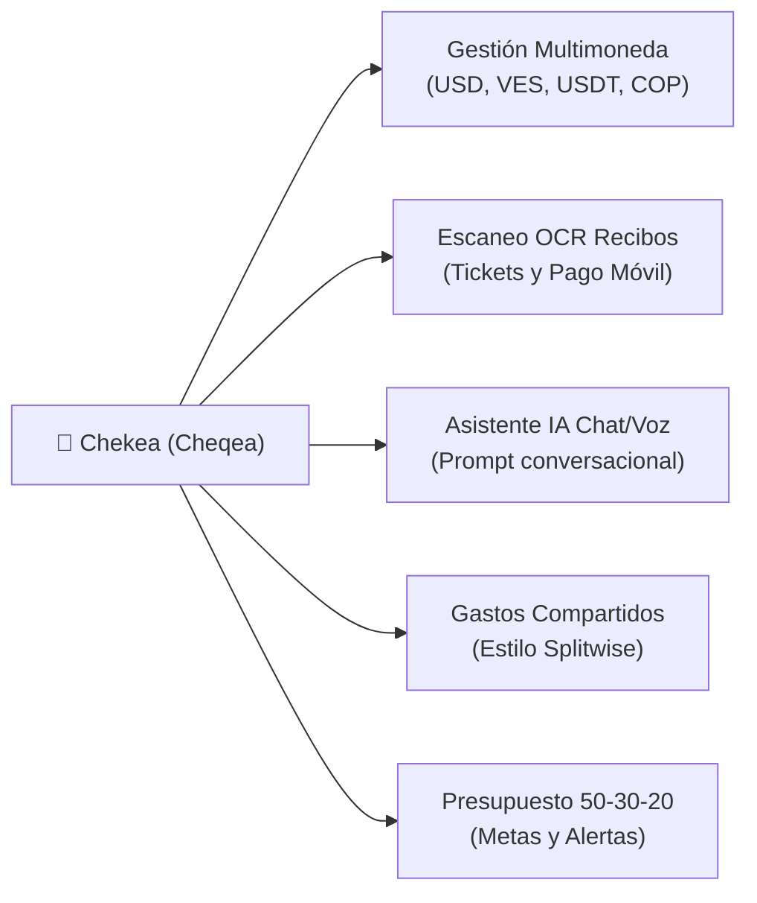
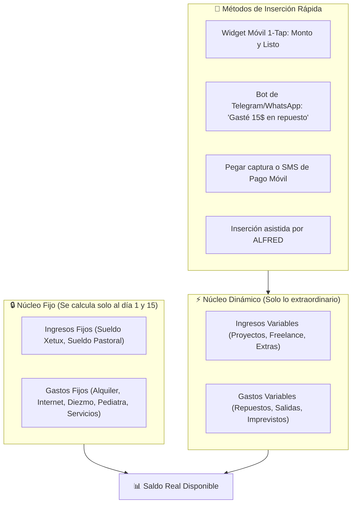

# 📊 Informe Ejecutivo: Análisis de Mercado & Reingeniería Inversa (REA)
## "Control Financiero Personal Sin Fricción" vs. Chekea (Cheqea)

**Para:** Don Víctor Montoya (El Señor)  
**De:** ☁️ Akatsuki Dispatcher / ALFRED & Equipo de Arquitectura  
**Metodología:** Reverse Engineer Anything (REA Protocol) & Product Market Fit Analysis  
**Fecha:** 2026-11-24  

---

## 1. 🔍 Deconstrucción con REA: ¿Qué es Chekea (Cheqea) y qué hace realmente?

A través del protocolo de análisis basado en evidencias (REA), evaluamos **Cheqea** (conocida comúnmente como Chekea), app nacida para el mercado venezolano y latinoamericano:



### 👁️ Evidencia Observada (Lo que hace bien)
1. **Multimoneda con Tasa Histórica:** Guarda la tasa cambiaria del día exacto de la transacción (BCV o P2P). Esto evita que los registros de hace 3 meses en bolívares se desfiguren hoy con la devaluación.
2. **Entrada Multimedia:** Permite tomar foto al comprobante de Pago Móvil o recibo fiscal, extrayendo monto, fecha y comercio.
3. **Integración Web3 / Cripto:** Vinculación con cuentas tipo Binance/Bybit para saldos en USDT.

### ⚠️ El Gran Punto Ciego (Por qué te aburrió y por qué el 90% abandona estas apps)
* **La trampa del "Micro-management":** Chekea sigue dependiendo de que abras la app, esperes la carga, selecciones una categoría, confirmes el monto y guardes. Si compras un café, un repuesto de moto, pagas un estacionamiento o compras algo en la bodega, **el costo cognitivo de registrarlo es mayor que el beneficio**.
* **Falta de Automatización de Gastos/Ingresos Fijos:** La mayoría de las personas tienen un 70% de su estructura fija y predecible (alquiler, internet, sueldo base, diezmo, colegio/pediatra). Tener que registrar o cuadrar esto manualmente cada quincena se convierte en una tarea burocrática pesada.
* **Sobrecarga de Features:** Tiene tantas cosas (cripto, dividir cuentas con amigos, metas compartidas, préstamos) que se siente pesada para quien solo quiere saber: *"¿Cuánto me queda libre este mes si ya cubrí mis gastos fijos y mis ingresos dinámicos entraron o no?"*.

---

## 2. 💰 ¿Es Rentable hacer un proyecto de este tipo? (Análisis Crítico)

> [!IMPORTANT]
> **Respuesta Directa:** Como aplicación genérica de finanzas personales ("otra app de gastos más en Play Store"), **NO es un negocio fácil ni altamente rentable** si buscas cobrar suscripciones B2C masivas, debido al alto costo de adquisición de usuarios (CAC) y alta tasa de abandono (*churn* al mes 2).  
> **SIN EMBARGO, es sumamente rentable y valiosa bajo dos enfoques:**

1. **Uso Personal & Familiar Inmediato (Retorno por Ahorro y Paz Mental):**
   * En tu caso particular, tu cuaderno financiero registra sueldos fijos (Xetux + Pastoral = ~$620 USD) combinados con ingresos variables (freelance, software) y salidas dinámicas (medicinas, repuestos, emergencias). Un sistema automatizado te ahorra fugas de capital de $50 a $120 USD mensuales.
2. **Producto B2B / Micro-SaaS "Cero Fricción" para Independientes & Profesionales:**
   * La rentabilidad no está en cobrar $2 por una app móvil convencional, sino en empaquetar una solución con **Asistente por WhatsApp / Telegram**: El usuario nunca abre una app; le manda un audio de 3 segundos por WhatsApp o le reenvía la captura del SMS del banco / Pago Móvil a un bot, y el bot procesa todo, cuadrando su flujo de caja automáticamente. Por esto la gente sí paga entre $5 y $10 USD mensuales.

---

## 3. 🎯 Propuesta de Valor: La Filosofía "Zero-Friction Cashflow"

Para que la uses a diario sin frustración, la aplicación no debe exigirte registrar cada gasto hormiga de forma manual. Debe operar bajo el modelo **Proyectado vs. Ejecutado**:



### Principios Fundamentales:
1. **Reglas Recurrentes Inteligentes:** Al comenzar la quincena, el sistema ya sabe que entraron tus ingresos fijos y salieron tus compromisos base. **No tienes que anotar nada**. El sistema ya asume que esos gastos ocurrirán y te muestra tu saldo real remanente.
2. **Registro por Voz o Texto Natural (Telegram / WhatsApp / Widget):**
   * Estás en la calle, pagaste la gasolina o el lavado de moto: abres Telegram y dictas un audio: *"Gasté 5 dólares en lavado de moto"* o pegas el texto del SMS de Pago Móvil.
   * La IA extrae: `{ monto: 5, moneda: "USD", concepto: "Lavado de moto", tipo: "variable" }` y lo imputa al instante.
3. **Modo "Cuadre Rápido Quincenal":**
   * Un botón: *"¿Se pagó todo lo fijo de esta quincena?"* -> Sí. Y el sistema marca todo pagado con un solo toque.

---

## 4. 🏗️ Arquitectura Técnica Recomendada

Siguiendo los estándares de la **Organización Akatsuki**:

```text
               [ Kisame: App Mobile Flutter ]
                             | (Offline-First, SQLite local, 60 FPS)
                             v
[ Telegram / WhatsApp Bot ] ---> [ NestJS API Gateway (Kakuzu) ]
                                             |
               +-----------------------------+-----------------------------+
               |                                                           |
      [ Gemini 2.5 Flash / Groq ]                                 [ PostgreSQL + Prisma ]
    (Extracción OCR y NLP de audio)                             (Multimoneda, Tasas BCV/P2P)
```

* **Frontend Móvil (Kisame Hoshigaki):**  
  * **Flutter & Dart**: Fluidez nativa total a 60 FPS tanto en Android como iOS.
  * **Persistencia Local (Offline-First)**: Funciona en la calle sin señal; cuando se conecta, sincroniza.
  * **Widgets de Pantalla de Bloqueo / Home**: Un botón rápido flotante para meter un monto en 2 segundos.
* **Backend & Integraciones (Kakuzu):**  
  * **NestJS**: Microservicio ligero desplegado en tu servidor o Docker local/Coolify.
  * **Webhook para Bot**: Escucha tu bot de Telegram o WhatsApp empresarial para recibir audios, texto o fotos de tickets.
  * **Motor de Divisas**: Consulta diaria automática de la tasa BCV y Paralelo/Binance para consolidar en USD y Bs.
* **Diseño UI/UX (Konan & Sai):**  
  * Diseño minimalista con alto contraste (Dark Mode sobrio). Cero gráficas enredadas; una sola métrica protagonista: **"Tu margen disponible hoy para gastar sin endeudarte"**.

---

## 5. 🚀 Plan de Acción Akatsuki (Roadmap Rápido)

| Fase | Responsable | Misión Clave |
| :--- | :--- | :--- |
| **1. Requerimientos & Modelo** | ☁️ **Pain** | Historias de usuario para el MVP (Ingresos/Gastos Fijos recurrentes vs. Variables). |
| **2. UI/UX Prototipo** | 🦋 **Konan** & 🎨 **Sai** | Wireframe de la vista principal ("Un solo número de saldo real") y flujo de audio. |
| **3. Base de Datos & Lógica** | 🖤 **Kakuzu** | Modelo Prisma: transacciones multimoneda (USD, VES, USDT) y lógica de recurrencia. |
| **4. Ingesta Sin Fricción** | 🤵 **ALFRED** & Bot | Conexión directa del bot de Telegram para que le hables y anote sin abrir la app. |
| **5. App Móvil** | 🦈 **Kisame** | App Flutter con widgets de acceso rápido y sincronización en tiempo real. |
