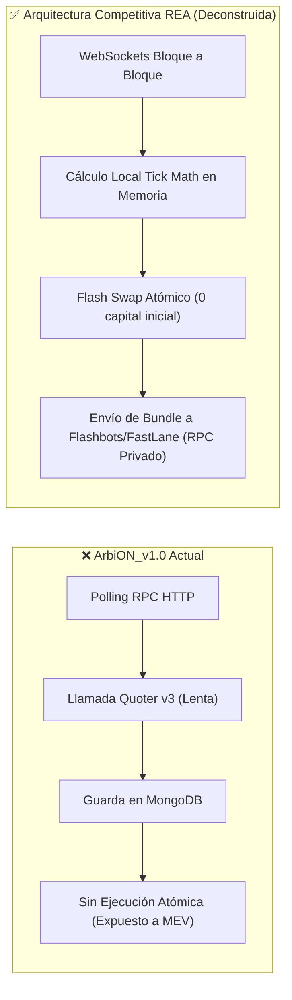
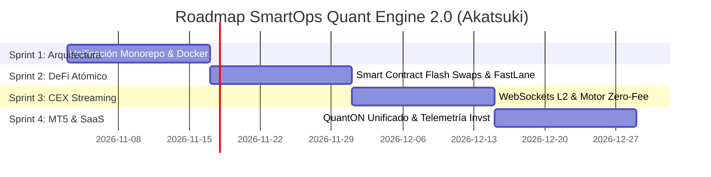

# 👁️‍🗨️ Informe REA: Deconstrucción Competitiva & Roadmap SmartOps Quant (Akatsuki)

**Investigador Líder**: ☁️ **Pain (Tendō)** — Rinnegan REA (`morluto/rea`) & Scrum Master  
**Organización**: ☁️ **Akatsuki Development Suite**  
**Objetivos Deconstruidos**:
1. *DeFi On-Chain Arbitrage*: Arquitecturas MEV Flashbots, Uniswap v3 Flash Swaps & 1inch Pathfinder.
2. *CEX Triangular Arbitrage*: Hummingbot & Freqtrade (Streaming L2 Orderbook).
3. *Prop-Firm Trading & Compliance*: QuantConnect LEAN & MQL5 Institutional Engines.

---

## 🔬 1. Marco de Análisis Basado en Evidencias (Evidence-Based Architecture)

### 1.1. DeFi Arbitrage: Deconstrucción de Bots MEV vs. `ArbiON_v1.0`

- **👁️ Lo Observado (Hard Evidence en Repositorios MEV Top)**:
  - Los bots de arbitraje rentables en EVM (Uniswap v3, QuickSwap, PancakeSwap) **nunca consultan `Quoter.quoteExactInputSingle` por RPC en tiempo real**; los cálculos de cambio de precio y ticks se computan en memoria localmente.
  - La ejecución se realiza mediante un contrato inteligente que implementa `IUniswapV3SwapCallback` o `IFlashLoanSimpleReceiver` (Aave/Balancer). Los fondos se piden prestados dentro de la misma transacción y se reembolsan antes de terminar el bloque.
  - Si `Balance_Final < Balance_Inicial + Gas`, la transacción ejecuta un `revert()`, garantizando que **nunca se pierde dinero por operaciones fallidas**.
  - No envían transacciones a la mempool pública; usan endpoints RPC privados como **Flashbots Protect** o **FastLane** para evitar ataques de sándwich.
- **🧠 Lo Inferido**:
  - `ArbiON_v1.0` fallaba en rentabilidad porque su arquitectura es puramente pasiva (modo observador) y su latencia por llamada RPC superaba los 2.000 ms, ventana en la cual cualquier ineficiencia ya ha sido arbitrada por bots en menos de 50 ms.
- **❓ Lo Desconocido**:
  - Algoritmos exactos de soborno a validadores (Coinbase Bribes) usados por los builders institucionales en Ethereum L1 (no aplicable directamente a L2 Polygon/Arbitrum/Base donde los secuenciadores operan por FIFO o subastas privadas).

---

### 1.2. CEX Triangular Arbitrage: Deconstrucción de Hummingbot vs. `ArbiON_BV1.0`

- **👁️ Lo Observado (Hard Evidence en Hummingbot / Freqtrade)**:
  - **Hummingbot** utiliza subscripciones asíncronas WebSocket a los canales de profundidad de mercado (`<symbol>@depth20@100ms` o `@bookTicker`).
  - Mantiene el libro de órdenes (*Orderbook L2*) en memoria RAM con estructuras de datos de acceso ultra-rápido ($O(1)$ en ticks).
  - La detección de arbitraje triangular (ej. `USDT -> BTC -> FDUSD -> USDT`) calcula en tiempo real:
    $$\Pi = \left( \frac{1}{\text{Ask}_{A/B}} \right) \times \text{Bid}_{B/C} \times \text{Bid}_{C/A} - (1 + f_1)(1 + f_2)(1 + f_3) - \text{Slippage}$$
  - Ejecución mediante órdenes límite pasivas (**Maker Orders**) con políticas *Post-Only* para cobrar comisiones negativas o Maker 0%, en vez de órdenes de mercado agresivas (*Taker*) que pagan 0.10%.
- **🧠 Lo Inferido**:
  - `ArbiON_BV1.0` utilizaba peticiones REST secuenciales con `ccxt` para descargar velas históricas OHLCV en 1h y 15m. El arbitraje triangular no ocurre a nivel de velas históricas, sino a nivel de microsegundos en el Orderbook en vivo.

---

### 1.3. Trading Cuantitativo Institucional: Deconstrucción de QuantConnect LEAN vs. `QuantON`

- **👁️ Lo Observado**:
  - **LEAN Engine** desacopla de forma limpia:
    1. `UniverseSelection`: Selección dinámica de activos.
    2. `AlphaCreation`: Generación de señales basada en ML / Análisis Técnico.
    3. `PortfolioConstruction`: Asignación óptima de capital.
    4. `ExecutionModel`: Enrutamiento inteligente hacia MT5 / Brokers.
    5. `RiskManagement`: Guardianes autónomos de capital (Trailing stop, Maximum Drawdown intradía).
- **🧠 Lo Inferido**:
  - `QuantON_V1` y sus variantes (BTC, Gold) tienen un código funcional excelente en sus estrategias de sesión (NY Breakout), pero carecen de la orquestación modular de LEAN, lo que genera duplicación de código en sus módulos `core/`.

---

## 🗺️ 2. Roadmap Estratégico de Sprints en ClickUp (4 Sprints Akatsuki)

**Espacio ClickUp**: `Proyectos / SmartOps Quant Hub`  
**Duración Total**: 8 Semanas (4 Sprints de 2 semanas) | **Carga Total**: 75 Story Points (SP)

---

### 🏃 Sprint 1: Consolidación Arquitectónica & Setup Base (15 SP)
- **Objetivo**: Unificar los repositorios fragmentados en un Monorepo modular `smartops-quant-engine`, dockerizar los entornos y blindar la gestión de secretos.
- **Responsables**: 🐍 **Orochimaru** (Arquitectura) & 🖤 **Kakuzu** (Backend).
- **Historias de Usuario**:
  1. `SMARTOPS-Q1` (5 SP): *Estructuración del Monorepo con subpaquetes (`packages/defi-arbitrage`, `packages/cex-streaming`, `packages/mt5-quant`, `packages/shared-core`).*
  2. `SMARTOPS-Q2` (5 SP): *Docker Compose multi-servicio para orquestar bots, MongoDB y Redis local para caché de Orderbooks.*
  3. `SMARTOPS-Q3` (5 SP): *Módulo unificado de alertas y telemetría por Telegram con comandos interactivos (`/status`, `/pnl`, `/pause`).*

### ⚡ Sprint 2: ArbiON DeFi — Arbitraje Atómico con Flash Loans (22 SP)
- **Objetivo**: Implementar el Smart Contract de arbitraje triangular atómico sin riesgo de capital propio, con enrutamiento privado para evadir MEV.
- **Responsables**: 🖤 **Kakuzu** (Solidity & Web3), 💣 **Deidara** (Pentesting/Security) & 🦂 **Sasori** (Hardening).
- **Historias de Usuario**:
  1. `SMARTOPS-Q4` (8 SP): *Desarrollo del Smart Contract `FlashTriangularArbitrage.sol` con Flash Loans de Balancer/Aave y callbacks de Uniswap v3.*
  2. `SMARTOPS-Q5` (8 SP): *Módulo de detección en Node.js con cálculo local de Tick Math en memoria y suscripción a WebSockets de Polygon/Arbitrum/Base.*
  3. `SMARTOPS-Q6` (6 SP): *Integración de envío de transacciones a través de RPC privado (Flashbots Protect / FastLane) para blindaje anti-sándwich.*

### 🏢 Sprint 3: ArbiON CEX — Streaming L2 & Motor Maker Zero-Fee (18 SP)
- **Objetivo**: Reemplazar el polling REST por WebSockets asíncronos y ejecutar arbitraje triangular en Binance en pares promocionales sin comisiones.
- **Responsables**: 🖤 **Kakuzu** (Python AsyncIO/WebSockets) & 💀 **Hidan** (QA & Stress Testing).
- **Historias de Usuario**:
  1. `SMARTOPS-Q7` (8 SP): *Conector WebSocket de Binance (`@bookTicker` y Depth L2) con libro de órdenes reconstruido en memoria RAM.*
  2. `SMARTOPS-Q8` (5 SP): *Motor de cálculo de rentabilidad neta triangular con matriz de comisiones Maker/Taker dinámicas.*
  3. `SMARTOPS-Q9` (5 SP): *Suite de pruebas de estrés en Jest/Pytest con más del 85% de cobertura simulando saltos de volatilidad y desconexiones de red.*

### 📊 Sprint 4: Suite QuantON MT5 & Conexión SaaS con `Invst-smartops` (20 SP)
- **Objetivo**: Unificar los bots de Nasdaq, Gold y BTC con el motor LEAN local, y enviar telemetría en tiempo real a la plataforma web de inversiones.
- **Responsables**: 👁️ **Itachi** (Frontend/Webhooks), 🦋 **Konan** (UI Dashboard), 🌿 **Zetsu** (Docs Técnicas) & 🎭 **Tobi** (Marketing/Reporting).
- **Historias de Usuario**:
  1. `SMARTOPS-Q10` (8 SP): *Consolidación de `QuantON` (US100, Gold, BTC) en un motor configurable por YAML con el estándar institucional de `ToVE-TradingV1` (Drawdown 5% y filtro horario).*
  2. `SMARTOPS-Q11` (5 SP): *Webhook de telemetría automática hacia `Invst-smartops-api` (`POST /api/v1/pools/:id/telemetry`).*
  3. `SMARTOPS-Q12` (4 SP): *Componente en Next.js (`Invst-smartops-front`) para visualización de curva de PnL y métricas auditadas en vivo para inversionistas.*
  4. `SMARTOPS-Q13` (3 SP): *Manual de despliegue en VPS Windows/Linux y especificación OpenAPI generado por Zetsu.*
