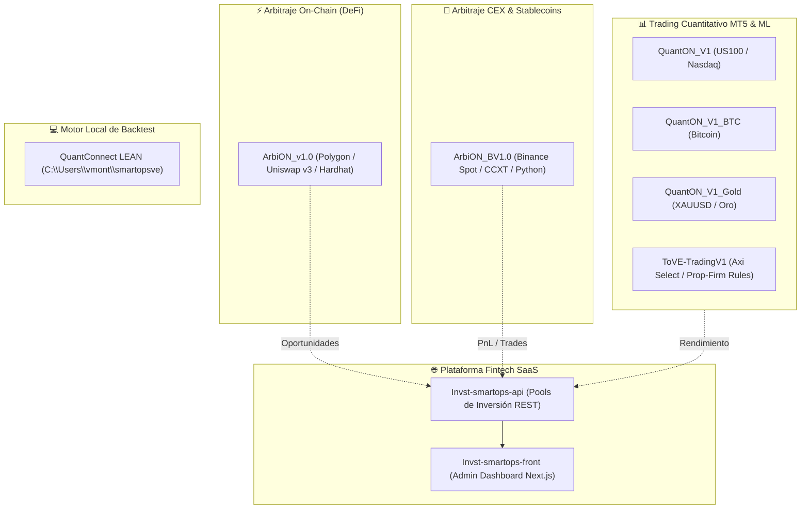

# 📈 Ecosistema SmartOps: Trading Algorítmico, Arbitraje y Cuantitativo

Auditoría integral, diagnóstico técnico y hoja de ruta de reingeniería para los sistemas de trading, arbitraje triangular y finanzas algorítmicas de **SmartOps** alojados bajo la cuenta GitHub `vmontoyasmtop` y el entorno local QuantConnect LEAN.

---

## 🗺️ 1. Mapa de Repositorios y Módulos Existentes



---

## 🔍 2. Diagnóstico Técnico por Proyecto

### 1. `ArbiON_v1.0` (Arbitraje On-Chain / Polygon)
- **Stack**: Node.js, Ethers.js, Hardhat, Uniswap v3 SDK, MongoDB, Telegram Bot.
- **Funcionamiento**: Escaneo de Top 20 tokens en Polygon (WPOL, WETH, USDC.e, USDT, DAI, WBTC, LINK) buscando arbitraje directo (discrepancias entre pools con fees 0.01%, 0.05%, 0.3%, 1%) y triangular (TokenA -> BridgeToken -> TokenB -> TokenA).
- **Limitaciones Detectadas**:
  1. **Modo observador**: Detecta y guarda en MongoDB (`ArbitrageOpportunity`), pero **no ejecuta swaps atómicos**.
  2. **Riesgo MEV / Frontrunning**: Si las órdenes se mandan a la mempool pública sin protección (Flashbots / FastLane), los searchers MEV se adelantan al trade.
  3. **Latencia RPC**: Las llamadas `Quoter.quoteExactInputSingle` por HTTP son lentas frente a cálculo local de tick math.

### 2. `ArbiON_BV1.0` (Arbitraje CEX & Stablecoins en Binance)
- **Stack**: Python, CCXT, Binance API, MongoDB Atlas, Matplotlib, Telegram Bot.
- **Funcionamiento**: Operativa de reversión a la media e ineficiencias de paridad en pares de stablecoins (`FDUSD/USDT`, `USDC/USDT`, `TUSD/USDT`, `USDP/USDT`). Estrategias `BaseStrategy` (SMA24, ATR, RSI) y `HyperStableStrategy` (EMA8, RSI10 en M15).
- **Limitaciones Detectadas**:
  1. **Comisiones vs. Margen**: El spread en stablecoins suele ser de 0.02% - 0.05%. Con comisiones normales de taker en Binance (0.10% o 0.075%), la operativa genera pérdidas salvo que se opere estrictamente en pares promocionales Maker Zero-Fee (como FDUSD).
  2. **Arquitectura REST**: Consulta por polling en lugar de WebSockets Orderbook (Depth L2), perdiendo micro-oportunidades de segundos.

### 3. `QuantON_V1`, `QuantON_V1_BTC` & `QuantON_V1_Gold` (Suite MT5 Cuantitativa)
- **Stack**: MetaTrader 5 API, Python 3.12, MQL5 EAs (`QuantON_US100_V3_Aggresive.mq5`, `QuantON_Gold_Scalper_PRO.mq5`, `QuantON_BTC_V5_ML.mq5`), Pandas, Scikit-Learn.
- **Funcionamiento**:
  - Motores de backtesting vectorizados propios (`core/backtest_engine.py`, `backtest_engine_breakout.py`, `backtest_engine_reversion.py`).
  - Optimizadores de Machine Learning (`ml_optimizer.py`) para clasificar señales de breakout en sesiones de Nueva York y Asia.
  - Conexión directa a cuentas MT5 mediante `mt5_connector.py`.
- **Limitaciones Detectadas**:
  1. **Código triplicado**: La estructura `core/` está repetida en los 3 repositorios con ligeras variaciones de parámetros.
  2. **Riesgo de Overfitting**: Los backtests de ML deben validarse con Walk-Forward Analysis y Out-of-Sample rigoroso para evitar sobreajuste en datos históricos de volatilidad atípica.

### 4. `ToVE-TradingV1` (Bot MT5 para Fondeo / Axi Select)
- **Stack**: Python 3.11, MetaTrader 5, Dotenv, Logging modular.
- **Funcionamiento**: Diseñado con estricto apego a normativas de cuentas de fondeo institucionales (Axi Select, FTMO):
  - Límite de Drawdown máximo del 5%.
  - Riesgo fijo del 2% por trade con cálculo dinámico de lotaje por valor del punto y stop-loss.
  - Horario operativo exclusivo de la sesión de New York (9:30 AM - 4:00 PM EST).
  - Pausa automática de 24 horas si se alcanza el drawdown límite.

### 5. `smartopsve` (Entorno Local QuantConnect LEAN)
- **Ubicación**: `C:\Users\vmont\smartopsve`
- **Componentes**: Motor LEAN CLI oficial, configuración `lean.json`, caché local de datos de mercado (equities USA, crypto, opciones, forex) y perfil de QuantConnect registrado (`victor-montoya`).
- **Potencial**: Es el estándar de la industria institucional para backtesting multi-activo sin sesgos de lookahead y con simulación exacta de deslizamiento (slippage) y márgenes.

---

## 🚀 3. Propuesta de Reingeniería ("Darle la Vuelta a Todo Eso")

Para transformar estos proyectos independientes en una infraestructura sólida y rentable, se propone una estrategia en **4 Pilares**:

```text
┌────────────────────────────────────────────────────────────────────────┐
│                   SMARTOPS QUANT HUB (ARQUETIPO 2.0)                   │
├───────────────────┬───────────────────┬────────────────────────────────┤
│ 1. DeFi Atómico   │ 2. CEX Streaming  │ 3. QuantON Core Unificado      │
│ (Polygon/Base)    │ (Binance L2 WS)   │ (MT5 + LEAN + ML)              │
│ Flash Swaps Aave  │ Orderbook Depth   │ Motor único multi-activo       │
│ MEV-Protected RPC │ Maker Zero-Fee    │ Walk-Forward Validation        │
└───────────────────┴───────────────────┴────────────────────────────────┘
                                  │
                                  ▼
      ┌────────────────────────────────────────────────────────────┐
      │        4. Integración Fintech: Invst-smartops-api         │
      │        Telemetría en tiempo real, pools y métricas        │
      └────────────────────────────────────────────────────────────┘
```

### Pilar 1: Modernización de ArbiON DeFi (Polygon / Base)
1. **Contrato de Ejecución Atómica (Flash Arbitrage Contract)**:
   - Crear un contrato Solidity (`FlashArbitrageV1.sol`) que reciba fondos vía Flash Loan (Balancer / Aave), ejecute el swap triangular en Uniswap v3 / QuickSwap en una única transacción atómica, y si el beneficio neto (después de gas) no es positivo, haga `revert()`. **Cero riesgo de capital propio.**
2. **Migración a Base / Arbitrum**:
   - Polygon tiene spreads más cerrados y competencia feroz de bots MEV. Redes como **Base** o **Arbitrum** tienen mayor volumen descentralizado y menor latencia L2.
3. **RPC Privado**:
   - Usar FastLane o Flashbots Protect para enviar transacciones directamente a los validadores sin pasar por la mempool pública.

### Pilar 2: Evolución de ArbiON CEX (Binance)
1. **Streaming por WebSockets en lugar de REST**:
   - Consumir el stream de Depth / Ticker de Binance en tiempo real (`<symbol>@bookTicker`).
2. **Condición Matemática Estricta de Spread**:
   $$\text{Spread Bruto} > \text{Fee}_1 + \text{Fee}_2 + \text{Fee}_3 + \text{Slippage Estimado} + \text{Margen Mínimo}$$
3. **Enfoque Exclusivo en Pares Maker Zero-Fee**:
   - Utilizar pares sin comisión (o reembolsos por liquidez pasiva) para garantizar rentabilidad neta.

### Pilar 3: Unificación de la Suite QuantON (Monorepo Cuantitativo)
1. **Consolidación en un solo Core Modular**:
   - Fusionar `QuantON_V1`, `QuantON_V1_BTC`, `QuantON_V1_Gold` y `ToVE-TradingV1` en un paquete Python reutilizable: `smartops-quant-engine`.
   - Selector de activo y estrategia mediante archivos YAML de configuración:
     - `config/us100.yaml` (Nasdaq NY Breakout)
     - `config/gold.yaml` (Gold Scalper Asian/NY)
     - `config/btc.yaml` (BTC Volatility Reversion)
2. **Backtesting Institucional con QuantConnect LEAN**:
   - Aprovechar la instalación local existente en `C:\Users\vmont\smartopsve` para validar las estrategias de MT5 contra datos de ticks reales institucionales.

### Pilar 4: Conexión con `Invst-smartops-api` & Dashboard
1. **Webhook de Telemetría**:
   - Añadir un módulo en el bot que reporte a `Invst-smartops-api` (`POST /api/v1/investments/metrics`):
     - Balance actual y Equity.
     - Drawdown intradía.
     - Historial de trades cerrados y Win Rate.
2. **Visualización en `Invst-smartops-front`**:
   - Mostrar a los inversores del pool el rendimiento auditado del bot en tiempo real con gráficas transparentes de PnL.

---

## 🔗 Páginas Relacionadas
- [[smartops-ve|Ficha General SmartOps VE]]
- [[smartops-ve-ecosystem|Ecosistema de Repositorios SmartOps]]
- [[pilar-proyectos|Área Proyectos]]
- [[pilar-programacion|Área Programación]]
