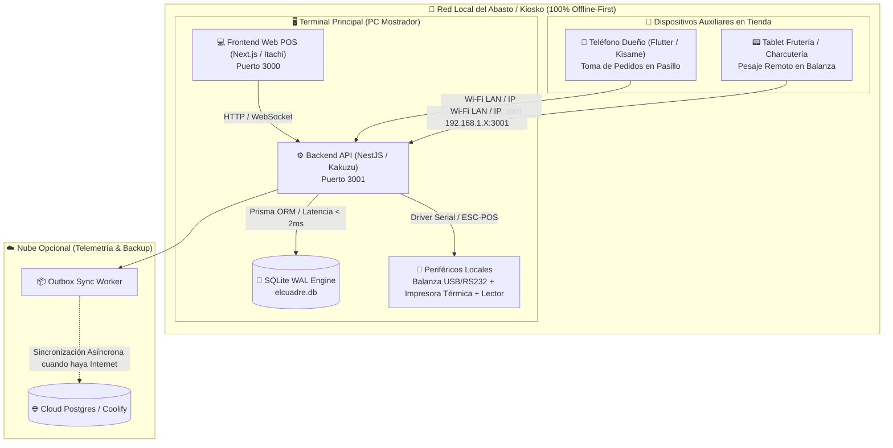
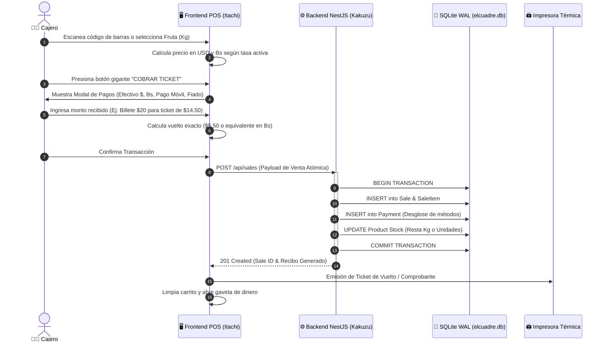
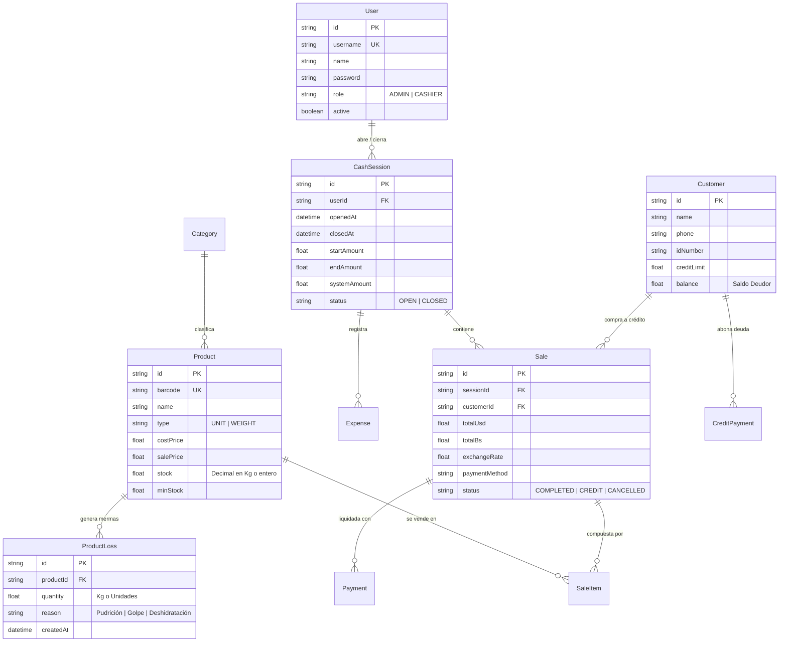

# 🌿 Blueprint de Arquitectura Técnica & Especificación Funcional: EL CUADRE POS
**Líderes de Proyecto & Arquitectura**: ☁️ Pain (PM & Scrum Master) & 🐍 Orochimaru (Chief Architect & DevOps)  
**Redacción & Estandarización Documental**: 🌿 Zetsu (🌑 Zetsu Negro / ⚪ Zetsu Blanco)  
**Entorno de Ejecución**: `C:\Users\vmont\OneDrive\Desktop\el-cuadre-pos`  
**Lista Oficial en ClickUp**: [📊 EL CUADRE POS (ID: 901422611886)](https://app.clickup.com/90141555783/v/li/901422611886)  

---

## 👥 Equipo de Desarrollo Akatsuki

| Miembro | Rol | Misión en EL CUADRE POS |
| :--- | :--- | :--- |
| ☁️ **Pain** | Project Manager & Scrum Master | Gestión de Épicas, User Stories Gherkin y Sprints en ClickUp. |
| 🐍 **Orochimaru** | Chief Software Architect & DevOps | Diseño de Arquitectura Hexagonal, SQLite WAL y Outbox Pattern. |
| 🦋 **Konan** | UI/UX Designer (Stitch) | Suite de 6 pantallas y Design System en Google Stitch. |
| 🖤 **Kakuzu** | Backend & Database Architect | NestJS, Prisma ORM, transacciones atómicas SQLite y DTOs Swagger. |
| 👁️ **Itachi** | Frontend Web Engineer | Terminal táctil POS en Next.js App Router, Tailwind & Shadcn UI. |
| 🦈 **Kisame** | Mobile Engineer | App móvil en Flutter (BLoC) para pesaje y pedidos por Wi-Fi LAN. |
| 💀 **Hidan** | QA Engineer & Stress Tester | Pruebas unitarias e integración en Vitest/Jest (>85% cobertura). |
| 💣 **Deidara** | Pentesting & Red Team | Hacking ético, auditoría de inyecciones y seguridad local. |
| 🦂 **Sasori** | Ciberseguridad Blue Team | Hardening de base de datos, cifrado bcrypt y validación de DTOs. |
| 🌿 **Zetsu** | Docs Specialist & Chronicler | Especificaciones OpenAPI, diagramas C4 y manuales de cajero. |
| 👑 **El Señor** | Dueño del Producto & Aprobación UAT | Pruebas finales de aceptación en entorno real. |

---

## 🌑 Documentación Técnica (Zetsu Negro & Orochimaru)

### 1. Topología del Sistema: Monolito Hexagonal Local Edge + LAN

EL CUADRE POS está concebido para operar bajo condiciones severas de conectividad (cortes de luz, fallos de internet, inestabilidad de red). Funciona como un **Edge Server Local** en el mostrador:

---

### 2. Diagrama de Secuencia: Ciclo de Cobro Táctico Multimoneda

---

### 3. Modelo Entidad-Relación (ERD) en SQLite WAL

---

## ⚪ Especificación Funcional & Manual del Negocio (Zetsu Blanco & Pain)

### 1. El Manejo de la Balanza y Productos por Peso (Kg / g)
- **Problema en Fruterías**: Los sistemas genéricos fuerzan a escribir unidades enteras. En un abasto criollo, el cliente pide *"medio kilo de tomate y dos plátanos"*.
- **Solución El Cuadre**: 
  - El modal de pesaje ofrece **botones de peso rápido**: `1/4 Kg (250g)`, `1/2 Kg (500g)`, `1 Kg (1000g)`, `2 Kg (2000g)`.
  - Soporte de balanza USB/Serial en tiempo real con botón de **Tara** para descontar el peso de bolsas o bandejas.
  - La cantidad se almacena en formato decimal (`1.450 Kg`), recalculando automáticamente el subtotal: `1.450 Kg * $1.80/Kg = $2.61 USD`.

### 2. El Libro de Fiados Digital (Cuentas por Cobrar)
- **Realidad del Comercio Popular**: Clientes de confianza se llevan víveres anotados en una libreta de papel que se pierde o mancha.
- **Solución El Cuadre**:
  - Cada cliente tiene ficha con Cédula, Teléfono, Límite de Crédito y Saldo Deudor acumulado.
  - Al vender con método `CREDIT`, el ticket pasa a estado `PENDING_CREDIT` y el saldo deudor del cliente aumenta automáticamente.
  - Módulo de **Abonos Parciales**: Doña Carmen puede abonar $10 en efectivo o en Bs al cambio del día, descontándose inmediatamente de su deuda pendiente.

### 3. Cierre de Turno & Arqueo Ciego ("El Cuadre")
- **Control Antifraude**: El cajero **no ve** cuánto dinero dice el sistema que debería haber en caja.
- **Protocolo de Cierre**:
  1. El cajero cuenta físicamente los billetes de USD, billetes de Bs, comprobantes de Punto de Venta y pagos móviles.
  2. Ingresa los montos reales en el modal de arqueo.
  3. El sistema compara contra las ventas registradas y emite el dictamen:
     - 🟢 **CUADRE PERFECTO**: Diferencia $0.00.
     - 🟡 **SOBRANTE**: Dinero extra en gaveta.
     - 🔴 **FALTANTE / DESCUADRE**: Alerta de pérdida para revisión del supervisor.

---

## ☁️ Alineación con Sprints en ClickUp (Pain)

| Subtarea ClickUp | Nombre de la Tarea | Estado Actual | Responsable |
| :---: | :--- | :---: | :---: |
| `86bcqv6b4` | US-01: Prototipado UI/UX en Stitch (6 Vistas) | **TESTING** | 🦋 Konan |
| `86bcqv6dp` | US-02: Base de Datos SQLite, Prisma & Seeds Criollos | **TESTING** | 🖤 Kakuzu |
| `86bcqv6du` | US-03: Login & Turnos de Caja (Apertura/Arqueo Ciego) | **TESTING** | 🖤 Kakuzu / 👁️ Itachi |
| `86bcqw6a6` | US-11: Identidad Visual Oficial, Logotipo SVG & Brand Book | **TO DO** | 🎨 Sai |
| `86bcqw6fd` | US-12: Pack de Iconos Criollos SVG & Assets para Balanza | **TO DO** | 🎨 Sai |
| `86bcqw6vc` | US-13: Mockups Fotorealistas en Mostrador & Banners de Redes | **TO DO** | 🎨 Sai / 🎭 Tobi |
| `86bcqv6e2` | US-04: Caja Táctica POS (Widescreen Terminal) | **TO DO** | 👁️ Itachi |
| `86bcqv6fm` | US-05: Pasarela de Cobro Multimoneda & Vueltos | **TO DO** | 👁️ Itachi / 🖤 Kakuzu |
| `86bcqv6h0` | US-06: Inventario Híbrido & Mermas de Perecederos | **TO DO** | 🖤 Kakuzu / 👁️ Itachi |
| `86bcqv6h8` | US-07: Contabilidad & Gastos de Caja Menor | **TO DO** | 🖤 Kakuzu |
| `86bcqv6he` | US-08: Tests Unitarios Vitest >85% | **TO DO** | 💀 Hidan |
| `86bcqv6hy` | US-09: Manual del Cajero & Guía Offline | **TO DO** | 🌿 Zetsu |
| `86bcqv8c7` | US-10: Libro de Fiados Digital / CxC | **TO DO** | 🖤 Kakuzu / 👁️ Itachi |
