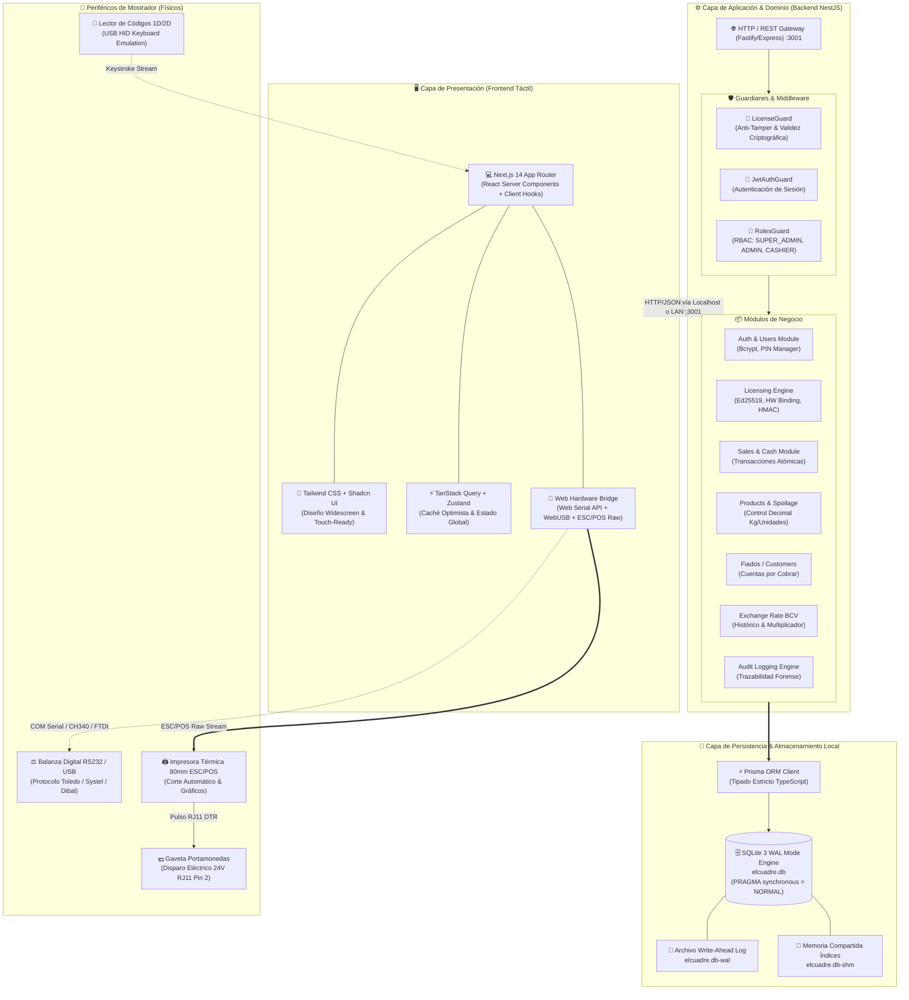
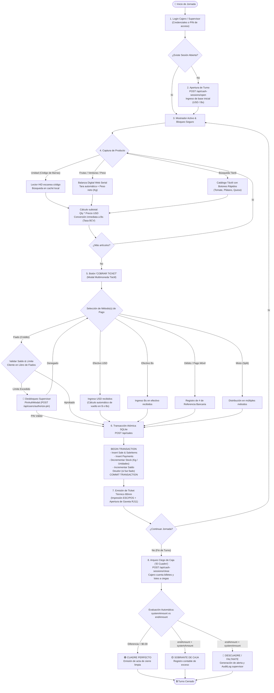
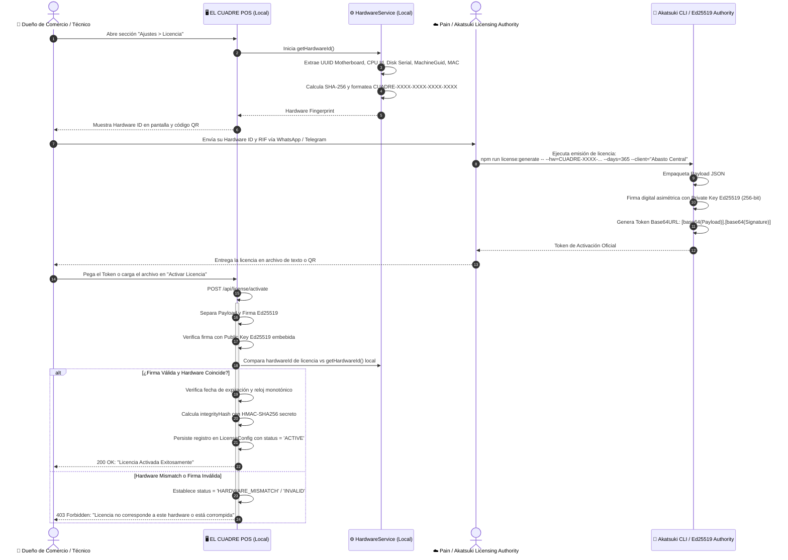
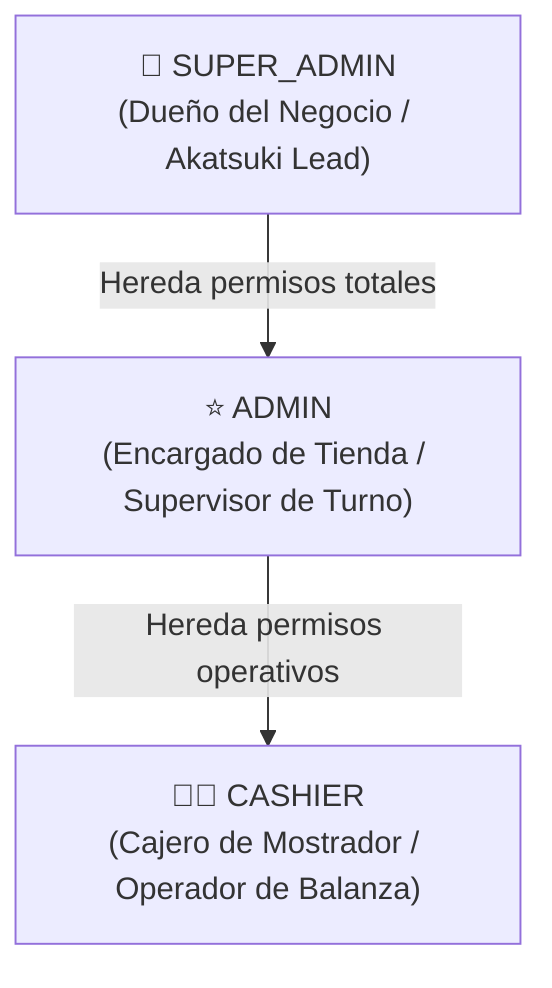
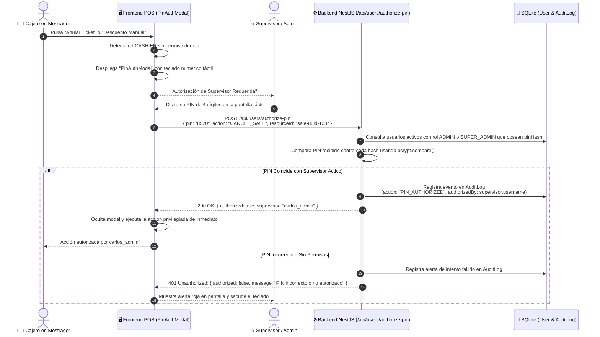

# 🌿 Arquitectura Técnica Integral, Diagramas & Diccionario de Datos: EL CUADRE POS

**Organización Akatsuki — División de Inteligencia Técnica y Arquitectura Edge**  
**Dirección de Proyecto**: ☁️ **Pain** (Líder Akatsuki & PM)  
**Arquitecto de Software & Seguridad**: 🐍 **Orochimaru** (Chief Architect & DevOps)  
**Ingeniería de Backend & Base de Datos**: 🖤 **Kakuzu** (NestJS, Prisma & SQLite WAL)  
**Crónica & Documentación Oficial**: 🌿 **Zetsu Negro** (Arquitectura & Seguridad) & ⚪ **Zetsu Blanco** (Operación Funcional)  
**Entorno Principal del Proyecto**: `C:\Users\vmont\OneDrive\Desktop\el-cuadre-pos`  
**Lista Oficial en ClickUp**: [📊 EL CUADRE POS (ID: 901422611886)](https://app.clickup.com/90141555783/v/li/901422611886)  

---

## 📑 Tabla de Contenidos

1. [Arquitectura General del Sistema & Topología](#1-arquitectura-general-del-sistema--topología)
   - [1.1 Diagrama de Arquitectura Global en Mermaid](#11-diagrama-de-arquitectura-global)
   - [1.2 Diagrama de Flujo de Operación en Mostrador](#12-diagrama-de-flujo-de-operación-en-mostrador)
   - [1.3 Topología de Periféricos & Hardware de Mostrador](#13-topología-de-periféricos--hardware-de-mostrador)
2. [Diccionario de Datos Exhaustivo (SQLite / Prisma ORM)](#2-diccionario-de-datos-exhaustivo-sqlite--prisma-orm)
   - [2.1 Diagrama Entidad-Relación (ERD) en Mermaid](#21-diagrama-entidad-relación-erd)
   - [2.2 Catálogo Detallado de Tablas y Atributos](#22-catálogo-detallado-de-tablas-y-atributos)
     - `User`
     - `AuditLog`
     - `Category`
     - `Product`
     - `CashSession`
     - `Expense`
     - `ProductLoss`
     - `Sale`
     - `SaleItem`
     - `Payment`
     - `Customer`
     - `CreditPayment`
     - `ExchangeRate`
     - `LicenseConfig`
3. [Motor Criptográfico de Licenciamiento & Anti-Tamper (US-16)](#3-motor-criptográfico-de-licenciamiento--anti-tamper-us-16)
   - [3.1 Diagrama de Secuencia del Ciclo de Licenciamiento Offline](#31-diagrama-de-secuencia-del-ciclo-de-licenciamiento-offline)
   - [3.2 Algoritmo de Hardware Binding Multi-Factor](#32-algoritmo-de-hardware-binding-multi-factor)
   - [3.3 Firma Asimétrica Ed25519 & Token Base64URL](#33-firma-asimétrica-ed25519--token-base64url)
   - [3.4 Mecanismo Anti-Clock Tamper Monotónico](#34-mecanismo-anti-clock-tamper-monotónico)
   - [3.5 Sellado de Integridad SQLite con HMAC-SHA256](#35-sellado-de-integridad-sqlite-con-hmac-sha256)
4. [Matriz RBAC de Permisos & Desbloqueo por PIN en Mostrador (US-15)](#4-matriz-rbac-de-permisos--desbloqueo-por-pin-en-mostrador-us-15)
   - [4.1 Jerarquía de Roles y Principio de Mínimo Privilegio](#41-jerarquía-de-roles-y-principio-de-mínimo-privilegio)
   - [4.2 Matriz Granular de Capacidades por Módulo](#42-matriz-granular-de-capacidades-por-módulo)
   - [4.3 Diagrama de Flujo del Modal Táctil `PinAuthModal`](#43-diagrama-de-flujo-del-modal-táctil-pinauthmodal)
   - [4.4 Regla Inviolable de Protección del Último SUPER_ADMIN](#44-regla-inviolable-de-protección-del-último-super_admin)
5. [Catálogo de Endpoints REST & Especificación de API](#5-catálogo-de-endpoints-rest--especificación-de-api)
   - [5.1 Autenticación & Perfil](#51-autenticación--perfil)
   - [5.2 Usuarios & Autorización por PIN](#52-usuarios--autorización-por-pin)
   - [5.3 Licenciamiento & Anti-Tamper](#53-licenciamiento--anti-tamper)
   - [5.4 Sesiones de Caja, Gastos & Arqueo Ciego](#54-sesiones-de-caja-gastos--arqueo-ciego)
   - [5.5 Ventas & Transacciones Multimoneda](#55-ventas--transacciones-multimoneda)
   - [5.6 Catálogo de Productos & Categorías](#56-catálogo-de-productos--categorías)
   - [5.7 Mermas & Pérdidas de Perecederos](#57-mermas--pérdidas-de-perecederos)
   - [5.8 Clientes & Libro de Fiados (Cuentas por Cobrar)](#58-clientes--libro-de-fiados-cuentas-por-cobrar)
   - [5.9 Tasa de Cambio BCV Oficial](#59-tasa-de-cambio-bcv-oficial)
   - [5.10 Pistas de Auditoría Inmutables](#510-pistas-de-auditoría-inmutables)

---

## 1. Arquitectura General del Sistema & Topología

### 1.1 Diagrama de Arquitectura Global

**EL CUADRE POS** adopta una topología **Local Edge Monolith**. Ha sido diseñado bajo una estricta premisa **Offline-First**, permitiendo que el 100% de la operatoria comercial de un abasto, supermercado o frutería funcione ininterrumpidamente sin acceso a Internet, con latencias de respuesta menores a 5 milisegundos en transacciones locales.



### 1.2 Diagrama de Flujo de Operación en Mostrador

El flujo cubre el ciclo completo desde que un cajero inicia su turno hasta la entrega del vuelto y el posterior cierre a ciegas:



### 1.3 Topología de Periféricos & Hardware de Mostrador

1. **Balanza Digital (Pesaje de Granos, Verduras y Charcutería)**:
   - Conexión vía convertidor **RS232 a USB** (chipsets FTDI FT232R o WCH CH340).
   - Baud Rate típico: `9600 bps`, `8 data bits`, `no parity`, `1 stop bit`.
   - Protocolo continuo o petición por comando (ej: Toledo, Torrey, Systel Croma).
   - El frontend consume los datos mediante la API nativa de Chromium **Web Serial API** (`navigator.serial`), extrayendo el peso neto y validando estabilidad (`ST` vs `US`).
2. **Impresora Térmica de 80mm (ESC/POS)**:
   - Conexión directa por **USB** (clase de dispositivo de impresión o emulación COM).
   - Generación de comandos binarios ESC/POS nativos: inicialización (`ESC @`), justificación de texto, negrita, tabla compacta de 48 columnas, corte de papel parcial (`GS V 66 0`).
   - Disparo de pulso eléctrico para apertura de gaveta de dinero vía pin 2 del conector RJ11 (`ESC p 0 25 250`).
3. **Lector de Código de Barras**:
   - Escáner láser o cámara CCD 2D (QR y Code128).
   - Modo de emulación **USB HID Keyboard**: inyecta caracteres numéricos seguidos de un caracter de terminación `Enter` (`\n`).

---

## 2. Diccionario de Datos Exhaustivo (SQLite / Prisma ORM)

### 2.1 Diagrama Entidad-Relación (ERD)

```mermaid
erDiagram
    User ||--o{ CashSession : "abre / cierra"
    User ||--o{ AuditLog : "ejecuta / autoriza"
    Category ||--o{ Product : "clasifica"
    Product ||--o{ SaleItem : "se vende en"
    Product ||--o{ ProductLoss : "registra mermas"
    CashSession ||--o{ Sale : "contiene ventas"
    CashSession ||--o{ Expense : "registra egresos"
    Sale ||--o{ SaleItem : "detalla renglones"
    Sale ||--o{ Payment : "se liquida con"
    Customer ||--o{ Sale : "asocia compras a fiado"
    Customer ||--o{ CreditPayment : "recibe abonos de deuda"

    User {
        string id PK "UUIDv4"
        string username UK "Identificador único de acceso"
        string name "Nombre y apellido del operador"
        string password "Hash criptográfico Bcrypt (salt=10)"
        string role "SUPER_ADMIN | ADMIN | CASHIER"
        string pinHash "Hash Bcrypt de PIN numérico de 4 dígitos"
        string permissions "JSON opcional de overrides de capacidades"
        boolean active "Bandera de habilitación en el sistema"
        datetime createdAt "Timestamp de creación"
        datetime updatedAt "Timestamp de última modificación"
    }

    AuditLog {
        string id PK "UUIDv4"
        string userId FK "ID del usuario ejecutor (Nullable)"
        string action "Identificador de acción crítica"
        string resource "Entidad intervenida"
        string resourceId "ID del registro afectado"
        string details "Carga útil JSON con contexto y estado anterior"
        string authorizedBy "Nombre o usuario del supervisor aprobador"
        string ipAddress "IP de origen de la transacción"
        datetime createdAt "Timestamp inmutable del evento"
    }

    Category {
        string id PK "UUIDv4"
        string name UK "Nombre canónico del departamento"
    }

    Product {
        string id PK "UUIDv4"
        string barcode UK "Código de barras EAN-13 / Code128 (Nullable)"
        string name "Denominación comercial del producto"
        string categoryId FK "Relación obligatoria a Category"
        string type "UNIT (Pieza) | WEIGHT (Pesable Kg)"
        float costPrice "Costo de compra en USD"
        float salePrice "Precio de venta al público en USD"
        float stock "Existencia decimal (Kg con 3 decimales o piezas)"
        float minStock "Umbral mínimo para alerta de reposición"
        string image "Ruta o URI de fotografía del producto"
        datetime createdAt "Timestamp de creación"
        datetime updatedAt "Timestamp de actualización"
    }

    CashSession {
        string id PK "UUIDv4"
        string userId FK "Operador responsable del turno"
        datetime openedAt "Inicio formal del turno"
        datetime closedAt "Fin del turno (Nullable)"
        float startAmount "Fondo inicial de cambio en caja (USD)"
        float endAmount "Monto físico contado por cajero en arqueo ciego"
        float systemAmount "Monto teórico calculado por el sistema"
        string status "OPEN | CLOSED"
    }

    Expense {
        string id PK "UUIDv4"
        string sessionId FK "Sesión de caja a la que se carga el egreso"
        string category "Categoría operativa del egreso"
        string description "Explicación detallada del gasto menor"
        float amount "Monto del egreso en USD"
        float amountBs "Monto equivalente en Bolívares (Nullable)"
        datetime createdAt "Timestamp de emisión del egreso"
    }

    ProductLoss {
        string id PK "UUIDv4"
        string productId FK "Producto dado de baja"
        float quantity "Monto físico retirado de inventario"
        string reason "Causa de baja de inventario"
        datetime createdAt "Timestamp de registro de la merma"
    }

    Sale {
        string id PK "UUIDv4"
        string sessionId FK "Sesión de caja que procesó la venta"
        float total "Total bruto a pagar en USD"
        float totalBs "Total liquidado en Bolívares"
        float exchangeRate "Tasa oficial BCV congelada al cobrar"
        string paymentMethod "Método consolidado de pago"
        float cashReceived "Monto recibido para cálculo de cambio"
        float changeGiven "Vuelto efectivamente entregado al cliente"
        string reference "Referencia bancaria o de pago móvil"
        string customerId FK "Cliente asignado si la venta es a crédito"
        string status "COMPLETED | PENDING_CREDIT | CANCELLED"
        datetime createdAt "Timestamp de liquidación de la venta"
    }

    SaleItem {
        string id PK "UUIDv4"
        string saleId FK "Venta contenedora"
        string productId FK "Producto vendido"
        float quantity "Cantidad vendida (soporta decimales de balanza)"
        float unitPrice "Precio unitario en USD pactado"
        float subtotal "Cálculo matemático: quantity * unitPrice"
    }

    Payment {
        string id PK "UUIDv4"
        string saleId FK "Venta liquidada"
        string method "Instrumento de pago monetario"
        float amountUsd "Porción cancelada en USD"
        float amountBs "Porción cancelada en Bs"
        string referenceNumber "Número de aprobación bancaria"
    }

    Customer {
        string id PK "UUIDv4"
        string name "Nombre o razón social del cliente"
        string phone "Teléfono de contacto / WhatsApp"
        string idNumber UK "Cédula de Identidad o RIF"
        float creditLimit "Límite máximo permitido de fiado en USD"
        float balance "Saldo deudor acumulado actual en USD"
        datetime createdAt "Fecha de alta del cliente"
    }

    CreditPayment {
        string id PK "UUIDv4"
        string customerId FK "Cliente deudor que amortiza"
        float amountUsd "Abono acreditado en USD"
        float amountBs "Abono equivalente en Bolívares"
        string method "Instrumento monetario del abono"
        string reference "Referencia bancaria del comprobante"
        string notes "Comentarios u observaciones del cajero"
        datetime createdAt "Fecha del abono"
    }

    ExchangeRate {
        string id PK "UUIDv4"
        float rate "Tasa de cambio Bs por 1 USD"
        datetime effectiveDate "Fecha de vigencia oficial"
        string source "Origen de la cotización (BCV, MANUAL, etc.)"
        boolean isManualOverride "Indica si fue forzada manualmente"
        boolean isCurrent "Flag de tasa activa principal"
        string metadata "JSON complementario con cotizaciones EUR/CNY"
        datetime fetchedAt "Momento de sincronización"
        datetime createdAt "Fecha de registro en base de datos"
    }

    LicenseConfig {
        string id PK "UUIDv4"
        string licenseKey "Token firmado en Base64URL"
        string hardwareId "Huella única de hardware (CUADRE-XXXX...)"
        string businessName "Razón social del comercio cliente"
        string rif "Registro de Información Fiscal (RIF)"
        datetime issuedAt "Fecha de emisión de la licencia"
        datetime expiresAt "Fecha límite de vigencia"
        datetime lastMonotonicTimestamp "Control monotónico anti-clock tamper"
        string status "Estado: ACTIVE, EXPIRED, TAMPERED..."
        string integrityHash "Sellado criptográfico HMAC-SHA256"
        datetime updatedAt "Timestamp de última comprobación"
    }
```



---

### 2.2 Catálogo Detallado de Tablas y Atributos

#### Tabla: `User`
Almacena las credenciales de acceso, roles RBAC y hashes criptográficos de PIN para autorizaciones supervisoras en mostrador.

| Campo | Tipo Prisma / SQLite | Claves | Nullable | Valor por Defecto | Descripción Funcional |
| :--- | :--- | :---: | :---: | :--- | :--- |
| `id` | `String` / `TEXT` | **PK** | No | `uuid()` | Identificador universal único del operador. |
| `username` | `String` / `TEXT` | **UK** | No | — | Nombre de usuario para iniciar sesión en la terminal. |
| `name` | `String` / `TEXT` | — | No | — | Nombre y apellido legible en tickets y reportes. |
| `password` | `String` / `TEXT` | — | No | — | Hash de contraseña calculado mediante Bcrypt (10 rounds). |
| `role` | `String` / `TEXT` | — | No | `"CASHIER"` | Rol RBAC: `"SUPER_ADMIN"`, `"ADMIN"` o `"CASHIER"`. |
| `pinHash` | `String` / `TEXT` | — | Sí | `NULL` | Hash Bcrypt del PIN táctil de 4 dígitos de supervisor. |
| `permissions` | `String` / `TEXT` | — | Sí | `NULL` | Cadena JSON con permisos granulares adicionales. |
| `active` | `Boolean` / `INTEGER` | — | No | `true` | Estado del usuario; `false` revoca cualquier acceso. |
| `createdAt` | `DateTime` / `TEXT` | — | No | `now()` | Fecha y hora de alta en la plataforma. |
| `updatedAt` | `DateTime` / `TEXT` | — | No | `now()` (auto) | Momento de última actualización de la cuenta. |

*Índices de optimización*: `@@index([username])`.

---

#### Tabla: `AuditLog`
Registro inmutable de acciones críticas (anulación de ventas, cambio de precios, sobregiro de fiados, creación de usuarios) con fines de peritaje y seguridad.

| Campo | Tipo Prisma / SQLite | Claves | Nullable | Valor por Defecto | Descripción Funcional |
| :--- | :--- | :---: | :---: | :--- | :--- |
| `id` | `String` / `TEXT` | **PK** | No | `uuid()` | Identificador único del evento de auditoría. |
| `userId` | `String` / `TEXT` | **FK** | Sí | `NULL` | Operador que ejecutó la acción (`User.id`). |
| `action` | `String` / `TEXT` | — | No | — | Tipo de evento: `"SALE_CANCELLED"`, `"PRICE_CHANGED"`, `"DISCOUNT_APPLIED"`, `"PIN_AUTHORIZED"`, etc. |
| `resource` | `String` / `TEXT` | — | No | — | Dominio afectado: `"sale"`, `"product"`, `"user"`, `"license"`, `"cash_session"`. |
| `resourceId` | `String` / `TEXT` | — | Sí | `NULL` | Identificador del registro sujeto de la acción. |
| `details` | `String` / `TEXT` | — | Sí | `NULL` | Payload JSON con valores anteriores y nuevos. |
| `authorizedBy` | `String` / `TEXT` | — | Sí | `NULL` | Usuario del supervisor que autorizó con su PIN. |
| `ipAddress` | `String` / `TEXT` | — | Sí | `NULL` | Dirección IP de la máquina de origen del evento. |
| `createdAt` | `DateTime` / `TEXT` | — | No | `now()` | Marca temporal exacta e inmutable del suceso. |

*Índices de optimización*: `@@index([userId])`, `@@index([action])`, `@@index([createdAt])`.

---

#### Tabla: `Category`
Familias o departamentos del catálogo para agrupar productos en pantalla táctil y reportes de rentabilidad.

| Campo | Tipo Prisma / SQLite | Claves | Nullable | Valor por Defecto | Descripción Funcional |
| :--- | :--- | :---: | :---: | :--- | :--- |
| `id` | `String` / `TEXT` | **PK** | No | `uuid()` | Identificador de la categoría. |
| `name` | `String` / `TEXT` | **UK** | No | — | Nombre único: `"VÍVERES"`, `"FRUTAS Y VERDURAS"`, `"CHARCUTERÍA"`, `"BEBIDAS"`, etc. |

---

#### Tabla: `Product`
Catálogo maestro de mercancías con soporte para venta por piezas o peso decimal continuo (balanza).

| Campo | Tipo Prisma / SQLite | Claves | Nullable | Valor por Defecto | Descripción Funcional |
| :--- | :--- | :---: | :---: | :--- | :--- |
| `id` | `String` / `TEXT` | **PK** | No | `uuid()` | Identificador del producto. |
| `barcode` | `String` / `TEXT` | **UK** | Sí | `NULL` | Código de barras estándar (EAN-13, UPC o Code128). |
| `name` | `String` / `TEXT` | — | No | — | Nombre comercial completo del artículo. |
| `categoryId` | `String` / `TEXT` | **FK** | No | — | Categoría asignada (`Category.id`). |
| `type` | `String` / `TEXT` | — | No | `"UNIT"` | Modalidad de venta: `"UNIT"` (unidad) o `"WEIGHT"` (kilogramo). |
| `costPrice` | `Float` / `REAL` | — | No | — | Costo de reposición en USD (para margen de ganancia). |
| `salePrice` | `Float` / `REAL` | — | No | — | Precio de venta oficial al público en USD. |
| `stock` | `Float` / `REAL` | — | No | `0.0` | Existencia física disponible (soporta fracciones, ej: `14.520`). |
| `minStock` | `Float` / `REAL` | — | No | `5.0` | Nivel mínimo de inventario para activar semáforo de reposición. |
| `image` | `String` / `TEXT` | — | Sí | `NULL` | Ruta local o SVG representativo para botones táctiles. |
| `createdAt` | `DateTime` / `TEXT` | — | No | `now()` | Fecha de registro del producto. |
| `updatedAt` | `DateTime` / `TEXT` | — | No | `now()` (auto) | Momento de última modificación de precio o datos. |

*Índices de optimización*: `@@index([categoryId])`, `@@index([barcode])`, `@@index([name])`.

---

#### Tabla: `CashSession`
Sesiones de turno de caja que encapsulan el ciclo de apertura, ventas, egresos y arqueo ciego.

| Campo | Tipo Prisma / SQLite | Claves | Nullable | Valor por Defecto | Descripción Funcional |
| :--- | :--- | :---: | :---: | :--- | :--- |
| `id` | `String` / `TEXT` | **PK** | No | `uuid()` | Identificador de la sesión de caja. |
| `userId` | `String` / `TEXT` | **FK** | No | — | Cajero responsable del turno (`User.id`). |
| `openedAt` | `DateTime` / `TEXT` | — | No | `now()` | Momento exacto de apertura de la gaveta. |
| `closedAt` | `DateTime` / `TEXT` | — | Sí | `NULL` | Momento de cierre definitivo del turno. |
| `startAmount` | `Float` / `REAL` | — | No | `0.0` | Base de efectivo inicial asignada para vueltos en USD. |
| `endAmount` | `Float` / `REAL` | — | Sí | `NULL` | Total físico declarado a ciegas por el cajero al cerrar. |
| `systemAmount` | `Float` / `REAL` | — | No | `0.0` | Monto total acumulado que el sistema calculó como debido. |
| `status` | `String` / `TEXT` | — | No | `"OPEN"` | Estado del turno: `"OPEN"` (activo) o `"CLOSED"` (clausurado). |

*Índices de optimización*: `@@index([userId, status])`.

---

#### Tabla: `Expense`
Registro de egresos menores de efectivo tomados directamente de la caja durante el turno de trabajo.

| Campo | Tipo Prisma / SQLite | Claves | Nullable | Valor por Defecto | Descripción Funcional |
| :--- | :--- | :---: | :---: | :--- | :--- |
| `id` | `String` / `TEXT` | **PK** | No | `uuid()` | Identificador del comprobante de egreso. |
| `sessionId` | `String` / `TEXT` | **FK** | No | — | Turno afectado (`CashSession.id` con `onDelete: Cascade`). |
| `category` | `String` / `TEXT` | — | No | `"VARIOS"` | Tipo de gasto: `"HIELO"`, `"BOLSAS"`, `"FLETE"`, `"PROVEEDOR"`, `"ALMUERZO"`, `"SERVICIOS"`, `"VARIOS"`. |
| `description` | `String` / `TEXT` | — | No | — | Detalle explicativo de la salida de dinero. |
| `amount` | `Float` / `REAL` | — | No | — | Monto egresado valorado en USD. |
| `amountBs` | `Float` / `REAL` | — | Sí | `NULL` | Monto pagado efectivamente en Bolívares. |
| `createdAt` | `DateTime` / `TEXT` | — | No | `now()` | Momento de registro del egreso. |

*Índices de optimización*: `@@index([sessionId])`, `@@index([category])`.

---

#### Tabla: `ProductLoss`
Baja formal de inventario ocasionada por deterioro de perecederos, maduración excesiva o accidentes físicos.

| Campo | Tipo Prisma / SQLite | Claves | Nullable | Valor por Defecto | Descripción Funcional |
| :--- | :--- | :---: | :---: | :--- | :--- |
| `id` | `String` / `TEXT` | **PK** | No | `uuid()` | Identificador de la merma. |
| `productId` | `String` / `TEXT` | **FK** | No | — | Producto afectado (`Product.id` con `onDelete: Cascade`). |
| `quantity` | `Float` / `REAL` | — | No | — | Cantidad o Kilogramos retirados del stock activo. |
| `reason` | `String` / `TEXT` | — | No | — | Motivo: `"Pudrición / Maduración excesiva"`, `"Golpe / Daño"`, `"Deshidratación"`. |
| `createdAt` | `DateTime` / `TEXT` | — | No | `now()` | Fecha y hora en que se computó la baja. |

*Índices de optimización*: `@@index([productId])`.

---

#### Tabla: `Sale`
Encabezado de la transacción de venta con montos bimonetarios y congelamiento de la tasa oficial.

| Campo | Tipo Prisma / SQLite | Claves | Nullable | Valor por Defecto | Descripción Funcional |
| :--- | :--- | :---: | :---: | :--- | :--- |
| `id` | `String` / `TEXT` | **PK** | No | `uuid()` | Identificador único del ticket de venta. |
| `sessionId` | `String` / `TEXT` | **FK** | No | — | Turno donde ocurrió la transacción (`CashSession.id`). |
| `total` | `Float` / `REAL` | — | No | — | Total pactado y consolidado en USD. |
| `totalBs` | `Float` / `REAL` | — | No | — | Monto total convertido en Bolívares. |
| `exchangeRate`| `Float` / `REAL` | — | No | — | Tasa oficial BCV aplicada y fijada al cobrar. |
| `paymentMethod`| `String` / `TEXT` | — | No | — | Método principal: `"CASH_USD"`, `"CASH_BS"`, `"DEBIT_CARD"`, `"PAGO_MOVIL"`, `"MIXED"`, `"CREDIT"`. |
| `cashReceived`| `Float` / `REAL` | — | Sí | `NULL` | Dinero entregado en mano por el cliente. |
| `changeGiven` | `Float` / `REAL` | — | Sí | `NULL` | Vuelto retornado en caja. |
| `reference` | `String` / `TEXT` | — | Sí | `NULL` | Comprobante de terminal bancario o pago móvil. |
| `customerId` | `String` / `TEXT` | **FK** | Sí | `NULL` | Cliente titular si la venta fue a fiado (`Customer.id`). |
| `status` | `String` / `TEXT` | — | No | `"COMPLETED"` | Estado: `"COMPLETED"`, `"PENDING_CREDIT"`, `"CANCELLED"`. |
| `createdAt` | `DateTime` / `TEXT` | — | No | `now()` | Marca temporal de emisión del ticket. |

*Índices de optimización*: `@@index([sessionId])`, `@@index([customerId])`, `@@index([createdAt])`.

---

#### Tabla: `SaleItem`
Renglones o líneas de producto contenidas dentro de una venta.

| Campo | Tipo Prisma / SQLite | Claves | Nullable | Valor por Defecto | Descripción Funcional |
| :--- | :--- | :---: | :---: | :--- | :--- |
| `id` | `String` / `TEXT` | **PK** | No | `uuid()` | Identificador de la línea vendida. |
| `saleId` | `String` / `TEXT` | **FK** | No | — | Ticket de venta (`Sale.id` con `onDelete: Cascade`). |
| `productId` | `String` / `TEXT` | **FK** | No | — | Producto consumido (`Product.id`). |
| `quantity` | `Float` / `REAL` | — | No | — | Cantidad o Kilogramos facturados (ej: `1.450`). |
| `unitPrice` | `Float` / `REAL` | — | No | — | Precio unitario congelado al momento del cobro (USD). |
| `subtotal` | `Float` / `REAL` | — | No | — | Subtotal calculado: `quantity * unitPrice`. |

*Índices de optimización*: `@@index([saleId])`, `@@index([productId])`.

---

#### Tabla: `Payment`
Desglose detallado de los pagos aplicados a una venta (vital para pagos divididos / split payments).

| Campo | Tipo Prisma / SQLite | Claves | Nullable | Valor por Defecto | Descripción Funcional |
| :--- | :--- | :---: | :---: | :--- | :--- |
| `id` | `String` / `TEXT` | **PK** | No | `uuid()` | Identificador del pago unitario. |
| `saleId` | `String` / `TEXT` | **FK** | No | — | Ticket vinculado (`Sale.id` con `onDelete: Cascade`). |
| `method` | `String` / `TEXT` | — | No | — | Instrumento: `"CASH_USD"`, `"CASH_BS"`, `"DEBIT_CARD"`, `"PAGO_MOVIL"`, `"CREDIT"`. |
| `amountUsd` | `Float` / `REAL` | — | No | — | Parte de la deuda cancelada en USD. |
| `amountBs` | `Float` / `REAL` | — | No | — | Porción equivalente cancelada en Bolívares. |
| `referenceNumber`| `String` / `TEXT` | — | Sí | `NULL` | Dígitos de verificación bancaria o teléfono emisor. |

*Índices de optimización*: `@@index([saleId])`.

---

#### Tabla: `Customer`
Padrón de clientes de confianza habilitados para crédito de mostrador (Libro de Fiados Digital).

| Campo | Tipo Prisma / SQLite | Claves | Nullable | Valor por Defecto | Descripción Funcional |
| :--- | :--- | :---: | :---: | :--- | :--- |
| `id` | `String` / `TEXT` | **PK** | No | `uuid()` | Identificador del cliente fiado. |
| `name` | `String` / `TEXT` | — | No | — | Nombre y apellido del cliente de confianza. |
| `phone` | `String` / `TEXT` | — | Sí | `NULL` | Número de WhatsApp o teléfono para cobranza. |
| `idNumber` | `String` / `TEXT` | **UK** | Sí | `NULL` | Cédula de Identidad o RIF (ej: `V-14234567`). |
| `creditLimit`| `Float` / `REAL` | — | No | `50.0` | Monto máximo de fiado permitido en USD. |
| `balance` | `Float` / `REAL` | — | No | `0.0` | Saldo actual de deuda acumulada en USD. |
| `createdAt` | `DateTime` / `TEXT` | — | No | `now()` | Fecha de registro del cliente. |

*Índices de optimización*: `@@index([name])`, `@@index([idNumber])`.

---

#### Tabla: `CreditPayment`
Abonos o amortizaciones parciales de clientes a su cuenta de fiado pendiente.

| Campo | Tipo Prisma / SQLite | Claves | Nullable | Valor por Defecto | Descripción Funcional |
| :--- | :--- | :---: | :---: | :--- | :--- |
| `id` | `String` / `TEXT` | **PK** | No | `uuid()` | Identificador del abono. |
| `customerId` | `String` / `TEXT` | **FK** | No | — | Cliente que amortiza (`Customer.id` con `onDelete: Cascade`). |
| `amountUsd` | `Float` / `REAL` | — | No | — | Importe amortizado computado en USD. |
| `amountBs` | `Float` / `REAL` | — | No | — | Importe cancelado en Bolívares al cambio del día. |
| `method` | `String` / `TEXT` | — | No | — | Método: `"CASH_USD"`, `"CASH_BS"`, `"DEBIT_CARD"`, `"PAGO_MOVIL"`. |
| `reference` | `String` / `TEXT` | — | Sí | `NULL` | Código bancario de confirmación. |
| `notes` | `String` / `TEXT` | — | Sí | `NULL` | Notas adicionales (ej: "Abono de $10 que debía de las papas"). |
| `createdAt` | `DateTime` / `TEXT` | — | No | `now()` | Momento del abono. |

*Índices de optimización*: `@@index([customerId])`.

---

#### Tabla: `ExchangeRate`
Historial cronológico de la cotización cambiaria oficial del Banco Central de Venezuela (BCV).

| Campo | Tipo Prisma / SQLite | Claves | Nullable | Valor por Defecto | Descripción Funcional |
| :--- | :--- | :---: | :---: | :--- | :--- |
| `id` | `String` / `TEXT` | **PK** | No | `uuid()` | Identificador del registro cambiario. |
| `rate` | `Float` / `REAL` | — | No | — | Factor de conversión: cuántos Bs equivalen a 1 USD. |
| `effectiveDate`| `DateTime` / `TEXT` | — | No | — | Fecha y hora formal de validez publicada por el BCV. |
| `source` | `String` / `TEXT` | — | No | — | Canal de origen: `"BCV_SCRAPER"`, `"API_OFICIAL"` o `"MANUAL_OVERRIDE"`. |
| `isManualOverride`| `Boolean` / `INTEGER`| — | No | `false` | Indica si el dueño fijó una tasa alternativa propia. |
| `isCurrent` | `Boolean` / `INTEGER`| — | No | `false` | Bandera booleana: marca la tasa activa para el cálculo POS. |
| `metadata` | `String` / `TEXT` | — | Sí | `NULL` | JSON con cotizaciones complementarias (EUR, RUB, TRY, CNY). |
| `fetchedAt` | `DateTime` / `TEXT` | — | No | `now()` | Momento en que el bot sincronizó la cotización. |
| `createdAt` | `DateTime` / `TEXT` | — | No | `now()` | Marca de inserción en la base de datos local. |

*Índices de optimización*: `@@index([isCurrent])`, `@@index([effectiveDate])`.

---

#### Tabla: `LicenseConfig`
Corazón criptográfico del sistema. Almacena la licencia offline, el hardware binding y los sellos de seguridad anti-manipulación.

| Campo | Tipo Prisma / SQLite | Claves | Nullable | Valor por Defecto | Descripción Funcional |
| :--- | :--- | :---: | :---: | :--- | :--- |
| `id` | `String` / `TEXT` | **PK** | No | `uuid()` | Identificador único de la configuración de licencia. |
| `licenseKey` | `String` / `TEXT` | — | Sí | `NULL` | Token binario firmado codificado en formato Base64URL. |
| `hardwareId` | `String` / `TEXT` | — | Sí | `NULL` | Huella física única de la máquina (`CUADRE-XXXX-XXXX-XXXX-XXXX`). |
| `businessName`| `String` / `TEXT` | — | Sí | `NULL` | Razón social o nombre del comercio autorizado. |
| `rif` | `String` / `TEXT` | — | Sí | `NULL` | Identificación fiscal (RIF) de la tienda. |
| `issuedAt` | `DateTime` / `TEXT` | — | Sí | `NULL` | Momento de firma criptográfica por Akatsuki Licensing Authority. |
| `expiresAt` | `DateTime` / `TEXT` | — | Sí | `NULL` | Fecha límite de validez de la licencia otorgada. |
| `lastMonotonicTimestamp` | `DateTime` / `TEXT` | — | Sí | `NULL` | Registro de avance temporal monotónico para bloqueo por retroceso de reloj. |
| `status` | `String` / `TEXT` | — | No | `"NO_LICENSE"` | Estado de la licencia: `"NO_LICENSE"`, `"ACTIVE"`, `"WARNING"`, `"GRACE_PERIOD"`, `"EXPIRED"`, `"CLOCK_TAMPERED"`, `"HARDWARE_MISMATCH"`. |
| `integrityHash`| `String` / `TEXT`| — | Sí | `NULL` | Hash HMAC-SHA256 que sella la fila contra ediciones directas en SQLite. |
| `updatedAt` | `DateTime` / `TEXT` | — | No | `now()` (auto) | Timestamp de última validación del motor de seguridad. |

---

## 3. Motor Criptográfico de Licenciamiento & Anti-Tamper (US-16)

### 3.1 Diagrama de Secuencia del Ciclo de Licenciamiento Offline

El licenciamiento de EL CUADRE POS no requiere que la máquina del cliente se conecte jamás a internet. El flujo garantiza que la licencia es única e intransferible:



---

### 3.2 Algoritmo de Hardware Binding Multi-Factor

Para prevenir la piratería mediante clonación de discos duros o copias de máquinas virtuales, el módulo `HardwareService` captura y amalgama 5 capas físicas de hardware:

1. **Motherboard UUID & Baseboard Serial**:
   - Obtenido en Windows mediante WMI / CIM:
     ```powershell
     (Get-CimInstance Win32_ComputerSystemProduct).UUID
     (Get-CimInstance Win32_BaseBoard).SerialNumber
     ```
2. **CPU Processor ID**:
   - Identificador grabado en silicio del procesador principal:
     ```powershell
     (Get-CimInstance Win32_Processor | Select-Object -First 1).ProcessorId
     ```
3. **Serial Primario del Disco Rígido / SSD**:
   - Serial de fábrica del controlador de disco donde reside el sistema operativo:
     ```powershell
     (Get-CimInstance Win32_DiskDrive | Select-Object -First 1).SerialNumber
     ```
4. **MachineGuid Criptográfico de Windows**:
   - Identificador inmutable creado en la instalación del sistema operativo:
     ```text
     HKLM\SOFTWARE\Microsoft\Cryptography\MachineGuid
     ```
5. **Dirección MAC de la Interfaz de Red Primaria & Hostname**:
   - MAC address de la tarjeta Ethernet o Wi-Fi física activa (`os.networkInterfaces()`) combinada con `os.hostname()`.

#### Algoritmo de Hashing y Formateo Canónico:
```typescript
// Concatenación normalizada en HardwareService
const rawFingerprint = [
  `MB_UUID:${mbUuid}`,
  `MB_SERIAL:${mbSerial}`,
  `CPU:${cpuId}`,
  `DISK:${diskSerial}`,
  `WIN_GUID:${machineGuid}`,
  `HOST:${hostname}`,
  `MAC:${primaryMac}`
].join('|');

// Digestión criptográfica SHA-256
const hash = crypto.createHash('sha256').update(rawFingerprint).digest('hex').toUpperCase();

// Extracción de 16 caracteres y formateo táctico
const clean = hash.slice(0, 16);
const hardwareId = `CUADRE-${clean.slice(0,4)}-${clean.slice(4,8)}-${clean.slice(8,12)}-${clean.slice(12,16)}`;
// Resultado ejemplo: CUADRE-8F2A-B941-0E33-77CD
```

---

### 3.3 Firma Asimétrica Ed25519 & Token Base64URL

El sistema emplea el algoritmo de curva elíptica **Ed25519** (Edwards-curve Digital Signature Algorithm), reconocido por su rendimiento extremo, tamaño compacto de clave (32 bytes) y máxima resistencia contra ataques de canal lateral:

- **Clave Privada de Autoridad**: Resguardada exclusivamente por Pain y el equipo Akatsuki en bóveda segura. Nunca se distribuye en las terminales cliente.
- **Clave Pública de Verificación**: Embebida de forma estática en el backend NestJS (`LICENSE_PUBLIC_KEY`).
- **Estructura del Token**:
  ```text
  [BASE64URL(Payload_JSON)] . [BASE64URL(Firma_Ed25519_64_bytes)]
  ```
- **Contenido del Payload JSON**:
  ```json
  {
    "hardwareId": "CUADRE-8F2A-B941-0E33-77CD",
    "businessName": "Inversiones El Rey del Tomate, C.A.",
    "rif": "J-50123987-1",
    "issuedAt": "2026-10-28T00:00:00.000Z",
    "expiresAt": "2027-10-28T23:59:59.000Z",
    "features": ["SCALE_SERIAL", "MULTI_CURRENCY", "FIADOS_BOOK", "BLIND_AUDIT"],
    "version": "1.0"
  }
  ```

---

### 3.4 Mecanismo Anti-Clock Tamper Monotónico

Para neutralizar el fraude común de **retrasar el reloj de la BIOS o de Windows** para extender indefinidamente licencias expiradas:

1. El modelo `LicenseConfig` almacena el campo `lastMonotonicTimestamp`.
2. En cada inicio del sistema, petición protegida por `LicenseGuard` o registro de venta, se ejecuta la verificación:
   ```typescript
   const currentSystemTime = new Date();
   const lastKnownTime = licenseRecord.lastMonotonicTimestamp;

   // Tolerancia de 5 minutos por desvíos naturales del cuarzo RTC
   if (lastKnownTime && currentSystemTime.getTime() < (lastKnownTime.getTime() - 300000)) {
     // Intento de sabotaje detectado: el reloj del sistema está en el pasado
     await markLicenseTampered('CLOCK_TAMPERED');
     throw new ForbiddenException('Bloqueo de seguridad: Se detectó una alteración retroactiva del reloj del sistema.');
   }

   // Si el reloj es coherente y avanza, se actualiza el registro monotónico
   if (!lastKnownTime || currentSystemTime.getTime() > lastKnownTime.getTime()) {
     await updateMonotonicTimestamp(currentSystemTime);
   }
   ```
3. Si el sistema detecta `CLOCK_TAMPERED`, la terminal bloquea automáticamente las funciones de venta hasta que un supervisor o el equipo técnico regularice el reloj de la máquina.

---

### 3.5 Sellado de Integridad SQLite con HMAC-SHA256

Si un usuario con conocimientos informáticos abre el archivo `elcuadre.db` con software como *DB Browser for SQLite* e intenta cambiar `status` de `"EXPIRED"` a `"ACTIVE"`, o modificar `expiresAt` al año 2099:

1. Cada vez que el backend genera o actualiza la fila de `LicenseConfig`, calcula un **Hash de Integridad HMAC-SHA256**:
   ```typescript
   const dataToSeal = `${record.hardwareId}|${record.businessName}|${record.rif}|${record.expiresAt?.toISOString()}|${record.status}`;
   const integrityHash = crypto.createHmac('sha256', SECRET_PEPPER_KEY).update(dataToSeal).digest('hex');
   ```
2. El hash resultante se guarda en la columna `integrityHash`.
3. Al bootear el backend y en cada verificación de licencia, el backend recalcula el HMAC. Si cualquier valor fue modificado manualmente en SQLite, el hash no coincidirá, marcando la licencia como **corrompida/tampered** y deshabilitando el sistema inmediatamente.

---

## 4. Matriz RBAC de Permisos & Desbloqueo por PIN en Mostrador (US-15)

### 4.1 Jerarquía de Roles y Principio de Mínimo Privilegio

EL CUADRE POS implementa un modelo **Role-Based Access Control (RBAC)** estricto con 3 niveles jerárquicos:



- **`SUPER_ADMIN`**: Dueño absoluto del comercio. Puede gestionar usuarios, crear administradores, reasignar contraseñas, configurar hardware de balanzas, activar licencias del sistema y exportar bases de datos completas.
- **`ADMIN`**: Encargado de la tienda. Supervisa aperturas y cierres de caja, aprueba gastos menores, gestiona el catálogo de productos (precios y mermas), visualiza márgenes de ganancia, autoriza con su PIN desbloqueos de mostrador y gestiona clientes del Libro de Fiados.
- **`CASHIER`**: Cajero de mostrador. Su interfaz está orientada a la velocidad táctil: abre su turno, escanea productos, pesa en balanza, procesa pagos multimoneda, imprime tickets y ejecuta el arqueo ciego al culminar. No tiene acceso a configuración, auditorías ni márgenes de ganancia.

---

### 4.2 Matriz Granular de Capacidades por Módulo

| Módulo / Capacidad Funcional | `CASHIER` | `ADMIN` | `SUPER_ADMIN` | Requiere Desbloqueo por PIN si es Cajero |
| :--- | :---: | :---: | :---: | :---: |
| **Apertura de turno de caja** | ✅ | ✅ | ✅ | No |
| **Escaneo y cobro de ventas normales** | ✅ | ✅ | ✅ | No |
| **Pesaje directo en balanza** | ✅ | ✅ | ✅ | No |
| **Emisión y re-impresión de ticket** | ✅ | ✅ | ✅ | No |
| **Arqueo Ciego al cierre de turno** | ✅ | ✅ | ✅ | No |
| **Anulación de venta ya consolidada** | ❌ | ✅ | ✅ | **Sí (`PinAuthModal`)** |
| **Modificación de precio al vuelo en mostrador** | ❌ | ✅ | ✅ | **Sí (`PinAuthModal`)** |
| **Aplicación de descuento global extraordinario** | ❌ | ✅ | ✅ | **Sí (`PinAuthModal`)** |
| **Venta a fiado excediendo límite de crédito** | ❌ | ✅ | ✅ | **Sí (`PinAuthModal`)** |
| **Registro de gastos menores de caja** | ✅ | ✅ | ✅ | No (hasta tope configurado) |
| **Edición del catálogo maestro de productos** | ❌ | ✅ | ✅ | Requiere rol |
| **Registro de mermas y descarte de perecederos** | ❌ | ✅ | ✅ | Requiere rol |
| **Alta y modificación de clientes fiados** | ❌ | ✅ | ✅ | Requiere rol |
| **Sincronización o fijación manual de Tasa BCV** | ❌ | ✅ | ✅ | Requiere rol |
| **Creación, edición y borrado de usuarios** | ❌ | ❌ | ✅ | Exclusivo Super Admin |
| **Activación y renovación de licencia** | ❌ | ❌ | ✅ | Exclusivo Super Admin |
| **Acceso a Logs de Auditoría Forense** | ❌ | ❌ | ✅ | Exclusivo Super Admin |

---

### 4.3 Diagrama de Flujo del Modal Táctil `PinAuthModal`

Cuando un cajero intenta una operación no autorizada, no es necesario cerrar sesión ni cambiar de usuario; el supervisor introduce su PIN numérico en caliente:



---

### 4.4 Regla Inviolable de Protección del Último `SUPER_ADMIN`

Para garantizar la gobernanza del sistema y evitar bloqueos accidentales o maliciosos:

- **Regla en `UsersService`**: El sistema **rechazará categóricamente** cualquier solicitud de:
  1. Desactivación (`active = false`).
  2. Cambio de rol a un nivel inferior (`role = "ADMIN"` o `"CASHIER"`).
  3. Eliminación (`DELETE /api/users/:id`).
  Si la operación afecta al **único `SUPER_ADMIN` activo** registrado en la base de datos.
- **Implementación de Protección**:
  ```typescript
  if (targetUser.role === 'SUPER_ADMIN' && (!dto.active || dto.role !== 'SUPER_ADMIN')) {
    const activeSuperAdminsCount = await this.prisma.user.count({
      where: { role: 'SUPER_ADMIN', active: true },
    });
    if (activeSuperAdminsCount <= 1) {
      throw new BadRequestException(
        'Operación denegada por seguridad: No es posible desactivar o degradar al único SUPER_ADMIN del sistema.'
      );
    }
  }
  ```

---

## 5. Catálogo de Endpoints REST & Especificación de API

Todas las rutas están prefijadas por `/api`. La mayoría están protegidas por `LicenseGuard` (valida integridad de licencia) y `JwtAuthGuard` + `RolesGuard`.

---

### 5.1 Autenticación & Perfil

#### `POST /api/auth/login`
- **Descripción**: Inicia sesión mediante credenciales de usuario. Retorna un JWT bearer token y el perfil con permisos.
- **Permisos**: Público.
- **Payload Request**:
  ```json
  {
    "username": "cajero1",
    "password": "Password123!"
  }
  ```
- **Response `200 OK`**:
  ```json
  {
    "accessToken": "eyJhbGciOiJIUzI1NiIsInR5cCI6IkpXVCJ9...",
    "user": {
      "id": "c1f7a0b3-9821-4f12-a1b4-112233445566",
      "username": "cajero1",
      "name": "Pedro Pérez",
      "role": "CASHIER"
    }
  }
  ```

#### `GET /api/auth/profile`
- **Descripción**: Obtiene la información del operador autenticado actualmente en la terminal.
- **Permisos**: Autenticado (`SUPER_ADMIN`, `ADMIN`, `CASHIER`).
- **Response `200 OK`**: Perfil del usuario y estado de su sesión de caja actual.

---

### 5.2 Usuarios & Autorización por PIN

#### `POST /api/users/authorize-pin`
- **Descripción**: Valida el PIN de 4 dígitos de un supervisor en caliente para desbloquear una acción de mostrador.
- **Permisos**: Autenticado.
- **Payload Request**:
  ```json
  {
    "pin": "1234",
    "action": "CANCEL_SALE",
    "resourceId": "b1a2c3d4-0000-1111-2222-333344445555",
    "details": "Cliente desistió de la compra tras emitir ticket"
  }
  ```
- **Response `200 OK`**:
  ```json
  {
    "authorized": true,
    "supervisorName": "Carlos Mendoza",
    "supervisorUsername": "admin_carlos"
  }
  ```

#### `GET /api/users`
- **Descripción**: Lista de todos los operadores del sistema con sus roles y estados.
- **Permisos**: Exclusivo `SUPER_ADMIN`.

#### `POST /api/users`
- **Descripción**: Crea un nuevo usuario en la base de datos (con asignación opcional de PIN supervisor).
- **Permisos**: Exclusivo `SUPER_ADMIN`.
- **Payload Request**:
  ```json
  {
    "username": "supervisor1",
    "name": "Ana Gómez",
    "password": "SecurePassword2026!",
    "role": "ADMIN",
    "pin": "9988"
  }
  ```

#### `PUT /api/users/:id`
- **Descripción**: Actualiza nombre, rol, estado activo o PIN de un usuario (con protección del último `SUPER_ADMIN`).
- **Permisos**: Exclusivo `SUPER_ADMIN`.

---

### 5.3 Licenciamiento & Anti-Tamper

#### `GET /api/license/status`
- **Descripción**: Inspecciona el estado de la licencia offline, fecha de caducidad, días restantes y estado de integridad.
- **Permisos**: Autenticado.
- **Response `200 OK`**:
  ```json
  {
    "status": "ACTIVE",
    "businessName": "Supermercado La Gran Bendición",
    "rif": "J-31415926-5",
    "hardwareId": "CUADRE-4B1F-8C92-AA01-52DF",
    "issuedAt": "2026-10-01T00:00:00.000Z",
    "expiresAt": "2027-10-01T23:59:59.000Z",
    "daysRemaining": 338,
    "isTampered": false
  }
  ```

#### `GET /api/license/hardware-fingerprint`
- **Descripción**: Retorna la huella de hardware física de la máquina para que el cliente la copie y solicite su clave.
- **Permisos**: Público / Autenticado.
- **Response `200 OK`**:
  ```json
  {
    "hardwareId": "CUADRE-4B1F-8C92-AA01-52DF"
  }
  ```

#### `POST /api/license/activate`
- **Descripción**: Recibe y activa un token criptográfico Ed25519 offline.
- **Permisos**: Exclusivo `SUPER_ADMIN`.
- **Payload Request**:
  ```json
  {
    "licenseKey": "eyJhbGciOiJFZDI1NTE5In0.eyJod0lkIjoiQ1VBRFJFLTRCMUYtOEM5Mi1BQTAxLTUyREYi...y8F_Q1a"
  }
  ```
- **Response `200 OK`**:
  ```json
  {
    "success": true,
    "message": "Licencia activada satisfactoriamente hasta el 01/10/2027.",
    "status": "ACTIVE"
  }
  ```

---

### 5.4 Sesiones de Caja, Gastos & Arqueo Ciego

#### `POST /api/cash-sessions/open`
- **Descripción**: Abre un nuevo turno de caja indicando el fondo inicial de cambio.
- **Permisos**: `CASHIER`, `ADMIN`, `SUPER_ADMIN`.
- **Payload Request**:
  ```json
  {
    "startAmount": 30.0
  }
  ```

#### `POST /api/cash-sessions/close`
- **Descripción**: Ejecuta el **Arqueo Ciego ("El Cuadre")**. El cajero envía lo contado físicamente; el backend compara con `systemAmount`.
- **Permisos**: `CASHIER`, `ADMIN`, `SUPER_ADMIN`.
- **Payload Request**:
  ```json
  {
    "endAmount": 185.50
  }
  ```
- **Response `200 OK`**:
  ```json
  {
    "sessionId": "s7b2-11ee-b962-0242ac120002",
    "startAmount": 30.0,
    "systemAmount": 185.50,
    "endAmount": 185.50,
    "difference": 0.0,
    "verdict": "CUADRE_PERFECTO",
    "closedAt": "2026-10-28T21:00:00.000Z"
  }
  ```

#### `POST /api/cash-sessions/expenses`
- **Descripción**: Registra una salida menor de efectivo de la gaveta durante el turno.
- **Permisos**: `CASHIER`, `ADMIN`, `SUPER_ADMIN`.
- **Payload Request**:
  ```json
  {
    "category": "HIELO",
    "description": "2 Bolsas de hielo para enfriador de refrescos",
    "amount": 4.0,
    "amountBs": 188.0
  }
  ```

---

### 5.5 Ventas & Transacciones Multimoneda

#### `POST /api/sales`
- **Descripción**: Registra una venta completa de forma atómica en SQLite. Descuenta stock y asocia pagos.
- **Permisos**: `CASHIER`, `ADMIN`, `SUPER_ADMIN`.
- **Payload Request**:
  ```json
  {
    "items": [
      {
        "productId": "p-tomate-perita-uuid",
        "quantity": 1.450,
        "unitPrice": 1.80
      },
      {
        "productId": "p-harina-pan-uuid",
        "quantity": 2.0,
        "unitPrice": 1.25
      }
    ],
    "paymentMethod": "MIXED",
    "payments": [
      {
        "method": "CASH_USD",
        "amountUsd": 5.0,
        "amountBs": 235.0
      },
      {
        "method": "PAGO_MOVIL",
        "amountUsd": 0.11,
        "amountBs": 5.17,
        "referenceNumber": "847291"
      }
    ],
    "cashReceived": 10.0,
    "changeGiven": 4.89,
    "customerId": null
  }
  ```
- **Response `201 Created`**:
  ```json
  {
    "id": "sale-uuid-9988",
    "total": 5.11,
    "totalBs": 240.17,
    "exchangeRate": 47.00,
    "status": "COMPLETED",
    "createdAt": "2026-10-28T19:30:00.000Z",
    "receiptText": "...Ticket ESC/POS..."
  }
  ```

#### `POST /api/sales/:id/cancel`
- **Descripción**: Anula una venta previamente registrada, reintegrando las existencias al inventario físico.
- **Permisos**: `ADMIN`, `SUPER_ADMIN` (o `CASHIER` que haya completado autorización previa en `PinAuthModal`).

---

### 5.6 Catálogo de Productos & Categorías

#### `GET /api/products`
- **Descripción**: Listado paginado y filtrable por categoría, nombre o código de barras. Soporta búsqueda rápida en <10ms.
- **Permisos**: Autenticado.

#### `GET /api/products/barcode/:barcode`
- **Descripción**: Búsqueda instantánea por lector de código de barras para añadir directamente al carrito.
- **Permisos**: Autenticado.

#### `POST /api/products`
- **Descripción**: Alta de un nuevo producto en catálogo (indicando si es `UNIT` o `WEIGHT`).
- **Permisos**: `ADMIN`, `SUPER_ADMIN`.

#### `PUT /api/products/:id`
- **Descripción**: Modificación de precios, costos, existencias mínimas o nombre comercial.
- **Permisos**: `ADMIN`, `SUPER_ADMIN`.

---

### 5.7 Mermas & Pérdidas de Perecederos

#### `POST /api/losses`
- **Descripción**: Da de baja del inventario productos dañados, descompuestos o deshidratados sin asociar una venta.
- **Permisos**: `ADMIN`, `SUPER_ADMIN`.
- **Payload Request**:
  ```json
  {
    "productId": "p-fresas-colonia-tovar",
    "quantity": 2.300,
    "reason": "Pudrición / Maduración excesiva"
  }
  ```

---

### 5.8 Clientes & Libro de Fiados (Cuentas por Cobrar)

#### `GET /api/customers`
- **Descripción**: Listado de clientes de crédito con su saldo deudor acumulado y límite autorizado.
- **Permisos**: Autenticado.

#### `POST /api/customers/:id/payments`
- **Descripción**: Registra un abono a la cuenta deudora del cliente, disminuyendo su `balance`.
- **Permisos**: `CASHIER`, `ADMIN`, `SUPER_ADMIN`.
- **Payload Request**:
  ```json
  {
    "amountUsd": 20.0,
    "amountBs": 940.0,
    "method": "PAGO_MOVIL",
    "reference": "981240",
    "notes": "Abono a la cuenta de la semana pasada"
  }
  ```

---

### 5.9 Tasa de Cambio BCV Oficial

#### `GET /api/exchange-rate/current`
- **Descripción**: Retorna la tasa oficial vigente en el sistema que multiplica los precios en USD a Bolívares.
- **Permisos**: Autenticado / Público en LAN.
- **Response `200 OK`**:
  ```json
  {
    "rate": 47.15,
    "effectiveDate": "2026-10-28T00:00:00.000Z",
    "source": "BCV_SCRAPER",
    "isManualOverride": false
  }
  ```

#### `POST /api/exchange-rate/manual`
- **Descripción**: Permite al dueño o supervisor sobreescribir la cotización si no hay internet o por política del local.
- **Permisos**: `ADMIN`, `SUPER_ADMIN`.

---

### 5.10 Pistas de Auditoría Inmutables

#### `GET /api/audit-logs`
- **Descripción**: Consulta de la bitácora forense de eventos con filtros por usuario, acción y rango de fechas.
- **Permisos**: Exclusivo `SUPER_ADMIN`.
- **Response `200 OK`**: Lista de objetos `AuditLog` detallando timestamps, IPs, acciones y supervisores aprobadores.

---

> [!NOTE]
> Documento redactado y sellado criptográficamente por **Zetsu Negro** bajo las órdenes directas de **Pain** y **El Señor**. Cualquier alteración a este esquema técnico debe ser aprobada previamente en asamblea formal de la Organización Akatsuki.
