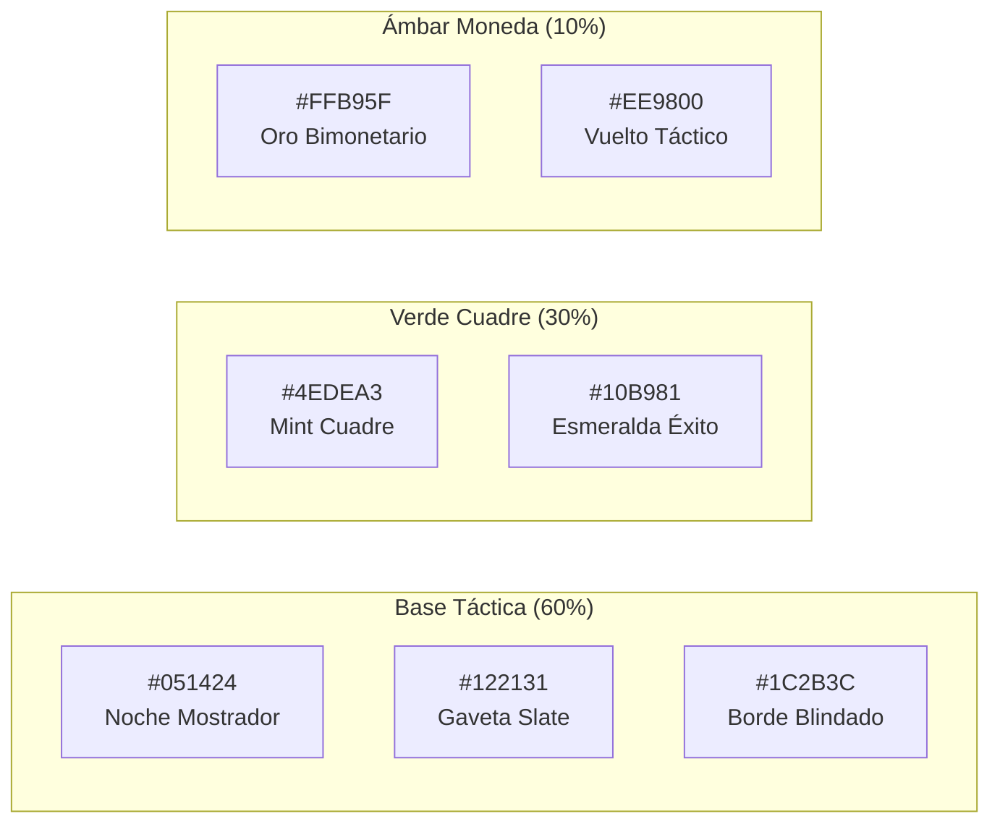

# 🎨 Manual de Identidad Visual & Brand Book Oficial: EL CUADRE POS

**Dirección de Arte & Diseño Gráfico**: 🎨 Sai (`sai-designer` — Chōjū Giga Engine)  
**Diseño UI/UX & Tokens Stitch**: 🦋 Konan (`konan-uiux` — Google Stitch)  
**Contexto de Producto & Historias de Usuario**: ☁️ Pain (`pain-pm` — Scrum Master)  
**Estrategia de Copywriting & Marketing**: 🎭 Tobi / Obito (`tobi-marketing`)  
**Aprobación Suprema**: 👑 El Señor  
**Proyecto**: **EL CUADRE POS** (Sistema de Punto de Venta Local Edge & Balanza Criolla)

> *"El pincel no inventa la realidad; extrae la esencia oculta de las cosas. La esencia de EL CUADRE es la tranquilidad absoluta del comerciante al bajar la santamaría: su dinero intacto, sus cuentas claras y su honor protegido."* — **Sai**

---

## 🏛️ 1. ADN, Filosofía y Arquetipo de Marca

### 🎯 La Misión de la Marca
**EL CUADRE POS** nace para erradicar el caos nocturno de los comerciantes populares (abastos, bodegas, fruterías, kioskos y charcuterías). Es la transición definitiva del cuaderno de fiados arrugado y la calculadora manchada hacia un terminal táctil veloz, blindado contra fallas de internet y 100% infalible ante el robo hormiga.

### 🛡️ Arquetipo de Marca: "El Guardián Pragmático"
- **Personalidad**: Firme, confiable, cercano, criollo, directo y blindado.
- **Tono de Voz**: Respetuoso pero sin rodeos corporativos ni tecnicismos confusos. Habla el idioma del mostrador: *"kilos"*, *"vueltos"*, *"arqueo"*, *"fiado"*, *"caja cuadrada"*.
- **Territorio Emocional**: **La Paz Mental**. Llegar a cenar con la familia a las 8:05 PM sabiendo que cada centavo en dólares y bolívares está donde debe estar.

---

## 💎 2. Anatomía del Imagotipo Oficial Aprobado por El Señor

El imagotipo oficial se compone del **Monograma "C" Táctico** y el **Logotipo Tipográfico** con su descriptor conciso:

```
    ┌─────────────────────────┐
    │       ISOTIPO           │   El Cuadre [POS]
    │  (Marco 'C' de Cuadre   │   SISTEMA PUNTO DE VENTA
    │   + Check Esmeralda)    │
    └─────────────────────────┘
```

### 🧩 Desglose Simbólico del Isotipo
1. **El Marco "C" Cuadrado (`#10B981`)**: Forma la letra inicial del proyecto (**C** de Cuadre) con esquinas redondeadas y un lateral abierto, evocando una gaveta de dinero abierta y lista para operar.
2. **El Check Central Esmeralda (`#4EDEA3` ➔ `#10B981`)**: Simboliza el balance contable validado, el cuadre ciego diario y la transacción exitosa.
3. **El Badge Cápsula `[POS]`**: Identifica de forma inmediata la naturaleza del software como Terminal de Punto de Venta.
4. **Descriptor de Marca**: **"SISTEMA PUNTO DE VENTA"**: Corto, conciso y universal, abarcando tanto abastos como fruterías y kioskos sin limitar el proyecto.

---

## 📦 3. Directorio de Assets Vectoriales Oficiales (Descarga Directa)

### 🌟 Colección Oficial de Logotipos & Declinaciones Cromáticas
> *Archivos SVG vectoriales puros, sin dependencias de fuentes externas y con soporte de escala infinita.*

| Versión Oficial | Formato | Archivo Local en el Sistema | Uso Recomendado |
| :--- | :---: | :--- | :--- |
| **Principal (Dark Mode)** | SVG | [`logo_el_cuadre_dark.svg`](file:///c:/Users/vmont/OneDrive/Desktop/2brain-vmontoya/wiki/proyectos/assets/logo_el_cuadre_dark.svg) | Terminal táctil POS, cabecera de la app web y fondo oscuro `#051424`. |
| **Positiva (Light Mode)** | SVG | [`logo_el_cuadre_light.svg`](file:///c:/Users/vmont/OneDrive/Desktop/2brain-vmontoya/wiki/proyectos/assets/logo_el_cuadre_light.svg) | Facturas A4, documentos PDF, manuales de usuario y fondos claros. |
| **Monocromo Negro** | SVG | [`logo_el_cuadre_mono_black.svg`](file:///c:/Users/vmont/OneDrive/Desktop/2brain-vmontoya/wiki/proyectos/assets/logo_el_cuadre_mono_black.svg) | Impresoras térmicas ESC-POS de 58mm/80mm y sellos de tinta. |
| **Monocromo Blanco (Negativo)**| SVG | [`logo_el_cuadre_mono_white.svg`](file:///c:/Users/vmont/OneDrive/Desktop/2brain-vmontoya/wiki/proyectos/assets/logo_el_cuadre_mono_white.svg) | Bordados, fotos de fondo, uniformes y fondos de color pleno. |
| **Isotipo Cuadrado Dark** | SVG | [`isotipo_el_cuadre_c_dark.svg`](file:///c:/Users/vmont/OneDrive/Desktop/2brain-vmontoya/wiki/proyectos/assets/isotipo_el_cuadre_c_dark.svg) | Icono de app desktop/móvil, favicon y avatar WhatsApp. |
| **Isotipo Cuadrado Light** | SVG | [`isotipo_el_cuadre_c_light.svg`](file:///c:/Users/vmont/OneDrive/Desktop/2brain-vmontoya/wiki/proyectos/assets/isotipo_el_cuadre_c_light.svg) | Favicon para temas claros y perfiles web. |
| **Versión Apilada (Stacked)** | SVG | [`logo_el_cuadre_stacked.svg`](file:///c:/Users/vmont/OneDrive/Desktop/2brain-vmontoya/wiki/proyectos/assets/logo_el_cuadre_stacked.svg) | Splash screens, calcomanías y formatos verticales. |
| **Showcase Web Oficial** | HTML | [`brand-assets-el-cuadre.html`](file:///c:/Users/vmont/OneDrive/Desktop/2brain-vmontoya/wiki/proyectos/brand-assets-el-cuadre.html) | Muestrario interactivo con todas las variantes en vivo. |

---

### 🏛️ Línea Alternativa Ilustrada (Arte Detallado)

| Asset Gráfico | Vista Previa / Formato | Ruta Local en el Sistema | Uso Recomendado |
| :--- | :---: | :--- | :--- |
| **Logotipo Completo Horizontal** | SVG Vectorial | [`logo_el_cuadre_principal.svg`](file:///c:/Users/vmont/OneDrive/Desktop/2brain-vmontoya/wiki/proyectos/assets/logo_el_cuadre_principal.svg) | Cabecera web, pantalla de carga POS, manuales impresos y facturas A4. |
| **Isotipo Cuadrado (Icon)** | SVG Vectorial | [`isotipo_el_cuadre.svg`](file:///c:/Users/vmont/OneDrive/Desktop/2brain-vmontoya/wiki/proyectos/assets/isotipo_el_cuadre.svg) | Icono de app de escritorio, favicon web, avatar de WhatsApp Business y app Flutter móvil. |
| **Sello de Garantía "Cuadre Perfecto"** | SVG Vectorial | [`badge_cuadre_perfecto.svg`](file:///c:/Users/vmont/OneDrive/Desktop/2brain-vmontoya/wiki/proyectos/assets/badge_cuadre_perfecto.svg) | Landing pages, tarjetas de garantía de 30 días y stickers para balanzas. |
| **Banner OpenGraph (Web & Redes)** | PNG (1200x630) | [`banner_el_cuadre_og.png`](file:///c:/Users/vmont/OneDrive/Desktop/2brain-vmontoya/wiki/proyectos/assets/banner_el_cuadre_og.png) | Portadas de Facebook, miniaturas web, enlaces enriquecidos en WhatsApp. |
| **Post de Instagram (Feed 1:1)** | PNG (1080x1080) | [`post_instagram_el_cuadre.png`](file:///c:/Users/vmont/OneDrive/Desktop/2brain-vmontoya/wiki/proyectos/assets/post_instagram_el_cuadre.png) | Publicaciones en feed de Instagram, Facebook Ads y carruseles. |
| **Story / Reel (Vertical 9:16)** | PNG (1080x1920) | [`story_el_cuadre.png`](file:///c:/Users/vmont/OneDrive/Desktop/2brain-vmontoya/wiki/proyectos/assets/story_el_cuadre.png) | Estados de WhatsApp, Instagram Stories, TikTok y Reels orgánicos. |

---

## 🎨 4. Ecosistema Cromático Oficial (Tokens de Color)

Sincronizado milimétricamente con el **Design System "El Cuadre POS"** creado por **Konan** en **Google Stitch**:



### Tabla de Especificación Técnica & Accesibilidad WCAG 2.1

| Nombre del Token | Valor HEX | RGB | CMYK (Impresión) | Contraste sobre `#051424` | Función en la Marca |
| :--- | :---: | :---: | :---: | :---: | :--- |
| **Noche Mostrador** | `#051424` | `(5, 20, 36)` | `86, 44, 0, 86` | Fondo Base | Fondo principal oscuro, descanso visual para 12h de turno. |
| **Gaveta Slate** | `#122131` | `(18, 33, 49)` | `63, 33, 0, 81` | 1.34:1 | Superficie de tarjetas de productos, modales y tickets. |
| **Borde Blindado** | `#1C2B3C` | `(28, 43, 60)` | `53, 28, 0, 76` | 1.82:1 | Divisores de balanza, inputs táctiles y marcos. |
| **Mint Cuadre** | `#4EDEA3` | `(78, 222, 163)`| `65, 0, 27, 13` | **12.45:1 (AAA ✅)** | Botón gigante de Cobrar, mensaje de "Cuadre Perfecto", precios USD. |
| **Esmeralda Éxito** | `#10B981` | `(16, 185, 129)`| `91, 0, 30, 27` | **8.12:1 (AAA ✅)** | Badge "POS", botón de ticket pagado, abonos completados. |
| **Oro Bimonetario**| `#FFB95F` | `(255, 185, 95)`| `0, 27, 63, 0` | **10.88:1 (AAA ✅)** | Precios en Bolívares (Bs.), tasas de cambio, alertas de fiados. |
| **Vuelto Táctico** | `#EE9800` | `(238, 152, 0)` | `0, 36, 100, 7` | **7.42:1 (AAA ✅)** | Visor de vuelto pendiente en caja, moneda flotante. |
| **Blanco Nítido** | `#FFFFFF` | `(255, 255, 255)`| `0, 0, 0, 0` | **17.85:1 (AAA ✅)** | Nombre de la marca, totales de ticket y números principales. |
| **Pizarra Suave** | `#94A3B8` | `(148, 163, 184)`| `20, 11, 0, 28` | **6.10:1 (AA ✅)** | Subtítulos, categorías secundarias y descripciones de peso. |

---

## 🔤 5. Arquitectura Tipográfica

Para garantizar que un cajero con las manos con harina o humedad lea instantáneamente los números desde 1.5 metros de distancia:

### 1. Tipografía Primaria: **Inter** (Google Fonts)
- **Titulares y Naming**: `Inter Black (900)` con `letter-spacing: -0.02em` para otorgar contundencia física y solidez corporativa.
- **Botones y Badges Táctiles**: `Inter Bold (700)` en mayúsculas sostenidas (`uppercase`) con `letter-spacing: +0.05em`.
- **Textos de Lectura**: `Inter Medium (500)` y `Inter Regular (400)`.

### 2. Tipografía Numérica & Tickets: **Consolas / JetBrains Mono**
- Empleada exclusivamente en:
  - Visor LCD de la balanza digital: `1.450 Kg`.
  - Desglose de arqueo ciego: `$145.00 USD | Bs. 5,820.00`.
  - Tickets térmicos para impresoras ESC-POS de 58mm y 80mm.

---

## 📐 6. Reglas de Construcción, Proporciones & Área de Seguridad

```
        ┌──────────────────────────────────────────────┐
        │ [X]                [X]                   [X] │
        │     ┌────────┐                               │
        │ [X] │ISOTIPO │  EL CUADRE [POS]          [X] │
        │     └────────┘  TERMINAL OFFLINE             │
        │ [X]                [X]                   [X] │
        └──────────────────────────────────────────────┘
```

1. **Área de Protección (`X`)**:
   - La medida `X` equivale al ancho de la ranura superior de la gaveta del isotipo. Ningún elemento gráfico, texto o borde externo debe invadir este margen perimetral.
2. **Tamaños Mínimos de Reproducción**:
   - **Digital**: Isotipo mínimo de `24 x 24 px` (favicon). Logotipo horizontal completo mínimo de `140 px` de ancho.
   - **Impresión / Tickets Térmicos**: Ancho mínimo de `35 mm` para garantizar nitidez en impresoras de baja resolución (203 DPI).
3. **Versión Monocromática**:
   - Para recibos térmicos monocromáticos: El isotipo se reproduce en negro puro `#000000` con trama de líneas blancas sin gradientes.

---

## 🚫 7. Usos Incorrectos de la Marca (Prohibiciones Expresas)

- ❌ **Prohibido estirar o deformar**: Alterar las proporciones de aspecto del logotipo.
- ❌ **Prohibido cambiar los colores del Check**: El check del isotipo **nunca** debe ser rojo, azul o gris; debe ser siempre Mint/Esmeralda fosforescente (`#4EDEA3`).
- ❌ **Prohibido usar tipografías manuscritas o serif**: Nunca usar fuentes estilo *Brush Script*, *Times New Roman* o caligrafías que resten precisión técnica.
- ❌ **Prohibido colocar el logo sobre fondos fotográficos ruidosos**: Siempre utilizar un contenedor con opacidad o el degradado oficial `#051424`.

---

## 🏪 8. Aplicaciones de Marca en el Mundo Real

### A. Pantalla del Terminal POS en el Mostrador (Google Stitch)
- El imagotipo descansa en la esquina superior izquierda del terminal con estado reactivo (`100% EDGE` con punto verde pulsante).
- Cuando el turno cuadra perfecto, el isotipo central se expande en pantalla completa con una animación de check y confeti sutil.

### B. Ticket Térmico de Venta (58mm / 80mm)
```text
========================================
             EL CUADRE POS             
      TERMINAL OFFLINE & BALANZA       
         RIF: J-40819283-0             
      Abasto & Fruteria Don Manuel     
========================================
FECHA: 24/10/2026 18:42  TICKET #00482
CAJERO: Juan P. (Turno 1)
----------------------------------------
CANT.  DESCRIPCION             TOTAL
1.450 Kg Tomate Perita ($1.80)   $2.61
2      Harina PAN ($1.25)       $2.50
1.000 Kg Queso Blanco ($5.20)    $5.20
----------------------------------------
SUBTOTAL USD:                   $10.31
TASA BCV:                      Bs. 49.50
TOTAL BS:                     Bs. 510.35
----------------------------------------
PAGO: EFECTIVO $15.00
VUELTO: $4.69 (o Bs. 232.15)
========================================
     ¡GRACIAS POR SU COMPRA!           
  Software Blindado por EL CUADRE POS  
========================================
```

### C. Avatar & Cobranza en WhatsApp Business
- El **Isotipo Cuadrado** (`isotipo_el_cuadre.svg`) sirve de foto de perfil institucional en las líneas de soporte comercial y cobranza de fiados de cada abasto.
