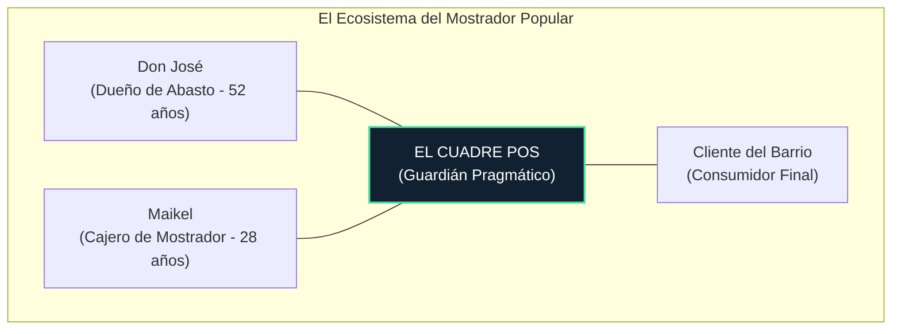
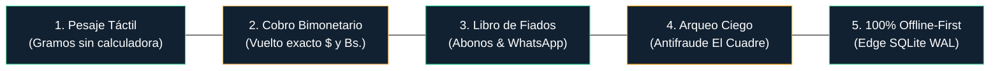
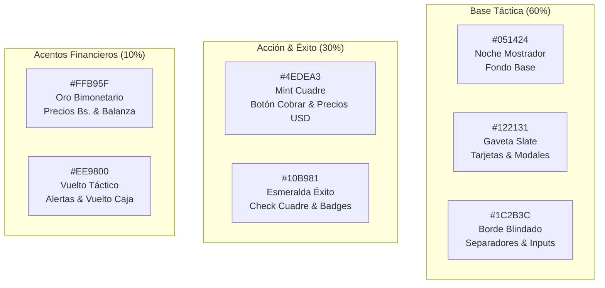

# 🎨 Brand Brief Profesional & Manual de Marca Ejecutivo
## **EL CUADRE POS — Sistema Punto de Venta**
### *"Caja, Peso & Finanzas Todo Cuadraíto"*

```
       ██████╗ ███████╗    ██████╗██╗   ██╗ █████╗ ██████╗ ██████╗ ███████╗
       ██╔══██╗██╔════╝   ██╔════╝██║   ██║██╔══██╗██╔══██╗██╔══██╗██╔════╝
   ─── ██████╔╝███████╗   ██║     ██║   ██║███████║██║  ██║██████╔╝█████╗  ───
       ██╔═══╝ ╚════██║   ██║     ██║   ██║██╔══██║██║  ██║██╔══██╗██╔══╝  
       ██║     ███████║██╗╚██████╗╚██████╔╝██║  ██║██████╔╝██║  ██║███████╗
       ╚═╝     ╚══════╝╚═╝ ╚═════╝ ╚═════╝ ╚═╝  ╚═╝╚═════╝ ╚═╝  ╚═╝╚══════╝
                     [ P U N T O   D E   V E N T A ]
```

---

## 📑 Índice General

1. [Resumen Ejecutivo & ADN de Marca](#1-resumen-ejecutivo--adn-de-marca)
2. [Buyer Persona & Contexto Operativo de Mostrador](#2-buyer-persona--contexto-operativo-de-mostrador)
3. [Propuesta de Valor Única (UVP) y Pilares Maestros](#3-propuesta-de-valor-única-uvp-y-pilares-maestros)
4. [Identidad Visual & Sistema de Diseño (Sai Specs)](#4-identidad-visual--sistema-de-diseño-sai-specs)
5. [Ecosistema Cromático Oficial & Certificación WCAG 2.1 AAA](#5-ecosistema-cromático-oficial--certificación-wcag-21-aaa)
6. [Arquitectura Tipográfica & Jerarquías de Lectura](#6-arquitectura-tipográfica--jerarquías-de-lectura)
7. [Voz, Tono & Glosario Criollo de Mostrador (Zetsu Specs)](#7-voz-tono--glosario-criollo-de-mostrador-zetsu-specs)
8. [Guía de Impresión Térmica ESC-POS (58mm / 80mm)](#8-guía-de-impresión-térmica-esc-pos-58mm--80mm)
9. [Gobernanza de Marca & Matriz de Aplicaciones](#9-gobernanza-de-marca--matriz-de-aplicaciones)

---

## 🏛️ 1. Resumen Ejecutivo & ADN de Marca

### 📌 Datos Generales de la Marca
- **Nombre Oficial**: **EL CUADRE POS — Sistema Punto de Venta**
- **Nombre Corto**: **EL CUADRE POS**
- **Descriptor de Marca**: **Sistema Punto de Venta**
- **Slogan Oficial**: *"Caja, Peso & Finanzas Todo Cuadraíto"*
- **Categoría**: Software POS Local Edge / Retail Tecnológico para Mercados Populares y Comercios de Proximidad.

### 🎯 La Misión de la Marca
Erradicar el caos nocturno, la fuga de capital por robo hormiga y la vulnerabilidad operativa de los pequeños y medianos comerciantes populares (abastos, bodegas, fruterías, carnicerías, panaderías y charcuterías). Transformamos la libreta manchada de fiados y la calculadora física en un terminal táctil veloz, bimonetario y 100% resistente a fallas eléctricas y cortes de internet.

### 🔭 La Visión de la Marca
Convertirse en el estándar indiscutible de tecnología de punto de venta popular en Venezuela y América Latina, siendo reconocido como el aliado indispensable que devolvió la dignidad, la precisión contable y las horas de descanso familiar al comerciante de mostrador.

### 🕊️ Territorio Emocional: "La Paz Mental del Comerciante"
El comerciante popular vive en un estado constante de alerta: sospecha de faltantes, miedo a caídas de luz, discusiones por vuelto en divisas y deudas de vecinos que se evaporan en cuadernos rotos. **EL CUADRE POS** no vende software; vende **Paz Mental**. Significa cerrar la santamaría a las 8:00 PM, hacer el arqueo en 90 segundos con exactitud al céntimo, y cenar con la familia sabiendo que cada gramo despachado y cada centavo en caja están perfectamente cuadrados.

### 🛡️ Arquetipo de Marca: "El Guardián Pragmático"
- **Carácter**: Firme, honesto, incorruptible, criollo, leal y sin rodeos corporativos.
- **Actitud**: Cuida los centavos como si fueran propios. No usa terminología importada ("checkout", "churn", "funnel"); habla en *"kilos"*, *"gramos"*, *"tara"*, *"vuelto"*, *"fiado"* y *"cuadre perfecto"*.
- **Posicionamiento**: El escudo protector del dueño de negocio contra el desorden, la inflación y la desconfianza.

---

## 👥 2. Buyer Persona & Contexto Operativo de Mostrador



### 👤 Perfil A: Don José (52 años) — Dueño de Abasto "La Fe"
- **Demografía**: Comerciante con 24 años de trayectoria en el barrio. Dedica 14 horas diarias (6:30 AM a 8:30 PM). Su capital es el sustento de su hogar.
- **Tecnología**: Utiliza WhatsApp en un smartphone Android de gama media; desconfía de la nube ("si se va el internet me quedo en la calle") y de los sistemas bancarios lentos.
- **Puntos de Dolor Críticos**:
  1. **Robos hormiga y descuadres de caja**: Al final del día faltan $15 o $30 y el cajero dice que "no sabe qué pasó".
  2. **La Libreta de Fiados**: Páginas grasientas, tachones y cuentas vencidas que los clientes niegan haber adquirido.
  3. **Vulnerabilidad de Conexión**: Cortes continuos de internet y apagones que paralizan los sistemas POS tradicionales web.
  4. **Billetes deteriorados y crisis de sencillo**: Clientes pagando con billetes rayados de $20 para compras de $3.50.
- **Su Recompensa con EL CUADRE POS**: Arqueo ciego en 2 minutos sin trampas, control del fiado con respaldo digital y tranquilidad al acostarse.

### 👤 Perfil B: Maikel (28 años) — Cajero de Mostrador
- **Demografía**: Joven diligente y rápido con el teléfono, encargado del peso y la caja en el turno de mayor afluencia (4:00 PM a 8:00 PM).
- **Puntos de Dolor Críticos**:
  1. **Colas interminables y clientes desesperados**: En hora pico, tener que pesar 350 g de jamón, 1.2 kg de harina de maíz y 4 plátanos calculando mentalmente a tasa oficial en bolívares.
  2. **El dilema del vuelto mixto**: Calcular cuánto dar en billetes de dólar y cuánto en bolívares en efectivo o pago móvil sin equivocarse.
  3. **Miedo al castigo por descuadre**: La incertidumbre de si la caja cuadró o si tendrá que poner dinero de su bolsillo por un error aritmético.
- **Su Recompensa con EL CUADRE POS**: Botones gigantes táctiles de selección rápida, pesaje automático directo y desglose automático de vuelto en pantalla.

---

## ⚡ 3. Propuesta de Valor Única (UVP) y Pilares Maestros

> ### **Propuesta de Valor Única (UVP)**:
> *"El único terminal de punto de venta táctil criollo que pesa en gramos sin calculadora, cobra en dólares y bolívares con vuelto exacto, gestiona fiados por WhatsApp y cuadra la caja a ciegas, 100% blindado contra caídas de internet."*

### 🏛️ Los 5 Pilares Maestros



#### ⚖️ Pilar 1: Pesaje Táctil en Gramos/Kilos sin Calculadora
- Interfaz táctil ergonómica para seleccionar productos a granel (charcutería, víveres, hortalizas).
- Integración automática de tara y conversión inmediata entre gramos, kilos y unidades.
- Multiplicación en tiempo real de `Peso x Precio Unitario = Total USD / Total Bs.` con cero latencia y sin márgenes de error manual.

#### 💵 Pilar 2: Cobro Bimonetario con Vuelto Táctico Automático
- Manejo simultáneo de Efectivo USD, Efectivo Bs, Pago Móvil, Tarjeta de Débito y Vales.
- Conversión a tasa oficial en tiempo real fijada por el negocio.
- **Algoritmo de Vuelto Inteligente**: Sugiere al cajero la combinación óptima de billetes en dólares y bolívares según la disponibilidad declarada en gaveta, erradicando los "redondeos a pérdida".

#### 📖 Pilar 3: Libro de Fiados Digital con Abonos y WhatsApp
- Digitalización total de la tradicional libreta de mostrador.
- Ficha de crédito por cliente con límite financiero y validación de estado moroso.
- Registro instantáneo de abonos parciales y emisión del comprobante directo al chat de WhatsApp del cliente con un solo clic.

#### 🛡️ Pilar 4: Arqueo Ciego Antifraude ("El Cuadre")
- Protocolo de seguridad donde el cajero no conoce el saldo del sistema antes de contar.
- El cajero introduce la cantidad física de billetes y monedas que tiene en la gaveta.
- El sistema contrasta y genera el reporte confidencial: **Sobrante**, **Faltante** o **¡Cuadre Perfecto!**, notificando al dueño por canal seguro.

#### 🔋 Pilar 5: 100% Offline-First Local Edge (SQLite WAL)
- Arquitectura descentralizada: no depende de conexión a internet para emitir tickets, pesar productos o registrar ventas.
- Base de datos embebida con Write-Ahead Logging (WAL) inmune a apagones repentinos y fluctuaciones eléctricas.
- Sincronización asíncrona en segundo plano cuando la conectividad se restablece.

---

## 🎨 4. Identidad Visual & Sistema de Diseño (Sai Specs)

### 🧩 Anatomía del Isotipo Oficial: Monograma "C" + Check Esmeralda
Diseñado bajo los preceptos del Chōjū Giga visual moderno: vectores matemáticamente puros, sin pesos innecesarios, legibles tanto en un favicon de 16px como en una valla publicitaria o un ticket térmico de 203 DPI.

```
       ┌────────────────────────┐
       │   ╔════════════════╗   │     EL CUADRE [POS]
       │   ║   ██████████   ║   │     SISTEMA PUNTO DE VENTA
       │   ║  ██╔════════╝  ║   │     
       │   ║  ██║   ██      ║   │     [ Check Esmeralda #4EDEA3 ]
       │   ║  ██║  ██║      ║   │     [ Marco 'C' Blindado #10B981 ]
       │   ║  ██╚══██║      ║   │     [ Badge Monospace [POS] ]
       │   ╚════════════════╝   │
       └────────────────────────┘
```

### 📐 Código SVG Oficial del Isotipo (Render Puro sin Dependencias)

```xml
<svg xmlns="http://www.w3.org/2000/svg" viewBox="0 0 120 120" width="120" height="120" fill="none">
  <!-- Fondo Gaveta Noche -->
  <rect width="120" height="120" rx="28" fill="#051424" stroke="#1C2B3C" stroke-width="4"/>
  <!-- Marco 'C' Cuadre -->
  <path d="M78 30 H42 C33.1634 30 26 37.1634 26 46 V74 C26 82.8366 33.1634 90 42 90 H78" 
        stroke="#10B981" stroke-width="12" stroke-linecap="round" stroke-linejoin="round"/>
  <!-- Check Esmeralda Central del Cuadre -->
  <path d="M46 60 L58 72 L88 42" 
        stroke="#4EDEA3" stroke-width="10" stroke-linecap="round" stroke-linejoin="round"/>
</svg>
```

### 🏷️ Badge Oficial de la Marca: `[POS]`
- **Composición**: Contenedor tipo píldora / cápsula con bordes redondeados (`rx: 4px`), fondo `#1C2B3C`, borde `#10B981` y texto monospaced en blanco `#FFFFFF`.
- **Propósito**: Denota robustez de ingeniería de terminal de punto de venta, diferenciándolo de simples calculadoras o apps de finanzas personales.

---

## 🌈 5. Ecosistema Cromático Oficial & Certificación WCAG 2.1 AAA

Nuestra paleta fue calculada rigurosamente para ofrecer máximo descanso ocular a cajeros en turnos de 12 horas bajo iluminación fluorescente, cumpliendo los más exigentes estándares de accesibilidad **WCAG 2.1 nivel AAA** sobre el fondo operativo `#051424`.



### 📊 Especificación Numérica & Certificación de Contraste

| Token de Diseño | Valor HEX | RGB | HSL | CMYK (Impresión) | Ratio Contraste (s/ `#051424`) | Nivel WCAG 2.1 | Uso Operativo en el Sistema |
| :--- | :---: | :---: | :---: | :---: | :---: | :---: | :--- |
| **Noche Mostrador** | `#051424` | `rgb(5, 20, 36)` | `hsl(211°, 76%, 8%)` | `86, 44, 0, 86` | — (Base) | Base | Fondo principal oscuro, descanso visual para jornadas de 12h. |
| **Gaveta Slate** | `#122131` | `rgb(18, 33, 49)` | `hsl(211°, 46%, 13%)` | `63, 33, 0, 81` | 1.34:1 | Superficie | Contenedor de productos, tarjetas de catálogo y modales. |
| **Borde Blindado** | `#1C2B3C` | `rgb(28, 43, 60)` | `hsl(212°, 36%, 17%)` | `53, 28, 0, 76` | 1.82:1 | Borde | Delimitador de campos táctiles, teclados y divisores. |
| **Mint Cuadre** | `#4EDEA3` | `rgb(78, 222, 163)`| `hsl(155°, 69%, 59%)` | `65, 0, 27, 13` | **10.87:1** | **AAA ✅** | Botón gigante de "Cobrar", totales en USD y confirmaciones. |
| **Esmeralda Éxito** | `#10B981` | `rgb(16, 185, 129)`| `hsl(160°, 84%, 39%)` | `91, 0, 30, 27` | **7.31:1** | **AAA ✅** | Badge [POS], check de cuadre perfecto y abonos completados. |
| **Oro Bimonetario** | `#FFB95F` | `rgb(255, 185, 95)`| `hsl(34°, 100%, 69%)` | `0, 27, 63, 0` | **10.92:1** | **AAA ✅** | Montos en Bolívares (Bs.), tasas de cambio y visor balanza. |
| **Vuelto Táctico** | `#EE9800` | `rgb(238, 152, 0)` | `hsl(38°, 100%, 47%)` | `0, 36, 100, 7` | **8.06:1** | **AAA ✅** | Visor de vuelto pendiente en caja, alertas y advertencias. |
| **Blanco Nítido** | `#FFFFFF` | `rgb(255, 255, 255)`| `hsl(0°, 0%, 100%)` | `0, 0, 0, 0` | **18.55:1** | **AAA ✅** | Nombre del negocio, títulos de ticket y dígitos de peso. |
| **Pizarra Suave** | `#94A3B8` | `rgb(148, 163, 184)`| `hsl(215°, 20%, 65%)` | `20, 11, 0, 28` | **7.24:1** | **AAA ✅** | Textos secundarios, etiquetas de fecha/hora y SKU de ítems. |

---

## 🔤 6. Arquitectura Tipográfica & Jerarquías de Lectura

En un entorno de mostrador real (con reflejos de luz solar en el vidrio, manos del cajero con harina o grasa y clientes a metro y medio de distancia), la tipografía es un factor de seguridad operativa:

### 1. Tipografía Primaria: **Inter** (Google Fonts)
- **Titulares Principales y Logotipo**: `Inter Black (900)` con tracking negativo (`-0.02em`) para transmitir solidez estructural y confianza financiera.
- **Botones y Badges Táctiles**: `Inter Bold (700)` en mayúsculas sostenidas (`uppercase`) con interletrado espaciado (`+0.05em`) para facilitar el toque certero en pantallas táctiles de 10" o 15".
- **Cuerpo de Texto y Formularios**: `Inter Medium (500)` y `Inter Regular (400)`.

### 2. Tipografía Numérica & Terminal: **Consolas / JetBrains Mono**
- Aplicada sin excepción en:
  - **Visor de Balanza Digital**: `1.450 Kg` / `Tara: 0.015 Kg`.
  - **Desglose de Totales Bimonetarios**: `$14.50 USD` | `Bs. 717.75`.
  - **Impresión Térmica ESC-POS**: Monospace estricto para perfecta alineación de columnas numéricas sin desviaciones de tabulación.

---

## 🗣️ 7. Voz, Tono & Glosario Criollo de Mostrador (Zetsu Specs)

### ✍️ Manual de Estilo de Redacción
- **Regla 1: Claridad de Mostrador**: Prohibido el lenguaje informático abstracto.
  - ❌ *"Se ha ejecutado la mutación contable en el ledger"* ➔ ✅ *"Venta registrada y guardada en caja"*.
  - ❌ *"Checkout finalizado con éxito"* ➔ ✅ *"Cobro completado. Gaveta abierta"*.
  - ❌ *"Procesando balance de pasivos"* ➔ ✅ *"Consultando cuenta del fiado"*.
- **Regla 2: Firmeza con Respeto**: El sistema es honesto, neutro y seguro. Al emitir un arqueo con faltante no juzga al cajero, sino que expone el dato matemático frío para que el dueño decida.

### 📚 Glosario Criollo del Negocio (Términos Maestros)

| Término | Definición Técnica y Operativa en EL CUADRE POS |
| :--- | :--- |
| **El Cuadre** | El evento sagrado de cierre de turno donde el dinero físico contado en gaveta debe coincidir al centavo con el balance del sistema. |
| **Arqueo Ciego** | Modo de cierre en el cual la pantalla no le muestra al cajero cuánto dinero debería tener; el cajero debe contar y declarar primero billete por billete. |
| **Gaveta** | El cajón metálico portamonedas y billetes con compartimentos para dólares y bolívares, abierto automáticamente mediante pulso eléctrico (RJ11). |
| **Fiado** | Venta a crédito de confianza otorgada a clientes frecuentes del vecindario, registrada bajo un límite de crédito preestablecido. |
| **Abono** | Pago parcial en efectivo o transferencia que reduce el saldo adeudado en la ficha de fiado de un cliente. |
| **Merma** | Pérdida registrada por merma de peso natural, deshidratación de víveres o productos averiados que se descuenta del inventario sin registrar cobro. |
| **Tara** | El peso del empaque, bolsa plástica, envase o papel parafinado que la balanza descuenta automáticamente para no cobrarle al cliente el peso del contenedor. |
| **Vuelto** | El excedente exacto devuelto al cliente tras un pago superior al monto de la compra, desglosado en dólares y/o bolívares según preferencia y existencia. |

---

## 🖨️ 8. Guía de Impresión Térmica ESC-POS (58mm / 80mm)

Los tickets térmicos son el documento legal y de confianza que el cliente se lleva a casa. Deben ser compactos, perfectamente legibles y resistentes a cabezales térmicos económicos de 203 DPI.

### 📏 Especificaciones Técnicas de Formato

```
   [TICKET 58 mm]                               [TICKET 80 mm]
   Ancho: 384 puntos (32 caracteres / línea)    Ancho: 576 puntos (48 caracteres / línea)
   Comando de Corte: GS V 66 0                  Comando de Corte: GS V 66 0
   Pulso Gaveta: ESC p 0 25 250                 Pulso Gaveta: ESC p 0 25 250
```

### 🧾 Plantilla Oficial de Ticket Térmico Bimonetario (80 mm)

```text
================================================
                 EL CUADRE POS                  
         SISTEMA DE PUNTO DE VENTA EDGE         
               RIF: J-50123984-2                
           ABASTO Y CHARCUTERIA LA FE           
     Calle Comercio Local #14, Sector Centro    
================================================
TICKET: #008492                     CAJA: 01
FECHA: 25/10/2026 18:35:12          TURNO: Tarde
CAJERO: Maikel R.                   ESTADO: PAGADO
------------------------------------------------
CANT./PESO  DESCRIPCION             TOTAL USD
------------------------------------------------
0.450 Kg    Queso Duro Llanero         $2.34
            ($5.20/Kg)
1.250 Kg    Tomate Perita              $2.25
            ($1.80/Kg)
2   UN      Harina PAN Tradicional     $2.50
            ($1.25/UN)
0.320 Kg    Jamon de Pierna Ahumado    $2.88
            ($9.00/Kg)
------------------------------------------------
SUBTOTAL:                              $9.97
EXENTO / IGTF:                         $0.00
TOTAL A PAGAR (USD):                   $9.97
TASA OFICIAL BCV:                  Bs. 49.50
TOTAL A PAGAR (BS):               Bs. 493.52
------------------------------------------------
DESGLOSE DE PAGO:
  * EFECTIVO USD:                     $10.00
  * TOTAL RECIBIDO:                   $10.00
------------------------------------------------
VUELTO ENTREGADO:
  * EN DOLARES:                        $0.00
  * EN BOLIVARES (Bs.):              Bs. 1.48
================================================
             ¡CAJA CUADRADA CON EXITO!          
    Conserve este ticket como comprobante       
      Software Operativo por EL CUADRE POS      
================================================
```

---

## 🛡️ 9. Gobernanza de Marca & Matriz de Aplicaciones

### 🚫 Usos Prohibidos Expresos (Leyes de Marca)
1. **Nunca cambiar los colores del Check central**: El check debe ser `#4EDEA3` o `#10B981` (o negro puro en impresión monocroma). Jamás debe utilizarse en rojo, amarillo o azul.
2. **Nunca deformar el Isotipo**: Mantener siempre la relación de aspecto 1:1.
3. **Nunca usar tipografías manuscritas o con serifa**: La marca representa certeza de ingeniería matemática, no caligrafía artística decorativa.
4. **Nunca esconder los montos bimonetarios**: Siempre mostrar en paralelo la cifra en Dólares y su equivalencia en Bolívares.

### 📁 Directorio de Archivos y Repositorios Oficiales

| Recurso | Tipo | Ubicación en el Sistema |
| :--- | :---: | :--- |
| **Brand Brief Oficial (Raíz Proyecto)** | Markdown | [BRAND_BRIEF.md](file:///C:/Users/vmont/OneDrive/Desktop/el-cuadre-pos/docs/BRAND_BRIEF.md) |
| **Brand Brief Ejecutivo (Wiki Akatsuki)** | Markdown | [el-cuadre-pos-brand-brief-ejecutivo.md](file:///c:/Users/vmont/OneDrive/Desktop/2brain-vmontoya/wiki/proyectos/el-cuadre-pos-brand-brief-ejecutivo.md) |
| **Manual de Identidad & Brand Book** | Markdown | [BRAND_BOOK.md](file:///C:/Users/vmont/OneDrive/Desktop/el-cuadre-pos/docs/BRAND_BOOK.md) |
| **Showcase Interactivo de Marca** | HTML | [BRAND_SHOWCASE.html](file:///C:/Users/vmont/OneDrive/Desktop/el-cuadre-pos/docs/BRAND_SHOWCASE.html) |
| **Vector Isotipo Principal Dark** | SVG | [logo_el_cuadre_dark.svg](file:///c:/Users/vmont/OneDrive/Desktop/2brain-vmontoya/wiki/proyectos/assets/logo_el_cuadre_dark.svg) |
| **Vector Isotipo Monocromo Térmico** | SVG | [logo_el_cuadre_mono_black.svg](file:///c:/Users/vmont/OneDrive/Desktop/2brain-vmontoya/wiki/proyectos/assets/logo_el_cuadre_mono_black.svg) |

---

> *"Las cuentas claras conservan las amistades, pero un cuadre perfecto custodia la tranquilidad de toda una familia."*  
> **— Akatsuki Design & Documentation Core (Sai & Zetsu)**
