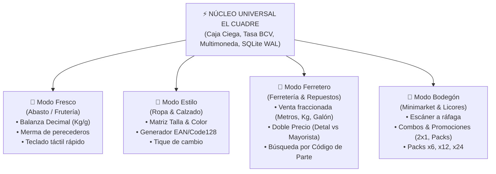

# 📋 EL CUADRE POS — Plan de Arquitectura & Sprints Multimodo
**Arquitecto & Project Manager**: ☁️ Pain (Tendō) — Scrum Master de Akatsuki  
**Validación Ejecutiva**: 🤵 ALFRED  
**Aprobación Suprema**: 👑 El Señor  

---

## 🏛️ 1. Filosofía Arquitectónica: Un Solo Núcleo, Múltiples Giros Comerciales

Para evitar bifurcar el código en sistemas separados, implementamos un **Patrón de Arquitectura Modular por Perfiles de Negocio (`BusinessTypeEngine`)**.

### El Núcleo Universal (Común a Todos los Modos):
1. **Cobro Bimonetario ($ / Bs)** a Tasa Oficial BCV con atajos en efectivo, Pago Móvil y Tarjeta.
2. **Arqueo Ciego Antifraude**: Conteo físico obligatorio sin visibilidad del saldo teórico.
3. **100% Offline-First**: Motor SQLite WAL embebido en NestJS y compilación estática Next.js.
4. **Libro de Fiados**: Registro de clientes habituales y control de cuentas por cobrar.

---

## 🎯 2. Definición de los 3 Nuevos Modos de Negocio



---

## 📋 3. Desglose de Historias de Usuario (Sintaxis Gherkin & Story Points)

### 👗 US-15: Matriz de Variantes (Talla & Color) y Generador de Etiquetas con Código de Barras
- **Como**: Dueño o encargado de una tienda de ropa o zapatería.
- **Quiero**: Crear un producto matriz (ej. *Zapato Deportivo Casual*) y desglosarlo en combinaciones de tallas (37 a 44) y colores (Negro, Blanco, Azul), además de generar e imprimir sus etiquetas de código de barras.
- **Para**: Controlar con precisión qué número de calzado o prenda se vendió y agilizar el cobro mediante escáner óptico.

#### Criterios de Aceptación (Gherkin):
```gherkin
Escenario: Creación de Producto con Variantes de Talla y Color
  Dado que el administrador está en el módulo de Inventario en 'Modo Estilo'
  Cuando registra un producto "Zapato Deportivo" y marca las tallas [38, 39, 40] y colores [Negro, Blanco]
  Entonces el sistema genera 6 SKUs hijos automáticos con stock y código de barras único para cada uno
  Y permite imprimir una hoja de etiquetas adhesivas con código Code128 en la impresora común o térmica.

Escenario: Venta con Lector de Código de Barras en Mostrador
  Dado que un cliente lleva una franela Talla M color Azul
  Cuando el cajero escanea la etiqueta en el POS
  Entonces el sistema añade exactamente "Franela Básica - Talla M / Azul" al carrito
  Y descuenta 1 unidad del inventario específico de esa variante.
```
- **Story Points**: 8 SP
- **Prioridad**: 2 (Alta)
- **Ninjas Asignados**: 🖤 Kakuzu (Modelo `ProductVariant`), 👁️ Itachi (UI de Matriz), 🎨 Sai (Plantilla SVG de Etiquetas).

---

### 🔧 US-16: Venta Fraccionada (Metros/Galones) y Doble Lista de Precios (Detal vs Mayorista)
- **Como**: Encargado de una ferretería o venta de repuestos.
- **Quiero**: Vender artículos fraccionados por metros, kilos o fracciones de galón, y aplicar automáticamente precios especiales para contratistas o maestros de obra.
- **Para**: No perder dinero redondeando cortes de cable o alambre y fidelizar a clientes mayoristas.

#### Criterios de Aceptación (Gherkin):
```gherkin
Escenario: Venta Fraccionada de Cable Eléctrico
  Dado un producto "Cable THW Nro 12" con unidad de medida "METRO" y precio de $0.85/metro
  Cuando el cajero digita "14.5" metros en el POS
  Entonces el sistema calcula exactamente $12.33 (o su equivalente en Bs a tasa BCV)
  Y descuenta 14.5 metros del rollo en el inventario.

Escenario: Aplicación de Tarifa Mayorista / Contratista
  Dado que un contratista registrado realiza una compra en la ferretería
  Cuando el cajero selecciona el perfil de cliente "Mayorista / Maestro de Obra"
  Entonces todos los artículos del ticket cambian automáticamente a la columna 'Precio Mayorista'
  Y el ticket impreso refleja el ahorro total obtenido.
```
- **Story Points**: 8 SP
- **Prioridad**: 2 (Alta)
- **Ninjas Asignados**: 🖤 Kakuzu (Lógica de Unidades y Tier Pricing), 👁️ Itachi (Selector de Medida en POS), 💀 Hidan (Tests de Redondeo).

---

### ⚙️ US-17: Selector de Giro Comercial (Setup Wizard & Perfiles de Negocio)
- **Como**: Dueño que instala EL CUADRE POS por primera vez.
- **Quiero**: Un asistente inicial de 3 pasos donde elija el rubro de mi negocio (Frutería, Tienda de Ropa, Ferretería o Minimarket).
- **Para**: Que la pantalla táctil y el inventario se configuren automáticamente con las funciones exactas de mi sector sin opciones que me estorben.

#### Criterios de Aceptación (Gherkin):
```gherkin
Escenario: Configuración Inicial de Tienda de Ropa
  Dado que el usuario inicia el sistema por primera vez
  Cuando selecciona el perfil "👗 Tienda de Ropa & Calzado"
  Entonces se oculta la balanza decimal de frutas
  Y se activan los botones de Tallas, Colores y Generador de Etiquetas.

Escenario: Cambio de Giro Comercial en Ajustes
  Dado que el Administrador accede a la configuración del sistema
  Cuando cambia el giro comercial a "🔧 Ferretería & Materiales"
  Entonces se habilitan las unidades fraccionadas (Metros/Kg/Litros) y listas de precios múltiples sin borrar los datos existentes.
```
- **Story Points**: 5 SP
- **Prioridad**: 2 (Alta)
- **Ninjas Asignados**: 🦋 Konan (Flujo Wizard Stitch), 👁️ Itachi (Engine de Vistas Dinámicas).

---

### 🍷 US-18: Motor de Combos, Packs y Promociones por Volumen (Modo Minimarket & Bodegón)
- **Como**: Dueño de un bodegón o minimarket.
- **Quiero**: Crear promociones tipo combo (ej. *Combo Parrillero: 2 Refrescos + 1 Carbón + 1 Paquete de Salchichas*) o precios por docena/six-pack.
- **Para**: Despachar promociones en un solo clic y descontar los ingredientes individuales del stock.

#### Criterios de Aceptación (Gherkin):
```gherkin
Escenario: Venta de un Combo Promocional
  Dado un combo configurado "Combo Fin de Semana" a un precio cerrado de $15.00
  Cuando el cajero agrega el combo al ticket
  Entonces se cobra el precio promocional único
  Y el inventario descuenta automáticamente cada uno de los productos que integran el combo.
```
- **Story Points**: 5 SP
- **Prioridad**: 3 (Normal)
- **Ninjas Asignados**: 🖤 Kakuzu (Mapeo de ComboItems) & 👁️ Itachi (UI de Combos Rápidos).

---

## ⏱️ 4. Estimación del Sprint Multimodo (Backlog V2.0)

| Tarea | Descripción | Responsable | Story Points | Tiempo Estimado |
| :--- | :--- | :--- | :---: | :---: |
| **US-17** | Setup Wizard & Selector de Giro Comercial | 🦋 Konan & 👁️ Itachi | **5 SP** | 2 días |
| **US-15** | Matriz Talla/Color & Etiquetas de Barra (Moda) | 🖤 Kakuzu & 👁️ Itachi | **8 SP** | 3 días |
| **US-16** | Venta Fraccionada & Doble Tarifa (Ferretería) | 🖤 Kakuzu & 💀 Hidan | **8 SP** | 3 días |
| **US-18** | Motor de Combos & Promociones (Bodegones) | 🖤 Kakuzu & 👁️ Itachi | **5 SP** | 2 días |
| **Total** | **Sprint Multimodo Completo** | **Equipo Akatsuki** | **26 SP** | **10 días hábiles** |

---

## 🛡️ 5. Blindaje con el Arnés de Calidad Akatsuki
Cada nueva vista y componente de estos modos deberá someterse obligatoriamente al arnés:
- `npm run harness` en Frontend (Cero violaciones de hooks, cero layouts duplicados).
- `npm test` en Backend (>85% de pruebas unitarias Jest para redondeos de metros y variantes).
- `next build` 100% libre de advertencias.
