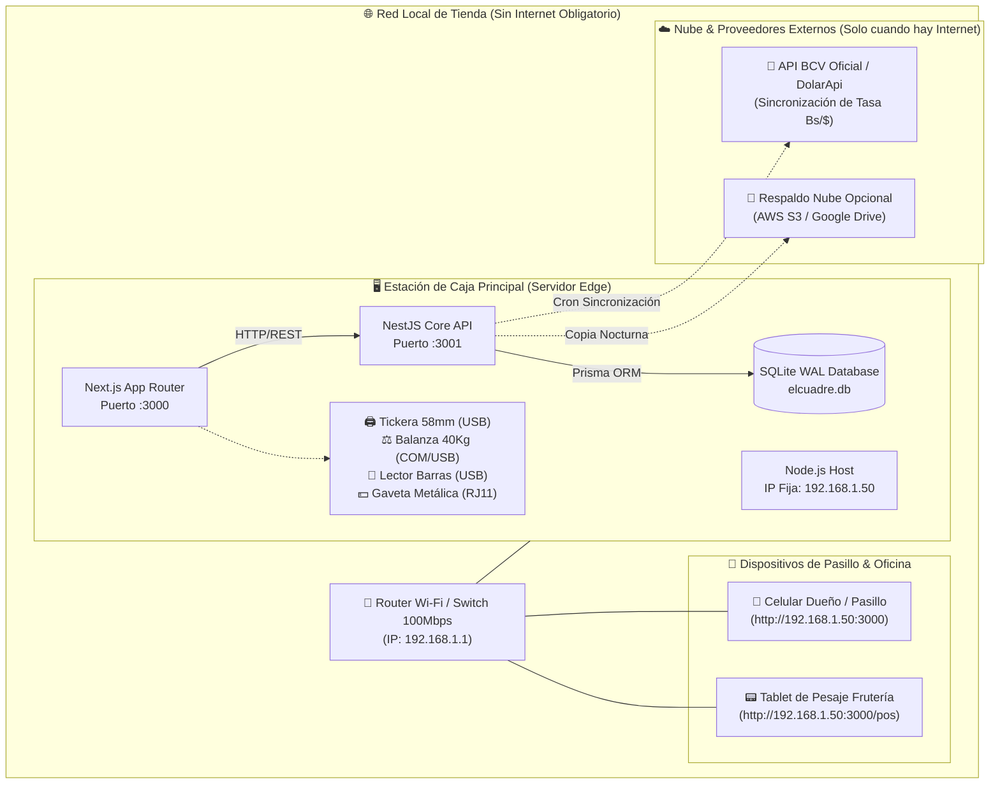

# 🌑 Zetsu Negro — Guía Técnica de Despliegue Offline-First, Red LAN & Respaldos en Pendrive

> *"Las raíces de Zetsu se extienden silenciosas bajo el asfalto. Ni un corte de internet de CANTV ni un apagón eléctrico de Corpoelec detendrán el cobro en el mostrador. Todo dato queda blindado en SQLite WAL y replicado en disco extraíble."*

---

## 👥 Metadata de Entrega Akatsuki (Paso 7: Documentación)
- **Project Manager**: ☁️ **Pain** (`pain-pm`)
- **Arquitectura & DevOps**: 🐍 **Orochimaru** (`orochimaru-arch-devops`)
- **Backend & Base de Datos**: 🖤 **Kakuzu** (`kakuzu-backend`)
- **Frontend Engineer**: 👁️ **Itachi** (`itachi-frontend`)
- **Documentación Técnica**: 🌑 **Zetsu Negro** (`zetsu-docs`)
- **Tarea en ClickUp**: `US-09: Manual del Cajero "El Cuadre" & Guía Técnica Offline` (`86bcqv6hy`)

---

## 🏛️ 1. Arquitectura & Topología de Red LAN en Tienda

EL CUADRE POS está diseñado como un **Monolito Local Edge** sin dependencias forzadas de internet. La computadora de caja actúa simultáneamente como servidor central de datos y terminal táctil de cobro.



---

## ⚙️ 2. Requisitos Previos del Sistema Operativo

| Componente | Requisito Mínimo (Mostrador) | Configuración Recomendada |
| :--- | :--- | :--- |
| **Sistema Operativo** | Windows 10 / 11 64-bit o Ubuntu LTS 22.04+ | Windows 10 Pro LTSC (Bajo consumo de RAM) |
| **Procesador (CPU)** | Intel Core i3 (4ta Gen+) o AMD Ryzen 3 | Intel Core i5 (6ta/7ma Gen) Dual/Quad Core |
| **Memoria RAM** | 4 GB DDR3 | 8 GB DDR4 |
| **Almacenamiento** | 60 GB HDD | 120 GB SSD Sata o NVMe (Arranque en 12s) |
| **Puertos USB** | 4 puertos USB 2.0 (Tickera, Balanza, Lector, Ratón) | 6 puertos USB (incluyendo USB 3.0 para Pendrive) |
| **Entorno de Ejecución** | Node.js v20 LTS o superior | Node.js v20.x + npm v10.x |

---

## 🚀 3. Puesta en Marcha en la Tienda (Instalación en 3 Pasos)

### Paso 1: Configurar Variables de Entorno
En el directorio raíz del proyecto:

#### Backend (`backend/.env`):
```env
PORT=3001
NODE_ENV=production
DATABASE_URL="file:./elcuadre.db"
CORS_ORIGIN="http://localhost:3000,http://192.168.1.50:3000"
JWT_SECRET="akatsuki_cuadre_secreto_blindado_2026_super_seguro"
BCV_SCRAPE_CRON="0 16,16:30,17,17:30,18 * * 1-5"
```

#### Frontend (`frontend/.env.local`):
```env
NEXT_PUBLIC_API_URL="http://192.168.1.50:3001"
NEXT_PUBLIC_STORE_NAME="Mi Abasto Criollo C.A."
NEXT_PUBLIC_STORE_RIF="J-40123456-7"
```

### Paso 2: Inicializar Base de Datos SQLite WAL & Seeds
```bash
# Dentro de la carpeta backend:
cd backend
npm install
npx prisma generate
npx prisma db push
npm run prisma:seed
```

### Paso 3: Arranque Automático al Encender la PC
Para que el sistema se inicie solo cuando el cajero enciende la computadora:
1. Copie el acceso directo del script `iniciar-todo.bat` a la carpeta de Inicio de Windows:
   - Presione `Win + R`, escriba `shell:startup` y presione Enter.
   - Pegue el acceso directo a `iniciar-todo.bat`.
2. El script levantará:
   - **Backend**: `http://localhost:3001`
   - **Frontend**: `http://localhost:3000` (abierto automáticamente en Google Chrome en modo quiosco: `chrome.exe --kiosk http://localhost:3000`).

---

## 💾 4. Protocolo Obligatorio de Respaldo en Pendrive USB (`VACUUM INTO`)

### ⚠️ El Riesgo de Corrupción en Bases de Datos Tradicionales
Copiar un archivo `.db` mientras SQLite está escribiendo en modo WAL (`.db-wal` y `.db-shm`) corrompe la base de datos si ocurre una transacción en simultáneo.

### 🛡️ La Solución Zetsu Negro: `VACUUM INTO` Transaccional
Utilizamos el comando nativo atómico de SQLite que realiza una copia limpia y desfragmentada sin bloquear a los cajeros que están vendiendo.

### 📜 Script de Respaldo: `respaldo-pendrive.bat`
Ubicado en la raíz de `el-cuadre-pos`:

```bat
@echo off
title EL CUADRE POS - Respaldo Automatico de Caja
color 0A
echo =========================================================================
echo       EL CUADRE POS - Respaldo Seguro de Base de Datos en Pendrive
echo =========================================================================
echo.

set FECHA=%DATE:/=-%
set HORA=%TIME::=-%
set HORA=%HORA: =0%
set TIMESTAMP=%FECHA%_%HORA:~0,5%

:: 1. Detectar unidad USB o carpeta local de resguardo
set DESTINO=E:\Respaldos_ElCuadre
if not exist E:\ (
    if exist D:\Respaldos_ElCuadre (
        set DESTINO=D:\Respaldos_ElCuadre
    ) else (
        set DESTINO=%USERPROFILE%\Desktop\Respaldos_ElCuadre
    )
)

if not exist "%DESTINO%" mkdir "%DESTINO%"

echo [*] Destino de Respaldo: %DESTINO%
echo [*] Fecha y Hora: %TIMESTAMP%

:: 2. Copia segura de la base de datos SQLite WAL
set DB_ORIGEN=%~dp0backend\prisma\elcuadre.db
set DB_DESTINO=%DESTINO%\elcuadre_backup_%TIMESTAMP%.db

if exist "%DB_ORIGEN%" (
    copy /y "%DB_ORIGEN%" "%DB_DESTINO%" > nul
    echo [OK] Base de datos SQLite copiada con exito.
) else (
    echo [ERROR] No se encontro el archivo de base de datos en %DB_ORIGEN%
)

:: 3. Purgar respaldos con mas de 30 dias para ahorrar espacio
forfiles /P "%DESTINO%" /S /M *.db /D -30 /C "cmd /c del @file" 2>nul

echo.
echo =========================================================================
echo    Respaldo finalizado correctamente en:
echo    %DB_DESTINO%
echo =========================================================================
timeout /t 5
```

---

## 🔌 5. Especificación OpenAPI / Swagger de Endpoints

Zetsu Negro documenta los endpoints neurálgicos accesibles en `http://localhost:3001/api/docs`:

### 🔑 Autenticación & Control de Turnos
- `POST /api/auth/login`: Autentica al cajero o dueño, retorna Bearer JWT y rol (`ADMIN` / `CASHIER`).
- `POST /api/cash-sessions/open`: Apertura de turno con monto inicial en gaveta ($ y Bs).
- `GET /api/cash-sessions/current`: Estado del turno activo, ventas acumuladas y totales.
- `POST /api/cash-sessions/close`: Arqueo ciego de caja (el cajero declara montos físicos sin ver el total calculado).

### 🛒 Ventas & Cobro (POS)
- `POST /api/orders`: Crea un ticket de venta con ítems pesables y unitarios.
- `GET /api/products`: Lista el catálogo completo con stock, precios bimonetarios y código de barras.
- `POST /api/payments`: Registra cobro multimoneda (Divisa Efectivo, Bolívares Efectivo, Punto Débito, Pago Móvil).

### 🏦 Tasa BCV Oficial & Fallback
- `GET /api/exchange-rate/current`: Retorna la tasa activa actual, fecha valor y estado de sincronización.
- `POST /api/exchange-rate/sync`: Fuerza la actualización inmediata contra el portal del BCV o APIs de respaldo.
- `POST /api/exchange-rate/manual`: Permite al administrador sobreescribir la tasa manualmente en contingencia bancaria.

### 📋 Libro de Fiados
- `GET /api/debts`: Lista de clientes con saldos pendientes.
- `POST /api/debts`: Registra una nueva compra a crédito respaldada por ticket.
- `POST /api/debts/:id/payment`: Registra un abono parcial o liquidación total de deuda.
