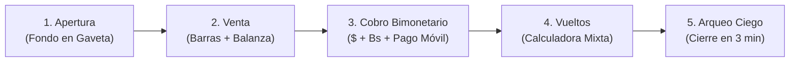

# ⚪ Zetsu Blanco — Manual del Cajero & Guía Operativa del Mostrador ("El Cuadre")

> *"Bienvenido al mostrador más rápido y seguro de Venezuela. Con este manual dominarás el sistema en menos de 3 minutos: abrirás tu turno, pesarás tomates y queso con exactitud milimétrica, cobrarás en dólares y Pago Móvil, y cerrarás tu caja con Cuadre Perfecto sin estrés ni dolores de cabeza."*

---

## 👥 Resumen del Módulo & Responsables
- **Módulo**: Operación de Caja, Pesaje y Arqueo Ciego
- **Destinatarios**: Cajeros, Despachadores y Dueños de Tienda (Abastos, Fruterías, Bodegas y Minimarkets)
- **Autor Funcional**: ⚪ **Zetsu Blanco** (`zetsu-docs`)
- **Aprobación de Flujo**: ☁️ **Pain** (`pain-pm`) & 👑 **El Señor**

---

## ⏱️ Guía Rápida en 5 Pasos: De la Santamaría al Cuadre Nocturno

---

## 🟢 Paso 1: Apertura de Turno (Inicio de Jornada)

1. **Encender la PC**: Al encender la computadora, el sistema **EL CUADRE POS** se abrirá automáticamente en la pantalla principal.
2. **Identificación del Cajero**:
   - Ingrese su PIN de 4 dígitos o seleccione su nombre de la lista de operadores.
3. **Declaración del Fondo Inicial de Caja**:
   - Cuente el dinero base que le entrega el dueño para dar vueltos.
   - Ingrese el monto en **Dólares en efectivo** (ej. `$20.00 USD`) y en **Bolívares en efectivo** (ej. `Bs. 1.250,00`).
4. **Verificación de la Tasa BCV**:
   - Mire la esquina superior derecha de la pantalla: el indicador debe estar en **🟢 Tasa BCV Oficial**.
   - Presione **"Abrir Turno"**. La gaveta se abrirá un instante y el punto quedará listo para facturar.

> [!TIP]
> **Consejo del Zetsu Blanco**: Si la tienda no tiene internet al abrir, el sistema utilizará automáticamente la última tasa oficial guardada sin bloquear la venta. No te preocupes por la conexión.

---

## 🛒 Paso 2: Agregar Productos al Carrito

En el mostrador criollo conviven dos tipos de productos. El sistema los maneja con fluidez:

### A. Productos Empacados (Víveres con Código de Barras)
* **Arroz, Harina P.A.N., Aceite, Refrescos, Enlatados:**
  1. Pase el producto por el lector láser.
  2. El sistema emitirá un *bip* y agregará automáticamente 1 unidad al ticket.
  3. Si el cliente lleva 3 paquetes iguales, pulse dos veces más sobre la tarjeta en pantalla o digite `3 * [Código]`.

### B. Productos a Granel por Peso (Frutería, Charcutería y Verduras)
* **Tomates, Cebollas, Plátanos, Queso Llanero, Jamón:**
  1. Coloque el producto sobre la **Balanza Digital**.
  2. Toque en la pantalla la foto o el botón grande del producto (ej. **"Tomate Perita"**).
  3. **Tara Automática**: El sistema descuenta el peso de la bolsa plástica y calcula el precio exacto al gramo en pantalla tanto en **USD ($)** como en **Bolívares (Bs.)**.
  4. Presione **"Agregar al Ticket"**.

> [!IMPORTANT]
> **Regla de Oro contra la Pérdida en Balanza**: Nunca redondees el peso "a ojo". El sistema calcula los decimales exactos. Si el cliente pide *"medio kilo de queso"*, el sistema multiplicará los `0.520 Kg` exactos por el precio por kilo, protegiendo las ganancias de la tienda.

---

## 💳 Paso 3: Cobro Multimoneda ($ / Bs / Pago Móvil)

Cuando el cliente termine de elegir, presione el botón verde gigante **"COBRAR (F12)"**. Se desplegará la pantalla de cobro bimonetario:

### 1. Cobro en Dólares en Efectivo ($ USD)
- Ingrese el valor del billete recibido (ej. `$20 USD`).
- Verifique siempre la autenticidad del billete (hilo de seguridad y relieve).
- El sistema calculará al instante cuánto resta por pagar o cuánto debe entregar de vuelto.

### 2. Cobro con Pago Móvil
- El cliente transfiere a los datos de la tienda reflejados en pantalla (Banco, RIF y Teléfono).
- El cajero solicita al cliente los **últimos 4 dígitos de la referencia** y el **banco emisor** (ej. *Banesco Ref: 8942*).
- Presione **"Confirmar Pago Móvil"**.

### 3. Cobro con Tarjeta de Débito (Punto de Venta Bancario)
- Pase la tarjeta por el terminal bancario físico.
- Al salir el comprobante del punto, marque en pantalla la opción **"Punto Débito"** e introduzca el número de lote/aprobación.

---

## 💱 Paso 4: Vueltos Mixtos Inteligentes (Sin Complicaciones)

En Venezuela es común que un cliente pague con un billete de **$10 USD** una cuenta de **$6.20 USD**, requiriendo un vuelto de **$3.80 USD**.

**¿Cómo lo resuelve EL CUADRE POS?**
1. La calculadora de vuelto le muestra las opciones automáticas:
   - *Opción A*: Dar `$3.00 USD` en billetes verdes + el equivalente de `$0.80 USD` en Bolívares en efectivo o Pago Móvil.
   - *Opción B*: Dar el 100% del vuelto en Bolívares en efectivo a la tasa del día.
2. Al pulsar **"Finalizar Venta"**, la tickera térmica imprimirá el recibo de compra en papel 58mm y la gaveta se abrirá automáticamente para guardar el dinero.

---

## 📒 Paso 5: Libro de Fiados (Cuentas por Cobrar a Vecinos)

Si el cliente es de confianza y solicita fiar:
1. En la pantalla de cobro, presione el botón amarillo **"Fiar / Cuentas por Cobrar"**.
2. Busque al cliente por su nombre o cédula.
3. El sistema verificará su **Límite de Crédito** aprobado por el dueño.
4. Presione **"Autorizar Fiado"**. La venta se registrará, el inventario se descontará y la deuda quedará anotada en el perfil del cliente con fecha y hora.

---

## 🔒 Paso 6: Cierre de Turno & Arqueo Ciego Antifraude

Al terminar su jornada laboral (antes de entregar la caja al siguiente turno o de bajar la santamaría):

1. Presione el botón **"Cerrar Turno (Arqueo)"** en el menú superior.
2. **El Arqueo Ciego**:
   - La pantalla **NO** le dirá cuánto dinero debería haber en gaveta. Esto previene tentaciones o cuadres ficticios.
   - El cajero cuenta físicamente y declara lo que tiene en las manos:
     * Cantidad de billetes de $20, $10, $5, $1 USD.
     * Total de Bolívares en efectivo (Bs.).
     * Total de comprobantes de Punto de Venta.
3. Presione **"Confirmar y Cerrar Caja"**.
4. El sistema generará el **Reporte Z de Cierre**:
   - Compara lo declarado por el cajero contra las ventas registradas.
   - Si la diferencia es de **$0.00**, emitirá la insignia:
     `🟢 CUADRE PERFECTO: Gaveta 100% Balanceada`.
   - Si existe una diferencia, quedará registrada en el historial del dueño para su revisión en privado.

---

## ❓ Preguntas Frecuentes del Cajero (FAQ)

### 1. ¿Qué hago si se va el internet en la tienda?
El sistema sigue funcionando con total normalidad. Toda la base de datos corre dentro de la PC de la tienda. Puedes seguir pesando, vendiendo, cobrando en divisas y registrando pagos móviles. Al regresar el internet, el sistema sincronizará la tasa del BCV sin reiniciar nada.

### 2. ¿Qué hago si se va la luz (apagón)?
Si la tienda cuenta con el Mini-UPS recomendado, la PC o Mini PC se mantendrá encendida durante el corte. Si se apaga la PC, al regresar la energía eléctrica enciéndala y el sistema restaurará la sesión activa sin pérdida de ventas ni de inventario.

### 3. ¿Cómo saco un respaldo de la base de datos al cerrar?
Conecte un pendrive en el puerto USB de la computadora y haga doble clic en el ícono del escritorio **"Respaldar El Cuadre"**. En 3 segundos su información quedará salvaguardada.
