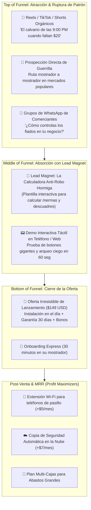

# 🎭 Plan Go-To-Market (GTM), Embudos Kamui & Copywriting Tsukuyomi: EL CUADRE POS

**Líder de Marketing & Growth**: 🎭 Tobi / Obito Uchiha (`tobi-marketing`)  
**Coordinación Ejecutiva**: 🤵 ALFRED  
**Supervisión Suprema**: 👑 El Señor  
**Proyecto**: **EL CUADRE POS** (Sistema de Punto de Venta Local-First para Kioskos, Abastos & Fruterías Criollas)  
**Entorno de Código**: `C:\Users\vmont\OneDrive\Desktop\el-cuadre-pos`  
**Lista en ClickUp**: [📊 EL CUADRE POS (ID: 901422611886)](https://app.clickup.com/90141555783/v/li/901422611886)

> *"El software más rápido y blindado de la Tierra no genera un solo centavo si el comerciante sigue anotando fiados en un cartón de huevos sucio. Con el Kamui absorberemos a la competencia y con el Tsukuyomi verán en EL CUADRE la salvación de su negocio."* — **Tobi**

---

## 🎯 1. Radiografía del Avatar: El Comerciante Criollo

### 👤 Perfil del Comprador (Buyer Persona)
- **Nombre arquetípico**: Don Manuel / Doña Carmen.
- **Tipo de negocio**: Abasto de víveres, minimarket de barrio, frutería, charcutería o kiosko popular.
- **Entorno operativo**: Mostrador estrecho, humedad o polvo, cortes eléctricos imprevistos, caídas continuas de Cantv/Fibra, clientela apurada en horas pico (11:30 AM y 6:00 PM).

### 🩸 Dolores Críticos (Puntos de Dolor Sangrantes)
1. **El Infierno de las 9:00 PM**: Quedarse hasta dos horas después de bajar la santamaría cuadrando billetes sucios de $1 y $5, bolívares en efectivo, lotes de puntos de venta y capturas de Pago Móvil que nunca coinciden.
2. **El "Robo Hormiga" en Gaveta**: Sospecha constante de que los empleados meten la mano en la caja, regalan vueltos o alteran las cantidades al cobrar.
3. **El Libro de Fiados en Cuadernos Manchados**: Cuentas por cobrar acumuladas en cuadernos desgastados donde se borran los números, clientes que dicen *"yo no me llevé ese aceite"* y cientos de dólares evaporados al mes.
4. **La Balanza que Regala Plata**: Empleados que cobran a ojo o no descuentan la tara de la bolsa en tomates, queso o plátanos, perdiendo entre 5% y 8% de margen por kilo.
5. **Pánico a los Sistemas en la Nube**: Miedo atroz a comprar un sistema que dependa de internet y los deje paralizados cuando se corte la luz o la conexión.

---

## 💎 2. La Oferta Irresistible de $100M (Fórmula Hormozi)

Para volver irracional la decisión de decir *"NO"*, estructuramos la propuesta bajo la **Ecuación de Valor**:

$$\text{Valor Percibido} = \frac{\text{Resultado Soñado (Dream Outcome)} \times \text{Certeza de Éxito (Perceived Likelihood)}}{\text{Demora de Tiempo (Time Delay)} \times \text{Esfuerzo y Sacrificio (Effort \& Sacrifice)}}$$

### 🏆 El Gran Paquete: *"Sistema Blindado El Cuadre Ciego"*

| Componente | Valor Real Percibido | Lo que Recibe el Comerciante |
| :--- | :---: | :--- |
| **Núcleo EL CUADRE POS** | $250 USD | Licencia vitalicia del servidor Local Edge (Next.js + NestJS + SQLite WAL) que jamás se cuelga sin internet. |
| **Módulo Arqueo Ciego Antifraude** | $120 USD | Algoritmo que impide al cajero ver el saldo esperado; elimina 100% de robos hormiga en gaveta. |
| **Libro de Fiados Digital & Cobranza** | $100 USD | Ficha digital por cliente con límite de crédito, balance acumulado y recordatorios automáticos por WhatsApp. |
| **Bono 1: Catálogo Criollo Precargado** | $80 USD | Más de 350 productos típicos venezolanos ya cargados con fotos, categorías, peso y códigos de barra. |
| **Bono 2: Protocolo Balanza Rápida** | $60 USD | Configuración directa con balanzas USB/Serial o botones táctiles rápidos (1/4 Kg, 1/2 Kg, 1 Kg, 2 Kg). |
| **Bono 3: Instalación & Puesta en Marcha VIP** | $70 USD | Acompañamiento presencial o remoto en 30 minutos sin formatear su computadora. |
| **VALOR TOTAL DEL PAQUETE** | **$680 USD** | |
| **PRECIO DE LANZAMIENTO OFICIAL** | **$149 USD** (Pago Único) o **$19.99 USD/mes** (Plan SaaS Local) | |

### 🛡️ Garantía Kamui de Reversión Total de Riesgo (Risk Reversal)
> **"Garantía El Cuadre Perfecto de 30 Días":**  
> *"Instala EL CUADRE POS hoy en tu mostrador. Si en los primeros 30 días no ahorras al menos 1 hora diaria en tu cierre de caja o descubres que no eliminó tus descuadres, te devolvemos el 100% de tu dinero de inmediato. Además, te dejamos la base de datos con todos tus clientes y productos cargados como disculpa por hacerte perder el tiempo."*

---

## 🌪️ 3. El Embudo Kamui (Arquitectura de Conversión de Tráfico)



---

## 👁️ 4. Copywriting Hipnótico Tsukuyomi (Piezas Listas para Producción)

### 📄 Pieza 1: Hero Section de la Landing Page (Fórmula PAS)

```markdown
# ¿Sigues cerrando tu abasto a las 9:30 PM porque la caja NUNCA te cuadra?

### Descubre el primer sistema de punto de venta venezolano que funciona SIN INTERNET, elimina el robo hormiga con Arqueo Ciego y te permite irte a cenar con tu familia a las 8:05 PM con la caja cuadrada al centavo.

[ 🔴 QUIERO PROBAR EL CUADRE EN MI MOSTRADOR HOY MISMO ]
*Instalación en 30 minutos. Cero riesgo: 30 días de garantía o te devolvemos tu dinero.*

---
✓ Funciona 100% Offline (aunque se caiga Cantv, Fibra o la luz).
✓ Balanza digital y venta por peso en 2 toques (Kg / gramos).
✓ Control estricto de fiados por cliente con límite de crédito.
✓ Arqueo Ciego: El cajero no ve el saldo; se acabaron las "desapariciones" de plata.
```

---

### 🎙️ Pieza 2: Script de Venta Mostrador a Mostrador (Pitch de 60 Segundos)

*El asesor comercial ingresa al negocio en hora valle (2:30 PM), saluda al dueño por su nombre y sostiene una tableta o teléfono mostrando la pantalla táctil de EL CUADRE POS:*

> **Asesor**: *"Buenas tardes, Don Manuel. No vengo a quitarle tiempo ni a venderle un sistema complicado de oficina. Vengo a hacerle una sola pregunta: ¿Cuánto tiempo tardó anoche cuadrando los dólares en efectivo, los bolívares y el punto de venta?"*  
>  
> **Comerciante**: *"Uf, como hora y media, mi pana. Entre los fiados y el lote del punto casi siempre me faltan $5 o $10."*  
>  
> **Asesor**: *"Exactamente por eso estamos aquí. Mire esta pantalla. Esto es EL CUADRE. Funciona en su misma computadora, sin internet. Cuando llega la noche, su cajero presiona aquí: 'CERRAR CAJA'. El cajero cuenta sus billetes y sus vouchers, los anota, y el sistema le dice a usted exactamente si cuadró o si hubo trampa, sin que el cajero sepa cuánto debía haber.*  
>  
> *Le propongo algo: déjeme instalárselo en 15 minutos en su máquina como prueba gratuita por 7 días. Si el viernes no cuadró su caja en menos de 5 minutos, me lo llevo y no me debe un solo bolívar. ¿A qué hora le queda mejor que se lo deje instalado, ahorita o a las 4?"*

---

### 📲 Pieza 3: Secuencia de WhatsApp para Cobranza de Fiados (Para los Clientes de EL CUADRE)

*Plantilla precargada en el sistema para que el comerciante envíe a sus clientes morosos con un solo toque:*

> *"¡Hola [Nombre]! Te saludamos desde [Nombre del Abasto]. 🛒  
> Esperamos que estés muy bien. Te escribimos para recordarte que tu saldo pendiente en el Libro de Fiados es de **$[Monto] USD** (o **Bs [MontoBs]** a la tasa del día).  
>  
> Puedes pasar hoy por el mostrador a abonar en efectivo, punto o hacernos un Pago Móvil a este número:  
> 🏦 Banco: [Banco] | 📱 Cédula: [CI] | 📞 Teléfono: [Teléfono]  
>  
> ¡Gracias por tu confianza de siempre!"*

---

## 🗓️ 5. Cronograma Go-To-Market (GTM) en 3 Fases

### 🚀 Fase 1: Batallón Beta & Prueba Social (Días 1 a 7)
- Selección de **5 negocios piloto** en mercados populares o calles comerciales de alto tráfico.
- Instalación bonificada al 100% a cambio de:
  1. Feedback directo sobre velocidad de botones y pesaje.
  2. Video testimonio grabado en el mostrador: *"Antes cerraba a las 10 PM, ahora con El Cuadre cierro en 3 minutos y sé dónde está cada centavo"*.

### ⚡ Fase 2: Campaña "Semana del Cierre Perfecto" (Días 8 a 15)
- Lanzamiento de anuncios geolocalizados en Instagram/TikTok dirigidos a dueños de negocios en un radio de 10 Km.
- Despliegue de folletos con código QR táctico entregados en mayoristas y mercados de víveres (donde compran los dueños de abastos a las 6:00 AM).
- Oferta relámpago con el kit de bonos criollos para los primeros 25 compradores.

### 📈 Fase 3: Escalado y Programa de Afiliados "Padrino del Mercado" (Días 16 a 30)
- Todo comerciante que recomiende EL CUADRE POS a otro colega del mercado recibe **$30 USD en efectivo** o **2 meses gratis** de soporte y copias en la nube.
- Activación del plan de suscripción mensual para terminales adicionales (teléfonos de pasillo con Kisame y tablets de charcutería).

---

## ☁️ Integración con Tareas en ClickUp (Pain & Tobi)

Para ejecutar esta estrategia con disciplina militar, se agregan al backlog de **EL CUADRE POS** en ClickUp:

1. `🎭 MKT-01`: Creación de Landing Page oficial de alta conversión en Next.js (con Itachi y Konan).
2. `🎭 MKT-02`: Maquetación de la Guía descargable "Calculadora Anti-Robo Hormiga" en PDF.
3. `🎭 MKT-03`: Producción de 5 videos cortos de ruptura de patrón para TikTok/Reels sobre el calvario del cierre de caja.
4. `🎭 MKT-04`: Campaña de prospección directa de mostrador a mostrador en los primeros 10 comercios beta.
