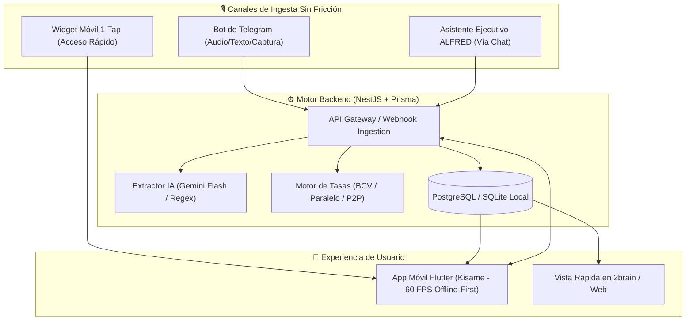

# 🚀 Proyecto: Flujo Cero (Zero-Friction Cashflow)

> *"El mejor sistema financiero no es el que te pide registrar cada centavo, sino el que sabe de antemano lo que vas a gastar y solo te consulta lo extraordinario."*

---

## 🎯 1. Visión y Propósito del Proyecto

**Flujo Cero** es un ecosistema financiero personal y familiar diseñado para la realidad de **Don Víctor Montoya** y el contexto multimoneda (USD, VES, USDT), orientado a **eliminar al 100% la fricción del registro diario** de gastos e ingresos.

Nace a partir de la deconstrucción y benchmarking con **Chekea (Cheqea)** mediante el protocolo **REA (Reverse Engineer Anything)** documentado en [[analisis-rea-chekea-control-financiero-sin-friccion|Análisis REA: Chekea vs. Control Financiero Sin Fricción]].

### 💥 El Problema Resuelto
Las aplicaciones existentes fracasan porque obligan al usuario a actuar como un contador manual frente a una pantalla. Flujo Cero adopta el modelo **Proyectado vs. Ejecutado**:
1. **El 70% de las finanzas son fijas y predecibles:** Sueldos fijos, alquiler, diezmo, internet, pediatra, servicios básicos. **El sistema los pre-calcula automáticamente el día 1 y 15 de cada mes.**
2. **El 30% restante es dinámico:** Ingresos variables (freelance, software) y gastos dinámicos (repuestos, salidas, compras extraordinarias).
3. **Registro sin abrir la app:** Ingesta por audio de 3 segundos o reenvío de SMS bancario / Pago Móvil mediante **Bot de Telegram/WhatsApp** o dictado directo a **ALFRED**.

---

## 🏗️ 2. Arquitectura del Sistema (Pipeline Akatsuki)



### 👥 Asignación de Roles Akatsuki:
* ☁️ **Pain (Tendō)**: Planificación de épicas, historias de usuario en Gherkin y sincronización en ClickUp.
* 🐍 **Orochimaru**: Arquitectura modular Clean Architecture / Event-Driven y despliegue en Docker.
* 🖤 **Kakuzu**: Modelado de base de datos multimoneda (USD, VES, USDT) con Prisma y endpoints REST.
* 🦈 **Kisame Hoshigaki**: App móvil multiplataforma en **Flutter & Dart**, con SQLite local (offline-first).
* 🦋 **Konan** & 🎨 **Sai**: Diseño UI/UX minimalista: vista enfocada en una sola métrica protagonista: **"Margen Libre Disponible Quincenal"**.
* 💀 **Hidan**: Tests unitarios de cálculo contable y conversión cambiaria con cobertura > 85%.
* 🔒 **Deidara & Sasori**: Blindaje de webhooks, cifrado de datos financieros y control de accesos.
* 🤵 **ALFRED**: Integración con el Bot de Telegram existente y asistente de consulta diaria.

---

## 📊 3. Modelo de Datos Núcleo (Especificación Inicial)

```prisma
enum Frecuencia {
  MENSUAL
  QUINCENAL
  SEMANAL
  UNICO
}

enum TipoMovimiento {
  INGRESO_FIJO
  INGRESO_VARIABLE
  GASTO_FIJO
  GASTO_VARIABLE
}

model ReglaRecurrente {
  id          String         @id @default(uuid())
  concepto    String
  montoBase   Decimal
  moneda      String         // USD, VES, USDT
  tipo        TipoMovimiento
  frecuencia  Frecuencia
  diaEjecucion Int           // 1, 15, etc.
  categoria   String         // Vivienda, Servicios, Diezmo, Salud, etc.
  activo      Boolean        @default(true)
}

model MovimientoReal {
  id          String         @id @default(uuid())
  concepto    String
  monto       Decimal
  moneda      String         // USD, VES, USDT
  tasaCambio  Decimal        // Tasa del día respecto a USD
  tipo        TipoMovimiento
  fecha       DateTime       @default(now())
  origen      String         // "telegram_bot", "mobile_widget", "alfred", "manual"
  comprobante String?        // Texto del SMS o ref del pago móvil
  reglaId     String?
}
```

---

## 📈 4. Roadmap de Fases de Ejecución

1. **Fase 1 (MVP Inmediato - Bot de Telegram & Lógica Básica):**
   - Configurar en el script existente del bot de Telegram (`scripts/telegram_bot.py`) un comando o procesamiento NLP para recibir audios/textos de gastos.
   - Registro en archivo estructurado o base de datos SQLite local de gastos variables.
2. **Fase 2 (Backend Robusto NestJS & Multimoneda):**
   - Microservicio con Prisma + PostgreSQL.
   - Sincronización automática de tasa BCV del día.
3. **Fase 3 (App Móvil Flutter):**
   - App móvil con widgets de pantalla de inicio para inserción en 1 toque.
   - Modo "Cuadre Quincenal" (1 solo botón para marcar todos los fijos pagados).
4. **Fase 4 (Empaquetado Micro-SaaS B2B):**
   - Evaluación comercial para ofrecer el bot a otros profesionales e independientes.

---

## 🔗 Enlaces Relacionados en el Segundo Cerebro
- 🔍 [[analisis-rea-chekea-control-financiero-sin-friccion|Informe de Reingeniería Inversa: Chekea (Cheqea)]]
- 📊 [[analisis-gastos-reales-cuaderno|Gastos Reales del Cuaderno & Diagnóstico Quincenal]]
- 💰 [[pilar-finanzas-personales|Pilar de Finanzas Personales]]
- 🗺️ [[index|Índice Maestro de la Wiki]]
