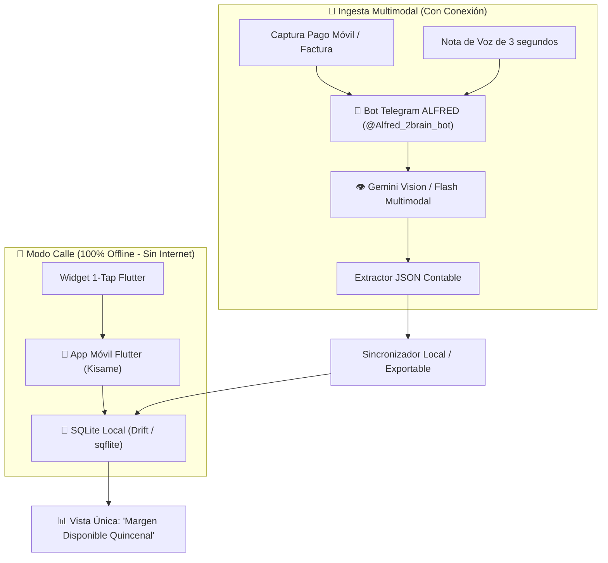

# 🚀 Proyecto: El Cuadre (Control Financiero Criollo & Sin Fricción)

> *"El mejor sistema financiero no es el que te pide registrar cada centavo, sino el que sabe de antemano lo que vas a gastar y solo te consulta lo extraordinario."*

**Nombre del Producto**: **El Cuadre**  
**Slogan Criollo**: *"Lleva tu flujo al día, sin rollos ni micro-management"*  
**Plataforma Base**: App Móvil Flutter (Ultra-ligera & 100% Offline-First) + Bot Multimodal Telegram (Gemini Vision OCR & Notas de Voz)  

---

## 🎯 1. Visión y Propósito del Proyecto

**El Cuadre** es un ecosistema financiero personal y familiar diseñado para la realidad de **Don Víctor Montoya** y el contexto multimoneda venezolano (USD, VES, USDT), orientado a **eliminar al 100% la fricción del registro diario** de gastos e ingresos.

Nace a partir de la deconstrucción y benchmarking con **Chekea (Cheqea)** mediante el protocolo **REA (Reverse Engineer Anything)** documentado en [[analisis-rea-chekea-control-financiero-sin-friccion|Análisis REA: Chekea vs. Control Financiero Sin Fricción]].

### 💥 El Problema Resuelto
Las aplicaciones existentes fracasan porque obligan al usuario a actuar como un cajero manual frente a una pantalla. El Cuadre adopta el modelo **Proyectado vs. Ejecutado**:
1. **El 70% de las finanzas son fijas y predecibles:** Sueldos fijos (Xetux, Pastoral), alquiler, diezmo, internet, pediatra, servicios básicos. **El sistema los pre-calcula automáticamente el día 1 y 15 de cada mes.** No se tipean a mano.
2. **El 30% restante es dinámico:** Ingresos variables (freelance, software) y gastos dinámicos (repuestos, salidas, compras extraordinarias).
3. **Registro sin abrir la app (Cero Tipeo):**
   - **Fotos / Capturas de Pago Móvil:** Reenvío del capture de pantalla (Banesco, BDV, Mercantil) al Bot de Telegram. Gemini Vision extrae monto, banco, referencia y concepto.
   - **Notas de Voz:** Audio de 3 segundos (*"Gasté 5$ en gasolina"*).
   - **Modo Móvil Offline (En la calle):** Widget de 1-Tap en Flutter para tipear un número en 2 segundos sin internet.

---

## 🏗️ 2. Arquitectura Técnica (Akatsuki Pipeline)



### 👥 Asignación de Responsabilidades Akatsuki:
* ☁️ **Pain (Tendō)**: Planificación de épicas, historias de usuario en Gherkin y backlog de sprints para la casa.
* 🦈 **Kisame Hoshigaki**: Construcción de la app móvil en **Flutter & Dart**, Clean Architecture, persistencia SQLite local a 60 FPS, sin lag ni dependencias pesadas.
* 🖤 **Kakuzu**: Integración del handler de imágenes (`photo`) en [`scripts/telegram_bot.py`](file:///c:/Users/vmontoyaMG/Desktop/2brain/scripts/telegram_bot.py) con Gemini Vision para parseo de comprobantes bancarios venezolanos.
* 🦋 **Konan** & 🎨 **Sai**: UI/UX ultra-minimalista Dark Mode. Una pantalla, una métrica protagonista: **"Margen Libre Disponible"** y selector rápido de quincena. Identidad y logotipo criollo por Sai.
* 💀 **Hidan**: Tests de cálculos multimoneda, redondeo y validación de tolerancia a fallos sin internet.

---

## 📋 3. Plan de Ejecución para la Computadora de la Casa

1. **En la PC de la Casa**:
   - Ejecutar `git pull origin master` para descargar esta especificación y la arquitectura base.
2. **Frente 1 (Bot Multimodal de Capturas)**:
   - Activar el handler `message.get("photo")` en `scripts/telegram_bot.py` para procesar comprobantes bancarios mediante Gemini Vision.
3. **Frente 2 (App Móvil Flutter)**:
   - Desplegar el proyecto base en Flutter (`apps/el_cuadre_mobile` o carpeta independiente) con arquitectura offline-first.


---

## 📊 3. Modelo de Datos Núcleo (Especificación Inicial)

```prisma
enum Frecuencia {
  MENSUAL
  QUINCENAL
  SEMANAL
  UNICO
}

enum TipoMovimiento {
  INGRESO_FIJO
  INGRESO_VARIABLE
  GASTO_FIJO
  GASTO_VARIABLE
}

model ReglaRecurrente {
  id          String         @id @default(uuid())
  concepto    String
  montoBase   Decimal
  moneda      String         // USD, VES, USDT
  tipo        TipoMovimiento
  frecuencia  Frecuencia
  diaEjecucion Int           // 1, 15, etc.
  categoria   String         // Vivienda, Servicios, Diezmo, Salud, etc.
  activo      Boolean        @default(true)
}

model MovimientoReal {
  id          String         @id @default(uuid())
  concepto    String
  monto       Decimal
  moneda      String         // USD, VES, USDT
  tasaCambio  Decimal        // Tasa del día respecto a USD
  tipo        TipoMovimiento
  fecha       DateTime       @default(now())
  origen      String         // "telegram_bot", "mobile_widget", "alfred", "manual"
  comprobante String?        // Texto del SMS o ref del pago móvil
  reglaId     String?
}
```

---

## 📈 4. Roadmap de Fases de Ejecución

1. **Fase 1 (MVP Inmediato - Bot de Telegram & Lógica Básica):**
   - Configurar en el script existente del bot de Telegram (`scripts/telegram_bot.py`) un comando o procesamiento NLP para recibir audios/textos de gastos.
   - Registro en archivo estructurado o base de datos SQLite local de gastos variables.
2. **Fase 2 (Backend Robusto NestJS & Multimoneda):**
   - Microservicio con Prisma + PostgreSQL.
   - Sincronización automática de tasa BCV del día.
3. **Fase 3 (App Móvil Flutter):**
   - App móvil con widgets de pantalla de inicio para inserción en 1 toque.
   - Modo "Cuadre Quincenal" (1 solo botón para marcar todos los fijos pagados).
4. **Fase 4 (Empaquetado Micro-SaaS B2B):**
   - Evaluación comercial para ofrecer el bot a otros profesionales e independientes.

---

## 🔗 Enlaces Relacionados en el Segundo Cerebro
- 🔍 [[analisis-rea-chekea-control-financiero-sin-friccion|Informe de Reingeniería Inversa: Chekea (Cheqea)]]
- 📊 [[analisis-gastos-reales-cuaderno|Gastos Reales del Cuaderno & Diagnóstico Quincenal]]
- 💰 [[pilar-finanzas-personales|Pilar de Finanzas Personales]]
- 🗺️ [[index|Índice Maestro de la Wiki]]
