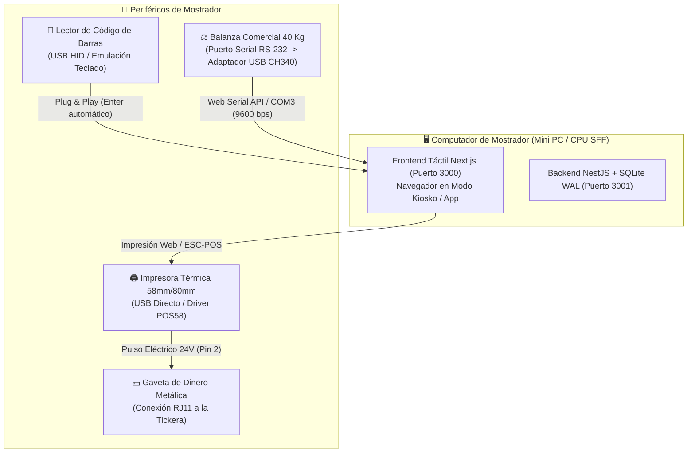

# 🛠️ Guía Oficial de Soporte Técnico: Configuración de Equipos & Periféricos
## EL CUADRE POS — Sistema de Punto de Venta Edge & Pesaje Comercial

**Documento Técnico de Soporte IT & Despliegue en Mostrador**  
**Proyecto**: EL CUADRE POS  
**Destinatario**: Equipo de Soporte Técnico IT & Programación  
**Versión**: 1.0 (Noviembre 2026)  
**Entorno Operativo**: Windows 10 / Windows 11 (64-bit)

---

## 📋 Índice General
1. [Visión General de la Arquitectura de Hardware](#1-visión-general-de-la-arquitectura-de-hardware)
2. [Configuración de Balanzas Digitales de Mostrador (USB / RS-232)](#2-configuración-de-balanzas-digitales-de-mostrador-usb--rs-232)
3. [Configuración de Impresoras Térmicas (58mm / 80mm) y Gaveta RJ11](#3-configuración-de-impresoras-térmicas-58mm--80mm-y-gaveta-rj11)
4. [Configuración de Lectores de Código de Barras USB](#4-configuración-de-lectores-de-código-de-barras-usb)
5. [Empaquetado y Modo Kiosko con "Doble Clic"](#5-empaquetado-y-modo-kiosko-con-doble-clic)
6. [Matriz Rápida de Resolución de Problemas (Troubleshooting en 60 Segundos)](#6-matriz-rápida-de-resolución-de-problemas-troubleshooting-en-60-segundos)

---

## 1. Visión General de la Arquitectura de Hardware

EL CUADRE POS está diseñado bajo la filosofía **Local-Edge & Zero-Cloud-Dependency**, comunicándose con los periféricos estándar más económicos y fiables del mercado comercial venezolano e hispanoamericano:



---

## 2. Configuración de Balanzas Digitales de Mostrador (USB / RS-232)

### 2.1 ¿Cómo se conectan físicamente las balanzas comerciales?
La mayoría de las balanzas comerciales de 40 kg (marcas **Camry, Roccia, American Boss, Torrey, Systel**):
1. Poseen en su chasis un puerto **Serial DB9 (RS-232)** hembra o macho.
2. Como las computadoras modernas carecen de puerto serial, se utiliza un **Cable Adaptador Convertidor USB a Serial RS-232** (con chip **WCH CH340** o **FTDI FT232R**).
3. Algunas balanzas más recientes vienen directamente con puerto USB tipo B, el cual internamente posee el mismo chip convertidor UART.

### 2.2 Instalación del Driver del Adaptador USB-Serial
1. Conecte el cable convertidor al puerto USB del computador.
2. Abra el **Administrador de Dispositivos** (`Win + X` -> *Administrador de dispositivos*).
3. Busque la sección **Puertos (COM y LPT)**:
   - Si aparece con signo de exclamación amarillo (`USB-Serial Controller`): Requiere instalar el driver del chip:
     - **Chip CH340 / CH341**: Descargar e instalar `CH341SER.EXE` (driver oficial del fabricante WCH).
     - **Chip FTDI**: Descargar e instalar *FTDI VCP (Virtual COM Port) Driver*.
     - **Chip Prolific PL2303**: Descargar e instalar el instalador oficial de Prolific.
4. Una vez reconocido, Windows asignará un nombre como:
   `USB-SERIAL CH340 (COM3)` o `COM4`.

### 2.3 Parámetros de Comunicación Estándar
En el Administrador de Dispositivos, haga clic derecho en el puerto `COM` -> **Propiedades** -> pestaña **Configuración de puerto**:
- **Bits por segundo (Baud Rate)**: `9600` (el 90% de las balanzas usan 9600; Torrey puede requerir 2400 o 4800).
- **Bits de datos**: `8`
- **Paridad**: `Ninguno` (None)
- **Bits de parada**: `1`
- **Control de flujo**: `Ninguno` (None)

### 2.4 Integración con el Sistema POS (Chromium Web Serial API)
EL CUADRE POS utiliza en el navegador la **Web Serial API** nativa de Chromium (Chrome / Edge):
1. En el módulo de venta del POS, al presionar el botón **⚖️ Conectar Balanza**:
2. El navegador mostrará una ventana flotante solicitando permiso para acceder al dispositivo serie:
   ```text
   elcuadre.local desea conectarse a un puerto serie:
   [ USB-SERIAL CH340 (COM3) ]  -> Seleccionar y presionar "Conectar"
   ```
3. El frontend abre el puerto serie a 9600 baudios y decodifica la trama continua.
4. **Formato de Trama Típico**:
   - `ST,GS,+001.450kg\r\n` (ST = Estable, GS = Peso Bruto, 1.450 kg).
   - El sistema extrae el número `1.450` y lo asigna inmediatamente a la cantidad del producto en pantalla.

---

## 3. Configuración de Impresoras Térmicas (58mm / 80mm) y Gaveta RJ11

### 3.1 Instalación de la Impresora Térmica USB
1. Conecte la tickera (ej: **Xprinter XP-58, POS-5890K, FRM-58**) al tomacorriente y al puerto USB del CPU.
2. Encienda la impresora con el rollo de papel térmico colocado (la cara brillante del papel debe mirar hacia el cabezal térmico).
3. **Instalación del Driver en Windows**:
   - **Opción Recomendada**: Instalar el driver oficial **POS-58 Driver** o **Xprinter Driver Setup**.
   - **Opción Alternativa (Driver Genérico de Windows)**:
     - Ir a *Configuración > Dispositivos > Impresoras y escáneres > Agregar impresora*.
     - Elegir *"La impresora deseada no está en la lista"*.
     - *"Agregar una impresora local con configuración manual"* > Puerto: `USB001` (Puerto de impresora virtual).
     - Fabricante: `Generic`, Modelo: `Generic / Text Only`.

### 3.2 Calibración de Márgenes y Hoja de Impresión
Para que el ticket salga nítido, sin cortes laterales y sin hojas en blanco:
1. Ir a *Panel de Control > Ver dispositivos e impresoras*.
2. Clic derecho en la tickera > **Propiedades de la impresora** > pestaña **Opciones avanzadas** > **Valores predeterminados de impresión**:
   - **Tamaño de Papel**: Seleccionar `58 x 210 mm` (o `80 x 297 mm` para tickeras de 80mm).
   - **Márgenes**: Ajustar a `0 mm` en los cuatro lados.
3. En el navegador (Google Chrome / Edge):
   - Al abrir el diálogo de impresión (`Ctrl + P`):
     - Destino: Seleccionar la tickera (ej: `POS-58`).
     - Márgenes: Elegir **Ninguno** (*None*).
     - Opciones: **Desmarcar** *"Encabezados y pies de página"* (Headers and footers) para no imprimir la URL ni la fecha del navegador.

### 3.3 Apertura Automática de la Gaveta de Dinero (Conexión RJ11)
La gaveta de dinero **no se conecta a la computadora**, se conecta a la **impresora térmica**:
1. Conecte el cable telefónico **RJ11** que sale de la gaveta al conector hembra posterior de la tickera (marcado habitualmente como `DK`, `Cash Drawer` o el icono de un cajón).
2. Para que la gaveta se abra automáticamente cada vez que se emite un ticket:
   - En Windows: *Propiedades de la impresora > Configuración del dispositivo (Device Settings)*.
   - Buscar la opción **Cash Drawer / Apertura de Gaveta**:
   - Configurar: **Open Before Printing** o **Open After Printing**.
   - Enviar un ticket de prueba: la tickera emitirá un pulso eléctrico de 24V por el pin 2 del cable RJ11, abriendo el pestillo metálico de la gaveta al instante.

---

## 4. Configuración de Lectores de Código de Barras USB

### 4.1 Principio Operativo
Los lectores de código de barras USB (pistolas láser o escáneres fijos de mostrador) operan bajo la norma **USB HID Keyboard Emulation** (Dispositivo de interfaz humana / Teclado):
- Son **100% Plug & Play**: no requieren instalación de drivers ni software adicional.
- Al escanear un código, transmiten los dígitos a la computadora como si una persona los estuviera tecleando a ultra alta velocidad.

### 4.2 Ajuste Crítico del Sufijo "Enter (CR / LF)"
Para que el cajero escanee un vívere y este se sume al carrito **sin tener que pulsar la tecla Enter ni tocar el ratón**:
1. El lector debe estar configurado para emitir un salto de línea (`Carriage Return + Line Feed`) al terminar de leer.
2. Abra el manual plegable de códigos de barras que viene en la caja del lector.
3. Escanee en secuencia los siguientes códigos del manual:
   1. `Start Configuration` / `Enter Setup`.
   2. `Add Suffix` / `Add CR (Enter)`.
   3. `Save & Exit`.
4. **Prueba rápida**: Abra el Bloc de Notas (`notepad`), escanee cualquier lata o paquete con código de barras: el número debe escribirse y el cursor debe saltar automáticamente al renglón de abajo.

---

## 5. Empaquetado y Modo Kiosko con "Doble Clic"

Para que el cajero o dueño del negocio no tenga que abrir consolas negras, ejecutar comandos de terminal ni ingresar URLs manualmente, se han creado los lanzadores automatizados de EL CUADRE POS:

### 5.1 Lanzador Kiosko Autónomo con Auto-Instalación (`iniciar-pos-kiosko.bat`)
Ubicado en la raíz del proyecto. Diseñado para funcionar en computadores nuevos o sin configurar:
1. **Auto-Detección y Auto-Instalación de Entorno (`scripts/preparar_entorno.ps1`)**:
   - Si **Node.js** no está en la máquina, lo descarga e instala de forma silenciosa y desatendida vía `winget` o MSI oficial.
   - Si faltan las dependencias (`node_modules`), las instala automáticamente (`npm install`).
   - Si falta la base de datos local SQLite o el build de NestJS, ejecuta las migraciones de Prisma y compila el backend.
2. Inicia el Backend NestJS (puerto 3001) y el Frontend Next.js (puerto 3000) en ventanas dedicadas.
3. Espera a que el puerto TCP 3000 confirme conexión activa.
4. Abre **Google Chrome** o **Microsoft Edge** en **Modo Aplicación Kiosko**:
   `chrome.exe --app=http://localhost:3000 --start-maximized`
   - Sin barra de direcciones ni pestañas.
   - Pantalla completa y apariencia nativa de software de caja.

### 5.2 Instalación del Acceso Directo en el Escritorio
Ejecute el script:
`instalar-acceso-directo.bat`
Este script genera automáticamente un acceso directo en el **Escritorio de Windows** con:
- Nombre: **EL CUADRE POS**
- Destino: Lanzador Kiosko automatizado
- Icono oficial corporativo

---

## 6. Matriz Rápida de Resolución de Problemas (Troubleshooting)

| Síntoma Observado | Causa Probable | Solución en 60 Segundos |
| :--- | :--- | :--- |
| **La balanza no transmite peso al POS** | Puerto COM desconectado o driver CH340 faltante. | 1. Verificar Administrador de Dispositivos > Puertos COM.<br>2. Si aparece error, reinstalar `CH341SER.EXE`.<br>3. En el POS, hacer clic en "Desconectar Balanza" y volver a presionar "Conectar Balanza", eligiendo el puerto COM correcto. |
| **El peso en pantalla muestra caracteres extraños (`???`, `$$$`)** | Velocidad de baudios (Baud Rate) incorrecta. | Cambiar el Baud Rate en el Administrador de Dispositivos de 9600 a 4800 o 2400 según el modelo de la balanza. |
| **La tickera imprime papel en blanco sin texto** | Rollo térmico colocado al revés. | Abrir la tapa de la tickera y voltear el rollo de papel (la cara sensible térmica debe estar contra el rodillo térmico). |
| **El ticket sale cortado o con letras gigantes** | Tamaño de papel configurado en Carta/A4 en lugar de 58mm. | En Propiedades de Impresión > Papel, seleccionar `58 x 210 mm` y márgenes en `0`. |
| **La gaveta de dinero no abre al cobrar** | Cable RJ11 desconectado o pin invertido. | Verificar que el cable RJ11 esté conectado firmemente al puerto posterior de la tickera. En Propiedades de la Impresora, verificar que la opción *"Apertura de gaveta antes de imprimir"* esté habilitada. |
| **El lector escanea pero no agrega el producto al carrito** | Falta el sufijo Enter automático. | Escanear el código `Add Suffix Enter / CR` en el manual del lector de código de barras. |
| **El sistema dice "No se puede conectar a la base de datos"** | El backend no ha terminado de levantar o el puerto 3001 está ocupado. | Cerrar las ventanas del servidor y volver a hacer doble clic en el acceso directo del escritorio. El script se encargará de purgar y reiniciar los puertos. |
