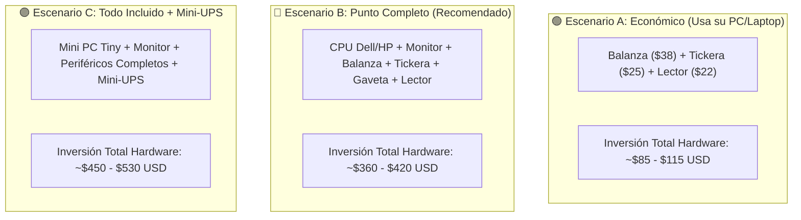

# 📊 Informe Ejecutivo de Inversión: Equipamiento de Hardware & Sistema EL CUADRE POS

**Emisor Corporativo**: ⚡ **SmartOps VE** (*Software & Cloud Retail Solutions*)  
**Responsable Técnico**: Ing. Víctor Montoya — Consultor & Arquitecto de Soluciones  
**Documento Oficial para Cliente**: [`informe-inversion-equipos-smartops.html`](file:///C:/Users/vmont/OneDrive/Desktop/2brain-vmontoya/wiki/proyectos/informe-inversion-equipos-smartops.html) *(Maquetación ejecutiva con logo oficial de SmartOps VE, adaptable a impresión PDF)*  
**Activo de Marca**: [`logo_smartops_ve.svg`](file:///C:/Users/vmont/OneDrive/Desktop/2brain-vmontoya/wiki/proyectos/assets/logo_smartops_ve.svg)  
**Proyecto**: **EL CUADRE POS** (Sistema de Punto de Venta Local Edge & Pesaje Criollo)  
**Fecha de Emisión**: Octubre 2026  
**Vigencia de Precios**: 30 días continuos (Referencias de mercado en Venezuela)

---

## 🎯 1. Resumen Ejecutivo & Justificación de la Inversión

El presente informe tiene como finalidad presentar al cliente un **análisis técnico y financiero transparente** sobre la inversión necesaria para la modernización integral de su mostrador comercial mediante la implementación de **EL CUADRE POS**.

### ⚠️ El Problema Actual del Mostrador Tradicional:
- **Cierres Nocturnos Agotadores**: Entre 60 y 120 minutos después de bajar la santamaría cuadrando billetes sucios, comprobantes de punto y capturas de Pago Móvil.
- **Fuga Silenciosa de Dinero ("Robo Hormiga")**: Descuadres diarios recurrentes de entre **$5 y $15 USD** en gaveta por falta de control ciego.
- **Pérdidas en Balanza**: Empleados que no descuentan la tara de la bolsa o redondean a ojo en productos por kilo (tomates, queso, frutas), perdiendo entre **5% y 8% del margen bruto**.
- **El Libro de Fiados en Cuadernos**: Pérdida de cuentas por cobrar por hojas rotas, manchadas o reclamos de clientes.

### 🛡️ La Solución "EL CUADRE POS":
Un sistema **100% Local-First** (funciona en su propia tienda sin necesidad de internet continuo ni pagos forzados de nube), conectado a balanza digital de pesaje en tiempo real, lector de código de barras, impresora térmica y módulo de **Arqueo Ciego Antifraude**.

---

## 🛠️ 2. Ficha Técnica de Equipos de Hardware (Precios Reales en Venezuela)

Para garantizar la durabilidad de los equipos en jornadas de alto tráfico comercial (10 a 14 horas continuas) y minimizar los costos de inversión, se seleccionaron marcas y modelos con alta disponibilidad de repuestos y servicio técnico en Venezuela (Caracas, Valencia, Maracay y principales ciudades):

| # | Componente | Modelo / Referencia Recomendada | Especificación Clave | Rango de Inversión (USD) | Enlace de Compra en MercadoLibre Venezuela |
| :-: | :--- | :--- | :--- | :---: | :---: |
| **1** | **Impresora Térmica 58mm (Tickera)** | **Xprinter XP-58 / POS-5890K / FRM-58** | Conexión USB directa + puerto RJ11 para apertura automática de gaveta. No usa tinta (papel térmico). | **$22 – $35** | [🔗 Ver en MercadoLibre](https://listado.mercadolibre.com.ve/impresora-termica-58mm) |
| **2** | **Balanza Comercial Digital 40 Kg** | **Camry / Roccia / American Boss / Torrey 40kg** | Doble display LED (cliente y cajero), batería interna recargable de 48h ante apagones, soporte de pesaje decimal. | **$35 – $48** | [🔗 Ver en MercadoLibre](https://listado.mercadolibre.com.ve/balanza-digital-comercial-40kg) |
| **3** | **Lector de Código de Barras USB** | **Láser 1D/2D con base manos libres** | Conexión USB Plug & Play sin drivers. Escaneo rápido de víveres empacados al pasar por el mostrador. | **$20 – $32** | [🔗 Ver en MercadoLibre](https://listado.mercadolibre.com.ve/lector-codigo-de-barras-usb) |
| **4** | **Gaveta de Dinero Metálica** | **Caja de acero con cerradura (4B/8M o 5B/8M)** | Carcasa metálica reforzada, apertura automática por pulso de la tickera o con llave manual. | **$45 – $60** | [🔗 Ver en MercadoLibre](https://listado.mercadolibre.com.ve/gaveta-de-dinero-rj11) |
| **5A** | **Computador de Caja (Opción SFF)** | **CPU Dell OptiPlex 3020/7020 o HP ProDesk** | Core i3 o i5, 8 GB RAM, Disco Sólido SSD 240 GB (Rápido, robusto y preparado para polvo/calor). | **$120 – $160** | [🔗 Ver en MercadoLibre](https://listado.mercadolibre.com.ve/cpu-dell-optiplex-caracas) |
| **5B** | **Computador de Caja (Opción Mini PC)** | **Mini PC Tiny HP / Lenovo / Dell Micro** | Ultra compacta (cabe detrás del monitor o bajo el mostrador), bajo consumo eléctrico (65W). | **$180 – $240** | [🔗 Ver en MercadoLibre](https://listado.mercadolibre.com.ve/mini-pc-intel) |
| **6** | **Monitor LED 19" a 20"** | **Samsung / HP / Dell / LG (VGA o HDMI)** | Pantalla nítida de bajo consumo para visualizar claramente el ticket activo y catálogo. | **$45 – $65** | [🔗 Ver en MercadoLibre](https://listado.mercadolibre.com.ve/monitor-19-pulgadas) |
| **7** | **Mini-UPS de Respaldo para Router/POS** | **Marsriva / KP3 (12V/9V/USB)** | Respaldo de 4 a 6 horas continuas para el punto y módem ante cortes eléctricos. | **$25 – $35** | [🔗 Ver en MercadoLibre](https://listado.mercadolibre.com.ve/mini-ups-router) |

---

## 📊 3. Tres Escenarios de Inversión Adaptados a su Negocio

Para ajustarnos a la realidad de cada comercio, presentamos tres alternativas de presupuesto:

### 🟢 Escenario A: "Puesta en Marcha Básica" (Si el cliente ya cuenta con PC o Laptop)
*Ideal para negocios que ya tienen una computadora o laptop funcional en caja:*
- Impresora Térmica 58mm: **$25 USD**
- Balanza Digital 40 Kg: **$38 USD**
- Lector de Código de Barras USB: **$22 USD**
- **TOTAL INVERSIÓN HARDWARE**: **~$85 – $100 USD**

---

### 🔵 Escenario B: "Punto de Venta Completo" (Opción Más Recomendada)
*Ideal para armar un mostrador independiente, rápido y duradero con CPU corporativo:*
- Computador Dell OptiPlex / HP Core i5, 8GB RAM, SSD: **$140 USD**
- Monitor LED 19" HD: **$50 USD**
- Impresora Térmica 58mm USB: **$25 USD**
- Gaveta de Dinero Metálica Automática: **$48 USD**
- Balanza Digital Comercial 40 Kg: **$38 USD**
- Lector de Código de Barras USB con Base: **$25 USD**
- **TOTAL INVERSIÓN HARDWARE**: **~$326 – $390 USD**

---

### 🟣 Escenario C: "Punto de Venta Blindado Anti-Apagones" (Ultra Compacto)
*Ideal para mostradores estrechos que requieren estética moderna y protección eléctrica:*
- Mini PC Tiny HP/Lenovo (ocupa menos de 20 cm): **$200 USD**
- Monitor LED 19"-20" HDMI: **$55 USD**
- Periféricos Completos (Balanza + Tickera + Gaveta + Lector): **$136 USD**
- Mini-UPS Marsriva de Respaldo Eléctrico: **$30 USD**
- **TOTAL INVERSIÓN HARDWARE**: **~$421 – $480 USD**

---

## 💻 4. Inversión en Software, Instalación y Puesta en Marcha

| Concepto | Modalidad | Valor | Lo que Incluye |
| :--- | :---: | :---: | :--- |
| **Licencia de Software EL CUADRE POS** | Pago Único | **$120 – $149 USD** | Servidor Local Edge (Next.js + NestJS + SQLite WAL). Licencia perpetua para la tienda sin cobros sorpresa. |
| **Instalación & Calibración de Equipos** | Incluido | **$0 USD** | Configuración de balanza, tickera, gaveta y red Wi-Fi para teléfonos de pasillo. |
| **Carga Inicial de Catálogo Criollo** | Incluido | **$0 USD** | +350 productos típicos de abasto y frutería ya configurados con categorías y unidades/peso. |
| **Capacitación Operativa en Mostrador** | Incluido | **$0 USD** | Sesión práctica de 45 minutos al dueño y cajeros (apertura, cobro, fiados y arqueo ciego). |
| **Plan Opcional de Soporte & Respaldo Nube** | Mensual | **$15 USD / mes** | Respaldo diario automático en la nube, actualización de tasa oficial y soporte remoto VIP por WhatsApp. |

---

## 📈 5. Análisis de Retorno de Inversión (ROI): ¿En cuánto tiempo se paga el sistema?

En un abasto o frutería promedio que factura entre **$150 y $400 USD diarios**:

| Fuente de Pérdida Tradicional | Pérdida Mensual Estimada | Con EL CUADRE POS | Ahorro Mensual para el Dueño |
| :--- | :---: | :---: | :---: |
| **Robos hormiga / descuadres en gaveta** | $150 – $300 USD / mes | **$0 USD** (Arqueo ciego obligatorio) | **+$180 USD / mes** |
| **Pérdida por tara y pesaje a ojo en balanza** | $80 – $150 USD / mes | **$0 USD** (Cálculo exacto al gramo) | **+$100 USD / mes** |
| **Fiados olvidados o libretas extraviadas** | $70 – $120 USD / mes | Registro digital inmediato | **+$90 USD / mes** |
| **Tiempo nocturno del dueño en cierres de caja** | 30 horas / mes (estrés) | Reducido a 3 min diarios | **Paz mental invaluable** |
| **AHORRO TOTAL MENSUAL ESTIMADO** | | | **+$370 USD / mes** |

> 💡 **Conclusión Financiera**: El sistema completo (Hardware + Software) se paga por sí solo en un período de **30 a 45 días continuos de operación**. A partir del segundo mes, todo el dinero recuperado representa ganancia neta directa para el propietario.

---

## 🛒 6. Recomendaciones y Rutas de Adquisición en Venezuela

Para garantizar que el cliente adquiera equipos de calidad al mejor precio de calle:

1. **Compras en Físico en Caracas**:
   - **C.C. City Market (Sabana Grande)**: Pasillo central y piso 2 (múltiples locales especializados en combos corporativos Dell/HP y accesorios de POS).
   - **La Hoyada / Av. Fuerzas Armadas**: Distribuidores directos de balanzas comerciales digitales (marcas Camry, Roccia) con garantía de 6 meses.
2. **Compras Online Directas en MercadoLibre Venezuela (Envíos Nacionales MRW / Zoom / Tealca)**:
   - 🖨️ [Impresoras Térmicas 58mm USB en MercadoLibre](https://listado.mercadolibre.com.ve/impresora-termica-58mm) ($22 - $35 USD)
   - ⚖️ [Balanzas Digitales Comerciales 40kg con Batería](https://listado.mercadolibre.com.ve/balanza-digital-comercial-40kg) ($35 - $48 USD)
   - 🔫 [Lectores de Código de Barras USB con Base](https://listado.mercadolibre.com.ve/lector-codigo-de-barras-usb) ($20 - $32 USD)
   - 💵 [Gavetas de Dinero Metálicas RJ11](https://listado.mercadolibre.com.ve/gaveta-de-dinero-rj11) ($45 - $60 USD)
   - 🖥️ [CPUs Corporativos Dell OptiPlex / HP (SFF)](https://listado.mercadolibre.com.ve/cpu-dell-optiplex-caracas) ($120 - $160 USD)
   - 📟 [Mini PCs Intel Tiny / Micro](https://listado.mercadolibre.com.ve/mini-pc-intel) ($180 - $240 USD)
   - 📺 [Monitores LED 19" a 20"](https://listado.mercadolibre.com.ve/monitor-19-pulgadas) ($45 - $65 USD)
   - 🔋 [Mini-UPS para Respaldo Eléctrico (Router/POS)](https://listado.mercadolibre.com.ve/mini-ups-router) ($25 - $35 USD)
3. **Modalidad Llave en Mano (Opcional)**:
   - Si el cliente prefiere no ocuparse de cotizar y trasladar los equipos, nuestro equipo técnico puede entregar el punto de venta **completamente armado, configurado, testeado y listo para cobrar en su mostrador**.

---

### 📞 Contacto y Activación
- **Ingeniería & Despliegue**: Ing. Víctor Montoya — SmartOps VE
- **Soporte & Demostraciones**: Equipo Akatsuki / 2brain
