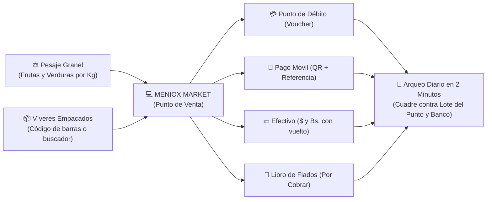
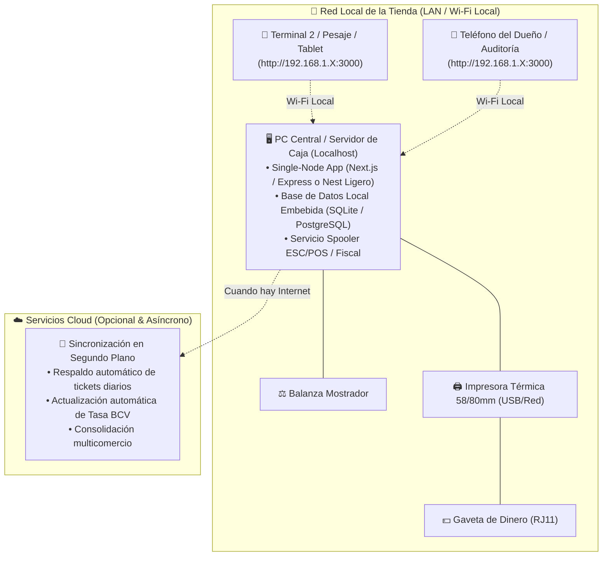

# 📋 Plan de Proyecto: Meniox Market (POS & Gestión de Tienda)

**Proyecto:** Meniox Market — Sistema de Punto de Venta & Gestión para Fruterías, Minimarkets y Víveres  
**Responsable Técnico:** Ing. Víctor Montoya  
**Líder de Mayordomía:** ALFRED & GRANDALF  
**Área 2brain:** `wiki/proyectos/meniox-market-plan.md`  
**Estado:** Planificación & Aprobación de Arquitectura  

---

## 🎯 1. Visión y Propuesta de Valor

Meniox Market nace para resolver el vacío operativo que dejan las aplicaciones genéricas del mercado en los pequeños comercios de alimentos en Venezuela y Latinoamérica. Su propósito es **erradicar el cuaderno de papel y lápiz** mediante una herramienta ágil, visual y diseñada para la dinámica real de mostrador:



---

## 🏛️ 2. Arquitectura de Despliegue Local & Red LAN (Local-First On-Premise)

Para garantizar viabilidad técnica en tiendas donde la conectividad a internet es inestable o nula, y los equipos son de gama de entrada (Mini-PCs N100, laptops con 4-8 GB de RAM o tablets):



| Capa | Solución Técnica | Beneficio Operativo Real |
| :--- | :--- | :--- |
| **Lenguaje & Tipado** | **TypeScript (Strict Mode)** | Cero errores de conversión o redondeo en montos bimonetarios ($/Bs.). |
| **Frontend UI** | **Next.js 15 (App Router) + React 19 + Tailwind CSS v4** | Malla visual táctil reactiva, atajos de teclado y tipografía grande de alto contraste. |
| **Modo de Ejecución** | **PWA (Progressive Web App - Kiosk Mode)** | Instalable desde Chrome en 1 clic; se abre a pantalla completa sin barra de navegador. |
| **Backend & Core** | **Next.js Standalone Server (Node.js)** | Todo el backend y frontend unificados en un solo proceso. Consume ~90 MB de RAM. |
| **Persistencia Local** | **SQLite (vía Prisma ORM con WAL Mode)** | Archivo único (`meniox-market.db`), transacciones atómicas seguras ante apagones, cero caída de puertos. |
| **Servidor LAN** | **HTTP Server (`0.0.0.0:3000`)** | Permite que tablets o teléfonos en la misma red Wi-Fi operen como cajas auxiliares. |
| **Impresión & Hardware** | **Web Print API + Node ESC/POS Spooler** | Impresión instantánea en tickeras de 58/80mm y apertura de gaveta vía pulso RJ11. |
| **Sincronización Cloud** | **Background Sync Worker Asíncrono** | Al detectar internet, envía respaldo diario cifrado y consulta la tasa oficial del BCV. |

---

## 🎨 3. Diseño UX/UI para Usuarios con Cero Conocimiento Tecnológico

El perfil del usuario final incluye comerciantes y cajeros con nula experiencia digital, acostumbrados únicamente al cuaderno y la calculadora. **La interfaz sigue el principio "Cero Fricción / Cero Errores":**

1. **Pantalla Dividida Táctil de Alta Visibilidad**:
   - **Lado Izquierdo (Malla Visual)**: Botones gigantes con fotos e íconos de frutas y verduras (Plátano, Papa, Cebolla, Tomate). Colores contrastantes y tipografía grande legible a 1 metro de distancia.
   - **Lado Derecho (Ticket en Vivo)**: Lista clara de lo que se lleva el cliente con botón de eliminar de un solo toque y totales gigantes en **$ (USD)** y **Bs.**.
2. **Pesaje en 2 Toques (Sin Calculadora)**:
   - Al tocar un producto a granel (ej. Tomate), se abre un teclado numérico grande en pantalla.
   - Incorpora botones rápidos de atajo para pesajes comunes: `[ 1/4 Kg ]`, `[ 1/2 Kg ]`, `[ 1 Kg ]`, `[ 2 Kg ]`.
   - El sistema calcula el subtotal instantáneamente sin que el cajero tenga que hacer matemáticas.
3. **Buscador Predictivo con 3 Letras para Víveres**:
   - Si no usa lector de código de barras, al escribir `"HAR"` aparecen instantáneamente las harinas en lista grande.
   - Compatible con lectores de código de barras USB Plug & Play estándar sin configurar drivers.
4. **Cobro Guiado en Pantalla Única**:
   - Selector visual de formas de pago: `[ 💳 Punto ]`, `[ 📱 Pago Móvil ]`, `[ 💵 Efectivo ]`, `[ 🤝 Fiado ]`.
   - Si pagan en efectivo, el cajero indica con cuánto pagan y la pantalla resalta en verde el **vuelto exacto** a devolver en $ o en Bs.

---

## ⚖️ 4. Estrategia Fiscal Venezuela: Post-Derogación de Homologación SENIAT

### Contexto Legal Reciente:
* **Providencia SNAT/2026/00084 (Gaceta Oficial N° 43.435)**: Derogó formalmente la Providencia SNAT/2024/000121, **eliminando la obligación del trámite de homologación previa de software informático administrativo ante el SENIAT**.
* **Impacto**: Los desarrolladores y comercios ya no requieren pasar por la certificación burocrática del sistema para poder operar. Sin embargo, se mantiene el deber formal de emisión y el control de documentos fiscales.

### Arquitectura de Emisión Fiscal Desacoplada en Meniox Market:

```
                            [ TICKET DE VENTA MENIOX ]
                                        │
                 ┌──────────────────────┼──────────────────────┐
                 ▼                      ▼                      ▼
        MODO 1: COMERCIO        MODO 2: CONTRIBUYENTE   MODO 3: FACTURACIÓN
        REGULAR / NO FISCAL     OBLIGADO A FISCAL       DIGITAL
        • Impresora Térmica     • Impresora Fiscal      • Factura Digital
          ESC/POS 58/80mm         (HKA / Bixolon)         (Prov. SNAT/2024/0102)
        • Nota de Entrega       • Spooler / Driver      • Control Web / QR
        • Costo HW: ~$25        • Costo HW: ~$400-$700  • Envío WhatsApp/Email
```

1. **Modo 1: Control Interno / Nota de Entrega (Configuración Base)**:
   - Orientado a pequeños abastos, fruterías y minimarkets que operan bajo control interno o regímenes simplificados.
   - Imprime comprobantes en mini-impresoras térmicas genéricas USB/Bluetooth de 58mm o 80mm usando protocolo estándar **ESC/POS**.
2. **Modo 2: Conector de Impresora Fiscal (Para Contribuyentes Obligados)**:
   - Para clientes que por su volumen de facturación o condición tributaria tienen impresora fiscal (The Factory HKA, Bixolon, Dascom).
   - Meniox Market se comunica mediante un **Micro-Spooler Fiscal local** que traduce los ítems al protocolo de la impresora fiscal (comandos de inicio de factura, línea de ítem con alícuota y cierre de factura).
3. **Tratamiento Automatizado de Impuestos (Reglas Fiscales Venezuela)**:
   - **Exentos de IVA (Tasa 0%)**: Frutas, verduras, hortalizas, tubérculos, harinas, huevos, leche y carnes sin procesar (según Ley del IVA).
   - **Gravados con IVA (Alícuota 16%)**: Golosinas, refrescos, enlatados especiales, artículos de limpieza e higiene personal.
   - **Soporte IGTF (3%)**: Identificación del cobro de 3% sobre pagos recibidos en divisas efectivo para comercios catalogados como Sujetos Pasivos Especiales.

## 🗓️ 5. Fases de Desarrollo (Roadmap por Sprints)

### 🔹 Sprint 1: Catálogo, Pesaje y Carrito de Compra (Core POS)
* **Objetivos**:
  1. Configuración del proyecto base con diseño responsivo para mostrador (pantalla dividida).
  2. Módulo de catálogo bimonetario: soporte dual para productos pesables (precio por Kg) y productos por unidad (código de barras).
  3. Malla visual táctil para Frutas y Verduras con fotos grandes y buscador predictivo para víveres.
  4. Modal de pesaje rápido: ingreso de peso en balanza con botones de acceso directo (`1/2 Kg`, `1 Kg`, `2 Kg`).
  5. Selector de Tasa del Día (BCV o personalizada) que actualiza todos los precios en pantalla en tiempo real.

### 🔹 Sprint 2: Pasarela de Cobro Bimonetaria y Arqueo de Caja
* **Objetivos**:
  1. Pantalla de cobro en 1 solo paso con selector de formas de pago:
     - **Punto de Venta Bancario**: Monto en Bs. + campo para últimos 4 dígitos del voucher.
     - **Pago Móvil**: Visualización en pantalla de datos bancarios + código QR dinámico + campo de referencia.
     - **Efectivo $ y Bs.**: Calculador automático de cambio/vuelto exacto en ambas monedas.
     - **Pagos Mixtos**: Combinar múltiples métodos en un solo ticket (ej. parte en $ y parte en Pago Móvil).
  2. Apertura de turno con monto base en gaveta.
  3. Registro rápido de salidas de caja (gastos menores como bolsas, hielo, transporte).
  4. **Cierre de Turno / Arqueo Diario**: Cuadre automático de lo cobrado vs. Lote del punto físico y extracto bancario.

### 🔹 Sprint 3: Libro de Fiados (Cuentas por Cobrar)
* **Objetivos**:
  1. Directorio de clientes de confianza con nombre, teléfono y límite de crédito.
  2. Opción en caja de mandar venta a *"Cuenta Pendiente / Fiado"*.
  3. Módulo de cobranza: registro de abonos parciales o totales con emisión de comprobante por WhatsApp.
  4. Reporte de cartera vencida / total adeudado a la tienda.

### 🔹 Sprint 4: Compras al Mayor, Mermas e Inventario
* **Objetivos**:
  1. Registro de compras a proveedores mayoristas con conversión automática (Sacos/Cestas ➔ Kilos de venta al detal).
  2. Módulo de **Merma Orgánica**: registro en dos toques de frutas/verduras dañadas o descompuestas para no distorsionar el inventario.
  3. Alerta de stock crítico para víveres empacados (Harina, Arroz, Aceite, etc.).

### 🔹 Sprint 5: Despliegue en Tienda y Capacitación Operativa
* **Objetivos**:
  1. Configuración del acceso en la PC/laptop o tablet de la tienda.
  2. Carga inicial del catálogo de productos con sus precios base.
  3. Capacitación de 30 minutos al personal de caja y al dueño.
  4. Acompañamiento en el primer cierre de caja real.

---

## 🗄️ 6. Modelo de Datos Preliminar (Prisma Schema Core)

```prisma
// Modelo de Producto (Víveres vs Granel)
model Product {
  id          String       @id @default(cuid())
  code        String?      @unique // Código de barras o PLU
  name        String
  category    Category     // FRUTAS, VERDURAS, VIVERES, CHARCUTERIA, BEBIDAS
  isWeighable Boolean      @default(false) // True si se vende por Kg
  costUsd     Decimal      @db.Decimal(10, 4)
  priceUsd    Decimal      @db.Decimal(10, 2)
  stock       Decimal      @default(0) @db.Decimal(10, 3) // Soporta decimales para Kg
  imageUrl    String?
  isActive    Boolean      @default(true)
  sales       SaleItem[]
}

// Modelo de Venta y Pagos Mixtos
model Sale {
  id          String       @id @default(cuid())
  saleNumber  Int          @default(autoincrement())
  totalUsd    Decimal      @db.Decimal(10, 2)
  totalBs     Decimal      @db.Decimal(14, 2)
  exchangeRate Decimal     @db.Decimal(10, 2)
  status      SaleStatus   @default(COMPLETED) // COMPLETED, PENDING_CREDIT, CANCELLED
  customerId  String?
  customer    Customer?    @relation(fields: [customerId], references: [id])
  items       SaleItem[]
  payments    Payment[]
  createdAt   DateTime     @default(now())
}

// Desglose de Pago (Punto, Pago Móvil, Efectivo)
model Payment {
  id             String        @id @default(cuid())
  saleId         String
  method         PaymentMethod // DEBIT_CARD, PAGO_MOVIL, CASH_USD, CASH_BS, CREDIT
  amountUsd      Decimal       @db.Decimal(10, 2)
  amountBs       Decimal       @db.Decimal(14, 2)
  referenceNumber String?      // 4 dígitos de voucher o referencia bancaria
  sale           Sale          @relation(fields: [saleId], references: [id])
}

// Control de Cierre de Caja / Turno
model CashShift {
  id           String      @id @default(cuid())
  openedAt     DateTime    @default(now())
  closedAt     DateTime?
  initialCashUsd Decimal   @default(0)
  initialCashBs  Decimal   @default(0)
  finalCashUsd   Decimal?
  finalCashBs    Decimal?
  totalDebitBs   Decimal?  // Para cuadre con Lote POS
  totalPagoMovilBs Decimal? // Para cuadre con Banco
  status       ShiftStatus @default(OPEN)
}
```

---

## 💰 7. Presupuesto de Inversión y Guía de Compra de Hardware en Venezuela

Para garantizar que el cliente adquiera equipos 100% compatibles, duraderos y de bajo costo en el mercado venezolano:

### 🛠️ Ficha Técnica de Hardware Recomendado (Precios Reales en Venezuela):

| Componente | Opción / Referencia de Mercado | Rango Precio Real (USD en VE) | Enlace de Búsqueda Directa en Venezuela |
| :--- | :--- | :---: | :---: |
| **Impresora Térmica 58mm (Tickera)** | **POS-5890K / Xprinter XP-58 / FRM-58** (USB + Puerto RJ11 para gaveta) | **$22 - $35** | [Buscar Impresora Térmica 58mm en MercadoLibre](https://listado.mercadolibre.com.ve/impresora-termica-58mm) |
| **Balanza Comercial Digital 40 Kg** | **Camry / Roccia / American Boss 40kg** (Batería recargable interna + doble display LED cliente/cajero) | **$35 - $48** | [Buscar Balanza Digital 40kg en MercadoLibre](https://listado.mercadolibre.com.ve/balanza-digital-comercial-40kg) |
| **Lector de Código de Barras USB** | **Láser 1D/2D tipo pistola con base manos libres** (Plug & Play USB HID) | **$20 - $32** | [Buscar Lector Código de Barras USB en MercadoLibre](https://listado.mercadolibre.com.ve/lector-codigo-de-barras-usb) |
| **Gaveta de Dinero Metálica** | **Gaveta 4 o 5 billetes / 8 monedas** (Carcasa de acero + cable telefónico RJ11 a la tickera) | **$45 - $60** | [Buscar Gaveta de Dinero RJ11 en MercadoLibre](https://listado.mercadolibre.com.ve/gaveta-de-dinero-rj11) |
| **Computadora de Caja (Opción A - Más Común)** | **CPU Corporativo Reacondicionado SFF** (Dell OptiPlex 3020/7020/9020 o HP ProDesk, Core i3/i5, 8GB RAM, SSD 240GB) | **$120 - $180** | [Buscar CPU Dell Optiplex Caracas en MercadoLibre](https://listado.mercadolibre.com.ve/cpu-dell-optiplex-caracas) |
| **Computadora de Caja (Opción B - Compacta)** | **Mini PC Tiny / Micro Corporativa Reacondicionada** (Dell Micro / HP Mini / Lenovo Tiny, Core i3/i5 6ta-8va gen) | **$180 - $250** | [Buscar Mini PC Reacondicionada en MercadoLibre](https://listado.mercadolibre.com.ve/mini-pc-intel) |
| **Computadora de Caja (Opción C - Nueva Sellada)** | **Mini PC Nueva** (Intel N95 / N100 / GMKtec / Asus NUC en tienda venezolana) | **$260 - $380** | [Buscar Mini PC Nueva en MercadoLibre](https://listado.mercadolibre.com.ve/mini-pc-intel) |
| **Monitor Económico 19" (Usado o Genérico)** | **Monitor LED 19" - 20"** (HDMI / VGA para mostrador) | **$45 - $65** | [Buscar Monitor 19 pulgadas en MercadoLibre](https://listado.mercadolibre.com.ve/monitor-19-pulgadas) |
| **Mini-UPS para Router + Caja** | **Mini UPS DC 12V/9V (KP3 / Marsriva)** (Respaldo de 4 a 6 horas para router ante apagones) | **$25 - $35** | [Buscar Mini UPS Router en MercadoLibre](https://listado.mercadolibre.com.ve/mini-ups-router) |

---

### 🛒 Dónde Comprar en Físico en Venezuela (Alternativas a Envío):
1. **Caracas (Centro Tecnológico City Market / Sabana Grande & La Hoyada)**:
   - Pasillo de puntos de venta y accesorios fiscales en C.C. City Market.
   - Varios locales de computación venden **Combos completos de CPU Dell OptiPlex + Monitor 19" + Teclado/Mouse por ~$220 - $250 USD**.
   - Accesorios de mostrador (*Tickera 58mm + Lector + Gaveta*) se consiguen en combo negociable entre **$90 y $110 USD**.
2. **Tiendas Especializadas de Retail & POS**:
   - Distribuidores de Xprinter, 3nStar y balanzas comerciales en Caracas, Valencia y Maracay con retiro personal y pago vía Pago Móvil (tasa BCV) o divisas en efectivo.

---

### 📊 Escenarios de Inversión del Comercio (Valores Reales de Calle):
* **Escenario 1 (Comercio que ya tiene PC o Laptop en el negocio)**:  
  *Tickera ($25) + Balanza ($38) + Lector ($22) = **~$85 USD** de inversión total en equipos.*
* **Escenario 2 (Comercio armando punto con CPU Corporativo Dell/HP SFF + Monitor)**:  
  *Combo CPU SFF + Monitor ($230) + Balanza ($38) + Tickera ($25) + Gaveta ($45) + Lector ($22) = **~$360 USD** de inversión total.*
* **Escenario 3 (Comercio armando punto con Mini-PC Tiny compacta + Monitor)**:  
  *Mini PC Tiny ($200) + Monitor ($50) + Balanza ($38) + Tickera ($25) + Gaveta ($45) + Lector ($22) = **~$380 USD** de inversión total.*
* **Escenario 4 (Comercio con Mini-PC Nueva sellada de vitrina)**:  
  *Mini PC Nueva ($300) + Monitor ($50) + Balanza ($38) + Tickera ($25) + Gaveta ($45) + Lector ($22) = **~$480 USD** de inversión total.*

---

### 💼 Modelo Comercial Sugerido para el Software:
* **Licencia / Instalación & Puesta en Marcha**: **$120 - $150 USD** (pago único inicial: configuración del host local, red LAN en tablets, carga del catálogo base de frutas/verduras y capacitación de 45 minutos al personal).
* **Mantenimiento, Soporte & Sincronización Cloud**: **$15 USD / mes** (incluye respaldo diario en la nube, actualización automática de tasa BCV y soporte técnico remoto por WhatsApp).

---

## 📈 8. Métricas de Éxito del Negocio

1. **Tiempo de Cierre de Caja**: Reducido de **60 minutos a menos de 3 minutos**.
2. **Cero Descuadres**: Concordancia al 100% entre el reporte de lote del punto físico y lo registrado en sistema.
3. **Control de Cobranza**: Eliminación de pérdidas por "fiados olvidados" en hojas sueltas.
4. **Adopción Inmediata**: Operado con fluidez por el personal desde el día 1 gracias a la interfaz visual.

