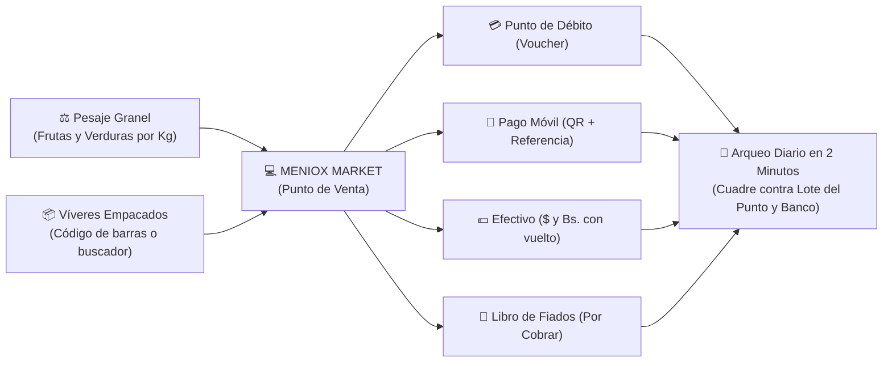

# 📋 Plan de Proyecto: Meniox Market (POS & Gestión de Tienda)

**Proyecto:** Meniox Market — Sistema de Punto de Venta & Gestión para Fruterías, Minimarkets y Víveres  
**Responsable Técnico:** Ing. Víctor Montoya  
**Líder de Mayordomía:** ALFRED & GRANDALF  
**Área 2brain:** `wiki/proyectos/meniox-market-plan.md`  
**Estado:** Planificación & Aprobación de Arquitectura  

---

## 🎯 1. Visión y Propuesta de Valor

Meniox Market nace para resolver el vacío operativo que dejan las aplicaciones genéricas del mercado en los pequeños comercios de alimentos en Venezuela y Latinoamérica. Su propósito es **erradicar el cuaderno de papel y lápiz** mediante una herramienta ágil, visual y diseñada para la dinámica real de mostrador:



---

## 🏛️ 2. Arquitectura Técnica y Entorno de Ejecución

Para garantizar que el software funcione sin fricción técnica para el dueño de la tienda:

| Componente | Elección Tecnológica | Justificación Operativa |
| :--- | :--- | :--- |
| **Frontend UI** | **Next.js 15 (App Router) + React 19 + Tailwind CSS** | Interfaz táctil reactiva, moderna, con atajos de teclado y compatible con modo PWA (pantalla completa sin barra de navegador). |
| **Persistencia Local** | **IndexedDB / SQLite / PWA Cache** | Permite que si hay una micro-caída de internet en la tienda, el cajero continúe cobrando sin detener la cola. |
| **Backend & API** | **Next.js Server Actions / NestJS Micro-API** | Arquitectura modular heredada de Meniox, ultra liviana y de bajo consumo. |
| **Base de Datos** | **PostgreSQL (Aiven Cloud o Supabase) / SQLite local** | Esquema estructurado con soporte bimonetario nativo ($ y Bs.) e integridad transaccional. |
| **Puesta en Marcha** | **PWA Instalable en Escritorio de Windows / Tablet** | Cero instalación de servidores en la tienda; se instala desde Chrome como un ícono de escritorio nativo. |

---

## 🗓️ 3. Fases de Desarrollo (Roadmap por Sprints)

### 🔹 Sprint 1: Catálogo, Pesaje y Carrito de Compra (Core POS)
* **Objetivos**:
  1. Configuración del proyecto base con diseño responsivo para mostrador (pantalla dividida).
  2. Módulo de catálogo bimonetario: soporte dual para productos pesables (precio por Kg) y productos por unidad (código de barras).
  3. Malla visual táctil para Frutas y Verduras con fotos grandes y buscador predictivo para víveres.
  4. Modal de pesaje rápido: ingreso de peso en balanza con botones de acceso directo (`1/2 Kg`, `1 Kg`, `2 Kg`).
  5. Selector de Tasa del Día (BCV o personalizada) que actualiza todos los precios en pantalla en tiempo real.

### 🔹 Sprint 2: Pasarela de Cobro Bimonetaria y Arqueo de Caja
* **Objetivos**:
  1. Pantalla de cobro en 1 solo paso con selector de formas de pago:
     - **Punto de Venta Bancario**: Monto en Bs. + campo para últimos 4 dígitos del voucher.
     - **Pago Móvil**: Visualización en pantalla de datos bancarios + código QR dinámico + campo de referencia.
     - **Efectivo $ y Bs.**: Calculador automático de cambio/vuelto exacto en ambas monedas.
     - **Pagos Mixtos**: Combinar múltiples métodos en un solo ticket (ej. parte en $ y parte en Pago Móvil).
  2. Apertura de turno con monto base en gaveta.
  3. Registro rápido de salidas de caja (gastos menores como bolsas, hielo, transporte).
  4. **Cierre de Turno / Arqueo Diario**: Cuadre automático de lo cobrado vs. Lote del punto físico y extracto bancario.

### 🔹 Sprint 3: Libro de Fiados (Cuentas por Cobrar)
* **Objetivos**:
  1. Directorio de clientes de confianza con nombre, teléfono y límite de crédito.
  2. Opción en caja de mandar venta a *"Cuenta Pendiente / Fiado"*.
  3. Módulo de cobranza: registro de abonos parciales o totales con emisión de comprobante por WhatsApp.
  4. Reporte de cartera vencida / total adeudado a la tienda.

### 🔹 Sprint 4: Compras al Mayor, Mermas e Inventario
* **Objetivos**:
  1. Registro de compras a proveedores mayoristas con conversión automática (Sacos/Cestas ➔ Kilos de venta al detal).
  2. Módulo de **Merma Orgánica**: registro en dos toques de frutas/verduras dañadas o descompuestas para no distorsionar el inventario.
  3. Alerta de stock crítico para víveres empacados (Harina, Arroz, Aceite, etc.).

### 🔹 Sprint 5: Despliegue en Tienda y Capacitación Operativa
* **Objetivos**:
  1. Configuración del acceso en la PC/laptop o tablet de la tienda.
  2. Carga inicial del catálogo de productos con sus precios base.
  3. Capacitación de 30 minutos al personal de caja y al dueño.
  4. Acompañamiento en el primer cierre de caja real.

---

## 🗄️ 4. Modelo de Datos Preliminar (Prisma Schema Core)

```prisma
// Modelo de Producto (Víveres vs Granel)
model Product {
  id          String       @id @default(cuid())
  code        String?      @unique // Código de barras o PLU
  name        String
  category    Category     // FRUTAS, VERDURAS, VIVERES, CHARCUTERIA, BEBIDAS
  isWeighable Boolean      @default(false) // True si se vende por Kg
  costUsd     Decimal      @db.Decimal(10, 4)
  priceUsd    Decimal      @db.Decimal(10, 2)
  stock       Decimal      @default(0) @db.Decimal(10, 3) // Soporta decimales para Kg
  imageUrl    String?
  isActive    Boolean      @default(true)
  sales       SaleItem[]
}

// Modelo de Venta y Pagos Mixtos
model Sale {
  id          String       @id @default(cuid())
  saleNumber  Int          @default(autoincrement())
  totalUsd    Decimal      @db.Decimal(10, 2)
  totalBs     Decimal      @db.Decimal(14, 2)
  exchangeRate Decimal     @db.Decimal(10, 2)
  status      SaleStatus   @default(COMPLETED) // COMPLETED, PENDING_CREDIT, CANCELLED
  customerId  String?
  customer    Customer?    @relation(fields: [customerId], references: [id])
  items       SaleItem[]
  payments    Payment[]
  createdAt   DateTime     @default(now())
}

// Desglose de Pago (Punto, Pago Móvil, Efectivo)
model Payment {
  id             String        @id @default(cuid())
  saleId         String
  method         PaymentMethod // DEBIT_CARD, PAGO_MOVIL, CASH_USD, CASH_BS, CREDIT
  amountUsd      Decimal       @db.Decimal(10, 2)
  amountBs       Decimal       @db.Decimal(14, 2)
  referenceNumber String?      // 4 dígitos de voucher o referencia bancaria
  sale           Sale          @relation(fields: [saleId], references: [id])
}

// Control de Cierre de Caja / Turno
model CashShift {
  id           String      @id @default(cuid())
  openedAt     DateTime    @default(now())
  closedAt     DateTime?
  initialCashUsd Decimal   @default(0)
  initialCashBs  Decimal   @default(0)
  finalCashUsd   Decimal?
  finalCashBs    Decimal?
  totalDebitBs   Decimal?  // Para cuadre con Lote POS
  totalPagoMovilBs Decimal? // Para cuadre con Banco
  status       ShiftStatus @default(OPEN)
}
```

---

## 💰 5. Presupuesto de Inversión y Equipamiento de Hardware

### 🛠️ Lista de Equipos Necesarios para la Tienda:
| Equipo | Función Operativa | Rango de Costo (USD) |
| :--- | :--- | :---: |
| **Computadora / Laptop** | Mini-PC Intel (N100, 8GB, SSD) + Monitor 19" o Laptop básica | $130 - $180 |
| **Balanza Comercial Digital** | 30 - 40 Kg con display de peso para frutas y verduras | $30 - $45 |
| **Lector de Código de Barras USB** | Con base manos libres para víveres empacados | $20 - $30 |
| **Impresora Térmica 58mm** | Para tickets de venta / notas de entrega al cliente | $25 - $35 |
| **Gaveta de Dinero Metálica** | Apertura automática/manual para billetes ($ y Bs.) | $35 - $45 |
| **Mini-UPS / Protector** | Respaldo para router de internet y caja ante bajones de luz | $25 - $35 |

### 📊 Escenarios de Inversión del Comercio:
* **Nivel 1 (Ultra Económico - Si ya tienen PC/Laptop)**: Balanza + Lector + Impresora + Protector = **~$95 USD**.
* **Nivel 2 (Equipamiento Completo Nuevo)**: Puesto de caja nuevo con Mini-PC, monitor, balanza, gaveta e impresora = **~$320 USD**.

### 💼 Modelo de Comercialización de Software:
* **Instalación y Puesta en Marcha Inicial**: $120 - $150 USD (incluye carga de catálogo y capacitación).
* **Soporte y Respaldo Cloud**: $15 USD / mes (respaldo automático, tasa de cambio y asistencia).

---

## 📈 6. Métricas de Éxito del Negocio

1. **Tiempo de Cierre de Caja**: Reducido de **60 minutos a menos de 3 minutos**.
2. **Cero Descuadres**: Concordancia al 100% entre el reporte de lote del punto físico y lo registrado en sistema.
3. **Control de Cobranza**: Eliminación de pérdidas por "fiados olvidados" en hojas sueltas.
4. **Adopción Inmediata**: Operado con fluidez por el personal desde el día 1 gracias a la interfaz visual.

