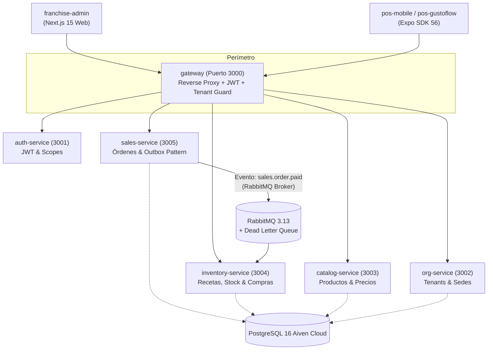

# 🛒 Proyecto: Meniox — Suite Cloud POS & Gestión de Franquicias

**Meniox** es una plataforma integral de software de alta disponibilidad diseñada específicamente para el sector gastronómico, restaurantes y cadenas de franquicias. Su arquitectura distribuida y desacoplada fue concebida como la **alternativa de nueva generación frente a las limitaciones de sistemas legacy como Xetux ERP**, eliminando cuellos de botella como las sincronizaciones manuales en caja, las pérdidas por microcortes de red, las "mermas fantasma" en inventario y la dispersión contable.

**Área 2brain**: [[pilar-proyectos|Área Proyectos - Software Independiente]]  
**Subagentes Responsables**: [Subagente Backend JS Expert](../../agents/backend_js_expert.md), [Subagente Frontend UI Expert](../../agents/frontend_ui_expert.md) & [Subagente Project Manager](../../agents/project_manager.md)  
**Ubicación del Código Local**: `C:\Users\vmontoyaMG\Desktop\Meniox\meniox`  
**Captura Cruda Relacionada**: [[2026-10-14-auditoria-forense-estado-meniox|Auditoría Forense y Estado Meniox (14/10/2026)]]

---

## 🎯 1. Tesis Estratégica: Meniox vs. Sistemas Legacy (Xetux)

| Vector de Comparación | Sistemas Legacy (Ej. Xetux) | Plataforma Meniox |
| :--- | :--- | :--- |
| **Sincronización de Datos** | Depende de sincronización manual ("Botón Sincronizar") y bases de datos locales en cada caja. | **Cero Sync Local**: Consumo directo de API Gateway con tokens JWT enriquecidos y caché multi-nivel. |
| **Deducción de Inventario** | Deducciones sincrónicas propensas a bloqueos o desincronización por cortes de red. | **Event-Driven & Outbox Pattern**: Ventas confirmadas inmediatamente; descuento atómico desacoplado vía RabbitMQ + DLQ. |
| **Manejo de Permisos** | Paquetes de permisos estáticos en terminales locales; requiere reinicio de tienda. | **RBAC & Scopes Granulares Centralizados**: Validación por request con tenencia aislada (`x-tenant-id`). |
| **Compras & Recepción** | Registro plano de facturas sin validación de tolerancias frente a órdenes emitidas. | **Ciclo Integral OC ➔ Recepción ➔ Factura**: Validación automática de variación de costos y cantidades. |
| **Arquitectura de Software** | Monolitos con acoplamiento de hardware y esquemas compartidos rígidos. | **Microservicios NestJS 11**: Esquemas aislados por dominio en PostgreSQL 16 y apps móviles desacopladas. |

---

## 🏗️ 2. Topología de Microservicios (`apps/`)

El monorepo está orquestado mediante Nx y npm workspaces con NestJS 11 y TypeScript 5.9:

### Detalle de Servicios:
1. **`gateway` (Puerto 3000)**: Punto de entrada perimetral. Valida autenticación Bearer, valida el header `x-tenant-id` para evitar cruce de inquilinos y enruta mediante proxies inversos a los microservicios.
2. **`auth-service` (Puerto 3001)**: Gestión de credenciales, refresh tokens, directivas de seguridad y control RBAC.
3. **`org-service` (Puerto 3002)**: Jerarquía corporativa de organizaciones, marcas, sucursales (sedes físicas) y bodegas/almacenes.
4. **`catalog-service` (Puerto 3003)**: Catálogo de productos terminados, modificadores de platos, combos, combos dinámicos y listas de precios por sucursal.
5. **`sales-service` (Puerto 3005)**: Control transaccional de comandas, facturación, cálculo impositivo (retenciones tipo SENIAT), propinas y pagos divididos. Incorpora el **Outbox Pattern** y el `SalesReconciliationService` para garantizar que toda orden pagada sea enviada de forma fiable al broker.
6. **`inventory-service` (Puerto 3004)**: Administración de materias primas, fichas técnicas de recetas y subrecetas multinivel, deducción de existencias en tiempo real por evento de venta, gestión de compras con control de tolerancia (precios y cantidades), traslados inter-bodegas y cierres mensuales.
7. **`franchise-admin` (Puerto 3010)**: Panel administrativo web en Next.js 15 (App Router), React 19, Tailwind CSS 4 y Framer Motion.
8. **`pos-mobile` & `pos-gustoflow`**: Aplicaciones móviles React Native con Expo SDK para terminales táctiles y comandas en sala/caja.

---

## 🗄️ 3. Infraestructura Cloud y Datos Reales (Aiven PostgreSQL)

- **Instancia Cloud**: PostgreSQL 16 alojado en **Aiven Cloud** (`pg-meniox-masterhub.f.aivencloud.com:28688/defaultdb`).
- **Esquemas de Base de Datos Aislados**:
  - `org.*`: Organizaciones, sedes y almacenes.
  - `catalog.*`: Categorías, productos y modificadores.
  - `inventory.*`: Materias primas, recetas, lotes, compras y movimientos.
  - `sales.*`: Facturas, órdenes, pagos y tabla de eventos `outbox`.
- **Datos Verificados en Producción/Cloud (14/10/2026)**:
  - **Tenants Registrados**: 2 (`beijing-sushi` y tenant de demostración).
  - **Sucursales Activas**: 14 sedes operativas de Beijing Sushi.
  - **Productos de Catálogo**: 80 ítems configurados.
  - **Materias Primas / Insumos**: 2,126 registros maestros de inventario.
  - **Órdenes de Venta**: 12 órdenes registradas en entorno de validación.

---

## 🔬 4. Auditoría Forense y Estado Técnico (Octubre 2026)

Durante la auditoría forense del 14/10/2026 ejecutada por **ALFRED**, se consolidaron los siguientes hallazgos y correcciones:

### 4.1 Corrección de Tipado en `SalesReconciliationService`
- **Diagnóstico**: Incompatibilidad de tipos en `apps/sales-service/src/sales-reconciliation.service.ts` donde `this.timer` generaba error de compilación TypeScript entre el tipo `NodeJS.Timeout` y `number`.
- **Resolución**: Se refactorizó la propiedad a `ReturnType<typeof setInterval> | null` con limpieza adecuada en `onModuleDestroy`.
- **Resultado**: Suite unitaria `tests/sales-reconciliation.service.spec.ts` superada al 100% (**4/4 pruebas verdes**).

### 4.2 Deuda Técnica en Suite de Inventario (`tests/inventory.integration.spec.ts`)
- **Situación**: 28 pruebas unitarias/integración fallan debido a desfase entre los fixtures de prueba antiguos y las nuevas reglas de negocio de subrecetas, factores de conversión y tolerancias de compra añadidas recientemente al servicio.
- **Acción requerida**: Refactorizar y alinear las fixtures del test suite con el esquema actual.

### 4.3 Dimensionamiento de Conexiones (`POSTGRES_POOL_SIZE`)
- **Situación**: El archivo `.env` define `POSTGRES_POOL_SIZE=2`. En pruebas de carga o arranques masivos contra Aiven Cloud (con latencia transcontinental de red), dos conexiones causan contención y timeouts.
- **Recomendación**: Ajustar a `POSTGRES_POOL_SIZE=8` o `10` y `POSTGRES_IDLE_TIMEOUT=15000` en entornos de desarrollo y testing.

### 4.4 Unificación de Frontends Móviles
- Coexisten en el repositorio `apps/pos-mobile` (arquitectura de conexión API y Expo SDK 56) y `apps/pos-gustoflow` (diseño táctil drill-down). Se recomienda unificar la experiencia visual interactiva de GustoFlow sobre la base arquitectónica de `pos-mobile`.

### 4.5 Rediseño UX del Módulo de Compras (`docs/rediseno-ux-compras.md`)
- Propuesta de ciclo integral de compras en un Drawer centralizado:
  $$\text{Orden de Compra (OC)} \longrightarrow \text{Recepción en Almacén (Parcial/Total)} \longrightarrow \text{Factura de Proveedor con Tolerancia}$$
- Evita el desvío de costos y previene la recepción de productos no solicitados.

---

## 🗺️ 5. Roadmap de Evolución Inmediata

1. 🧪 **Estabilización de QA**: Reparar las 28 pruebas de integración de `inventory.integration.spec.ts`.
2. 📱 **Consolidación Mobile POS**: Integrar los componentes drill-down de `pos-gustoflow` en `pos-mobile`.
3. 📦 **Drawer de Compras**: Implementar el flujo UX de Órdenes de Compra con validación de tolerancias en `franchise-admin`.
4. 📊 **Métricas & Trazabilidad**: Incorporar propagación de `correlationId` para trazas end-to-end entre Gateway, Sales e Inventory.

---

## 🔗 Enlaces Relacionados en 2brain
- [[pilar-proyectos|Área Proyectos - Software Independiente]]
- [[pilar-trabajo-xetux|Área Trabajo - Analista IT y Soporte Xetux]]
- [[masterhub-mg-hub|Proyecto: MasterHub (MG-HUB)]]
- [[story-points-y-estimacion-scrum|Concepto: Story Points (SP) y Estimación de Esfuerzo en Scrum]]
- [[2026-10-14-auditoria-forense-estado-meniox|Captura Cruda: Auditoría Forense Meniox]]
