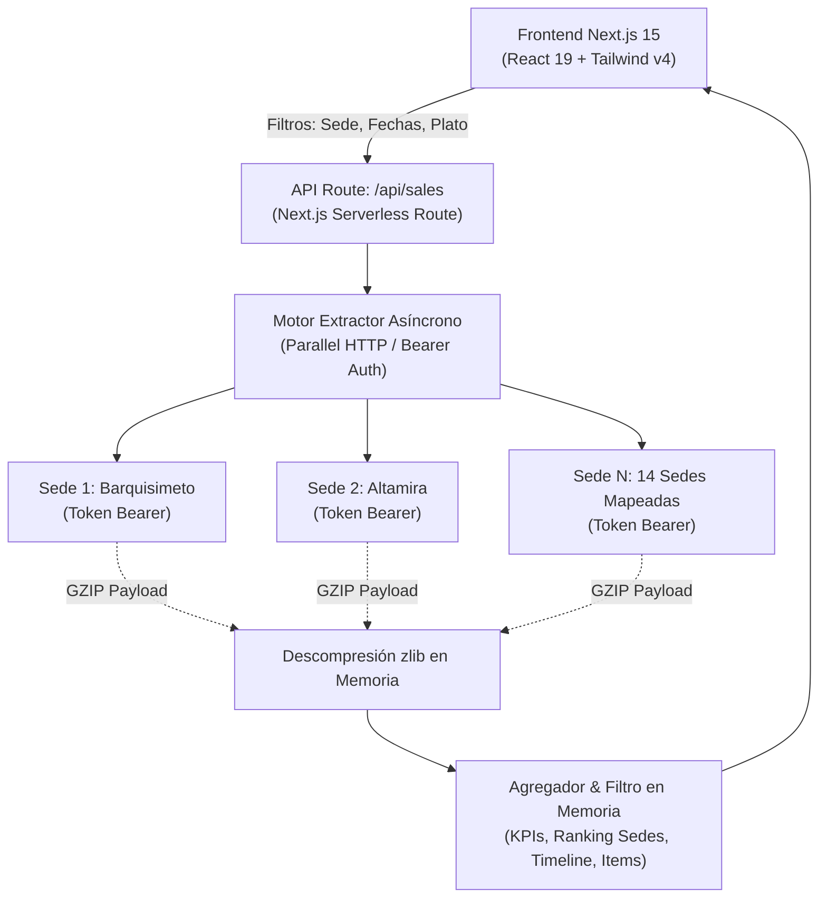

# 📊 Proyecto: MG-SALES-ANALYTICS

**MG-SALES-ANALYTICS** es una plataforma desacoplada de Business Intelligence (BI) y analítica de ventas gastronómicas diseñada para **Master Group**. Conecta directamente con la API en vivo de **Xetux ERP** (`xconnect/api/ExtractionData/SalesFull`) en las 14 sucursales activas (Beijing Sushi y Radio Bar), permitiendo realizar búsquedas multicriterio manuales (por producto, sede, rango de fechas, categoría y canal) con cálculo instantáneo de KPIs, comparativas entre sucursales y exportación a Excel/CSV.

**Área 2brain**: [[pilar-proyectos|Área Proyectos - Software Independiente]]  
**Subagentes**: 🏹 **Legolas Hojaverde** (UI/UX) & ⛏️ **Gimli** (Backend & Data Extraction)  
**Ubicación Local**: `C:\Users\vmontoyaMG\Desktop\MG-SALES-ANALYTICS`  
**Puerto de Servicio Local**: `http://localhost:3050`

---

## 🎨 1. Identidad Visual & Sistema de Diseño (Reglas MGH)

El proyecto hereda estrictamente las **reglas de diseño y tokens de `frontend-ui-dashboard` (MG-HUB)**:
- **Paleta de Marca Master Group**:
  - `--master-black`: `#231f20`
  - `--soft-black`: `#393e46`
  - `--clear-gray`: `#929aab`
  - `--clear-white`: `#eeeeee`
  - `--master-white`: `#f7f7f7`
  - `--master-gold`: `#bc9939` (Dorado de distinción)
  - `--master-gold-soft`: `rgba(188, 153, 57, 0.12)`
  - `--master-border`: `rgba(146, 154, 171, 0.25)`
- **Componentes MGH Integrados**:
  - `Header`: Isotipo Master Group dorado con insignia *Live Xetux Engine*.
  - `StatCard`: Tarjetas de KPIs con bordes redondeados `2xl`, acentos dorados y tipografía tabular para cifras monetarias.
  - `FilterBar`: Selector de 14 sedes, accesos rápidos de fechas (Hoy, Ayer, 7d, Mes), input con icono para producto y categorías.
  - `SalesTable`: Tabla interactiva con paginación, filtro en vivo y exportador CSV con codificación UTF-8 BOM para Excel.

---

## ⚡ 2. Arquitectura de Extracción Xetux



---

## 📋 3. Catálogo de Sedes Mapeadas en Producción

1. **BEIJING BARQUISIMETO** (`beijingbarquisimeto.xetux.online` / `VE01626`)
2. **BEIJING ALTAMIRA VILLAGE** (`beijingaltamira.xetux.online` / `BU1BLT`)
3. **BEIJING BOYERA** (`beijingboyera.xetux.online` / `BU3BLN`)
4. **BEIJING EL PARAISO** (`beijingparaiso.xetux.online` / `BU4BLP`)
5. **BEIJING EL RECREO** (`beijingrecreo.xetux.online` / `BU5BLR`)
6. **BEIJING LECHERIAS** (`beijinglecheria.xetux.online` / `BU6BLL`)
7. **BEIJING MILENIUM** (`beijingmilenium.xetux.online` / `BU7BLM`)
8. **BEIJING NARANJOS** (`beijingnaranjos.xetux.online` / `BU8BLN`)
9. **BEIJING SAMBIL CANDELARIA** (`beijingsbcandelaria.xetux.online` / `BU9BSC`)
10. **BEIJING SAMBIL CHACAO** (`beijingsbchacao.xetux.online` / `BU10BCH`)
11. **BEIJING SAN BERNARDINO** (`beijingsbernardino.xetux.online` / `BU11BSB`)
12. **BEIJING TAHONA** (`beijingtahona.xetux.online` / `BU12BTH`)
13. **RADIO BAR MASTER GROUP** (`radiobar.xetux.net` / `BU13RBM`)

---

## 🚀 4. Comandos de Ejecución

```powershell
# Ubicación
cd C:\Users\vmontoyaMG\Desktop\MG-SALES-ANALYTICS

# Modo Desarrollo
npm run dev

# Compilación y Arranque de Producción
npm run build
npm run start
```

---

## 🔗 Enlaces Relacionados en 2brain
- [[pilar-proyectos|Área Proyectos - Software Independiente]]
- [[masterhub-mg-hub|Proyecto: MasterHub (MG-HUB)]]
- [[pilar-trabajo-xetux|Área Trabajo - Analista IT y Soporte Xetux]]
