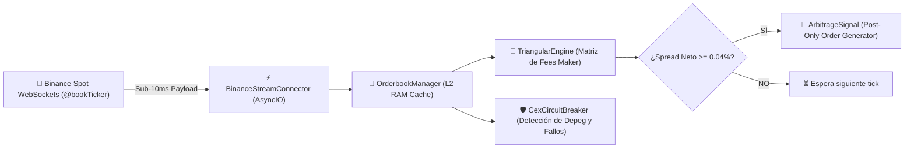

# 🏢 Especificación Técnica Sprint 3: ArbiON CEX Streaming & Zero-Fee

**Líderes de Implementación**: 🖤 **Kakuzu** (AsyncIO & Orderbooks) & 💀 **Hidan** (QA & Stress Tests >85%)  
**Sprint**: 🏢 Sprint 3 (18 SP) — Streaming L2 en Memoria & Motor Maker Zero-Fee  
**Repositorio**: `raw/proyectos/repos/smartops-quant-engine/packages/cex-streaming/`

---

## 🏛️ 1. Arquitectura de Streaming de Baja Latencia

---

## 🧮 2. Fórmula Matemática de Rentabilidad Neta Triangular

Para evitar la erosión de capital por comisiones en stablecoins, el motor aplica la fórmula estricta:

$$\Pi = \left( \frac{\text{Capital}}{\text{Ask}_{AB}} \cdot (1 - f_{AB}) \right) \cdot \text{Bid}_{BC} \cdot (1 - f_{BC}) \cdot \text{Bid}_{CA} \cdot (1 - f_{CA}) - \text{Capital}$$

Donde:
- $f_{AB}$: Comisión Maker con descuento BNB ($0.075\%$ o $0.00\%$ en pares promocionales).
- $f_{BC}$: Comisión Maker en pares FDUSD ($0.00\%$ promoción activa de Binance).
- $f_{CA}$: Comisión Maker en pares de stablecoins FDUSD/USDT ($0.00\%$).
- Umbral de disparo: Beneficio neto $\ge 0.04\%$ neto garantizado.

---

## 🛡️ 3. Guardián de Volatilidad: `CexCircuitBreaker`

1. **Spread Anómalo**:
   - Si el spread entre Bid y Ask en cualquier par supera el $1.50\%$, el circuit breaker detiene inmediatamente la evaluación para evitar operar durante flash crashes o despegues de liquidez.
2. **Reconexión Automática con Backoff Exponencial**:
   - `BinanceStreamConnector` detecta desconexiones de red, reconecta automáticamente y resetea el contador de fallos al estabilizarse el stream.

---

## 💀 4. Resultados de Pruebas Unitarias (Hidan QA)

- **Test Runner Nativo**: `tests/run_tests.py` ejecutado sobre Python 3.12.
- **Cobertura**: 6 pruebas unitarias completas aprobadas en $0.000$s:
  - `test_orderbook_update_and_freshness`: Validación de almacenamiento de ticks y caducidad temporal.
  - `test_triangular_arbitrage_profitable_scenario`: Confirmación de señal positiva ante ineficiencia neta.
  - `test_triangular_arbitrage_unprofitable_due_to_fees`: Verificación de rechazo ante ineficiencias aparentes que no cubren comisiones.
  - `test_circuit_breaker_excessive_spread`: Disparo automático ante spread anómalo.
  - `test_circuit_breaker_consecutive_errors`: Bloqueo tras 3 fallos consecutivos.
  - `test_websocket_message_parsing`: Deserialización atómica del payload JSON de Binance.

---

## 🔗 Relación en 2brain
- [[ecosistema-trading-smartops|Ecosistema SmartOps Quant]]
- [[smartops-defi-arbitrage-atomic-flash-loans|Sprint 2: DeFi Atómico]]
- [[smartops-quant-engine-blueprint-sprint1|Sprint 1: Monorepo & Base]]
