# ⚡ Especificación Técnica Sprint 2: ArbiON DeFi Atómico

**Líderes de Implementación**: 🖤 **Kakuzu** (Smart Contracts), 💣 **Deidara** (Auditoría/Pentest), 🦂 **Sasori** (Hardening Blue Team) & 💀 **Hidan** (QA)  
**Sprint**: ⚡ Sprint 2 (22 SP) — Arbitraje Atómico On-Chain con Flash Loans  
**Repositorio**: `raw/proyectos/repos/smartops-quant-engine/packages/defi-arbitrage/`

---

## 🏛️ 1. Flujo de Ejecución Atómica (Zero-Risk Architecture)

```mermaid
sequenceDiagram
    autonumber
    actor Scanner as 📡 Scanner RAM (TickMath)
    participant Contract as ⚡ FlashTriangularArbitrage
    participant Balancer as 🏦 Balancer Vault (0% Fee)
    participant UniRouter as 🔄 Uniswap v3 SwapRouter
    participant MEV as 🛡️ FastLane / Flashbots RPC

    Scanner->>MEV: Detecta Spread Neto > Umbral Gas
    MEV->>Contract: executeArbitrage(params) [Privado]
    Contract->>Balancer: flashLoan(tokens, amounts, userData)
    Balancer->>Contract: Transfiere Token A prestado
    Balancer->>Contract: receiveFlashLoan(callback)
    
    rect rgb(20, 30, 40)
        Note over Contract,UniRouter: Swaps Triangulares en el mismo bloque
        Contract->>UniRouter: Hop 1: Token A -> Token B
        Contract->>UniRouter: Hop 2: Token B -> Token C
        Contract->>UniRouter: Hop 3: Token C -> Token A
    end

    alt finalAmountA >= borrowedAmount + minProfit
        Contract->>Balancer: Devuelve borrowedAmount exacto (0% fee)
        Note over Contract: Beneficio neto retenido en el contrato
    else finalAmountA < totalTarget
        Contract-->>Contract: revert ArbitrageNotProfitable()
        Note over Contract,Balancer: Transacción abortada. 0 fondos perdidos.
    end
```

---

## 🔒 2. Blindaje de Seguridad & Auditoría (Deidara & Sasori)

1. **Anti-Spoofing en el Callback**:
   - `receiveFlashLoan` verifica de forma estricta `if (msg.sender != address(balancerVault)) revert OnlyVaultAllowed()`. Ninguna cuenta externa puede simular un callback con datos maliciosos.
2. **ReentrancyGuard en Todas las Entradas**:
   - Protección contra ataques de reentrada cruzada durante los callbacks de Uniswap v3.
3. **SafeERC20 con `forceApprove`**:
   - Resuelve incompatibilidades con tokens como USDT en Polygon/Ethereum que requieren resetear aprobaciones previas a cero.
4. **Protección Anti-MEV (Sasori Shield)**:
   - `MevProtectedRouter` envía las transacciones de arbitraje vía **Flashbots Protect** o **FastLane** (endpoints RPC privados), evitando que las transacciones viajen por la mempool pública y sean víctimas de bots sándwich.

---

## ⚡ 3. Optimización de Rendimiento: TickMath en RAM (Kakuzu)

En lugar de consultar al contrato `Quoter` por RPC (que causaba retrasos de 2 segundos en `ArbiON_v1.0`), la clase `UniswapV3TickMath`:
- Toma el `sqrtPriceX96` emitido en los eventos de los pools.
- Calcula el precio y spread triangular exacto en menos de **0.5 milisegundos**.
- Evalúa el beneficio neto restando las comisiones de los pools ($500 = 0.05\%$, $3000 = 0.30\%$) antes de lanzar la transacción on-chain.

---

## 🔗 Relación en 2brain
- [[ecosistema-trading-smartops|Ecosistema SmartOps Quant]]
- [[rea-smartops-trading-arbitrage-benchmarks|Informe REA Benchmarking Akatsuki]]
- [[smartops-quant-engine-blueprint-sprint1|Blueprint Sprint 1: Monorepo & Base]]
