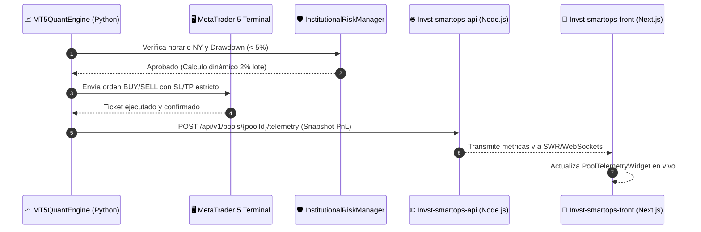

# 📊 Especificación Técnica Sprint 4: Suite QuantON MT5 & Telemetría SaaS

**Líderes de Implementación**: 👁️ **Itachi** (Webhooks & Frontend), 🦋 **Konan** (UI Dashboard), 🌿 **Zetsu** (Manuales Técnicos) & 🎭 **Tobi** (Reporting para Inversionistas)  
**Sprint**: 📊 Sprint 4 (20 SP) — Unificación MT5 & Conexión SaaS  
**Repositorio**: `raw/proyectos/repos/smartops-quant-engine/packages/mt5-quant/`

---

## 🏛️ 1. Arquitectura de Integración MT5 ➔ SaaS

---

## 🛡️ 2. Reglas Institucionales Axi Select / Prop Firms

1. **Riesgo Fijo del 2%**:
   $$\text{LotSize} = \frac{\text{Balance} \times 0.02}{\text{StopLoss}_{\text{puntos}} \times \text{PointValue}}$$
2. **Hard Stop en Drawdown (5.00%)**:
   - Monitoreo continuo de la equidad frente al pico histórico (*Peak Balance*). Si el drawdown supera el 5%, el motor activa el *Circuit Breaker* y bloquea nuevas operaciones.
3. **Filtro Estricto de Sesión New York**:
   - Opera exclusivamente entre **09:30 AM y 04:00 PM EST**. Fuera de esa ventana, el motor permanece en reposo para evitar spread widening nocturno.

---

## 🎨 3. Widget Visual en Next.js (`PoolTelemetryWidget`)

Desarrollado en `packages/mt5-quant/src/ui/telemetry_widget.tsx`:
- Conexión directa con la API de fondos de SmartOps.
- Visualización de balance total, equity flotante, PnL diario en $ y %.
- Medidor visual del Drawdown actual contra el límite del 5.00%.
- Contador de operaciones totales y porcentaje de acierto (*Win Rate*).
- Indicador visual de estado: `ONLINE`, `CIRCUIT_BREAKER` o `OFFLINE`.

---

## 🧪 4. Resultados de Pruebas Unitarias (Hidan QA)

- **Test Suite**: `packages/mt5-quant/tests/test_mt5_quant.py`
- **6 pruebas completas aprobadas al 100% en 0.000s**:
  - `test_dynamic_lot_size_calculation`: Validación de cálculo exacto de lotes con riesgo 2%.
  - `test_session_filter`: Validación de aceptación en horario NY y rechazo fuera de sesión.
  - `test_circuit_breaker_on_5_percent_drawdown`: Disparo automático al superar el 5% de drawdown.
  - `test_order_entry_approved_in_session`: Aprobación y formateo de órdenes en sesión.
  - `test_order_entry_rejected_outside_session`: Bloqueo inmediato de órdenes fuera de horario.
  - `test_telemetry_payload_generation`: Generación de payload JSON tipado para `Invst-smartops-api`.

---

## 🔗 Relación en 2brain
- [[ecosistema-trading-smartops|Ecosistema SmartOps Quant]]
- [[smartops-cex-streaming-zero-fee-engine|Sprint 3: CEX Streaming & Zero-Fee]]
- [[smartops-defi-arbitrage-atomic-flash-loans|Sprint 2: DeFi Atómico]]
- [[smartops-quant-engine-blueprint-sprint1|Sprint 1: Monorepo & Base]]
