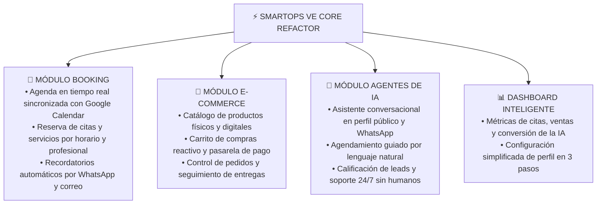

# 🚀 SmartOps VE — Blueprint de Refactor: Booking, E-commerce & Agentes de IA
**Líder Técnico & Arquitecto**: 🤵 ALFRED (Coordinador General)  
**Supervisión Suprema**: 👑 El Señor Víctor Montoya (`vmontoya.smartopsve@gmail.com`)  
**Ecosistema**: `Website_smartopsve` | `Admin_SmartOps` | `Profile-public-smartops` | `API_V3`  

---

## 💡 1. Objetivo del Refactor: La Nueva Era de SmartOps VE

Transformar la plataforma actual de perfiles estáticos y dashboard tradicional en un **Hub de Negocio Todo-en-Uno para Profesionales y Empresas**, fusionando tres pilares de alto valor:

---

## 🧩 2. Reestructuración de Módulos Existentes

### A. Perfiles de Negocio (`Profile-public-smartops`)
- **Situación Anterior**: Vistas estáticas tipo tarjeta de presentación digital.
- **Evolución Refactor**:
  1. **Hero Interactivo**: Botón directo de *"Agendar Cita"* o *"Comprar Servicios"*.
  2. **Selector de Servicios & Booking**: Calendario visual donde el cliente elige fecha, hora y especialista disponible.
  3. **Vitrina E-commerce**: Malla de productos o paquetes con botón *"Añadir al Carrito"*.
  4. **Chatbot Flotante (Agente IA)**: Asistente que atiende dudas sobre precios y agenda citas si el usuario prefiere hablar en lenguaje natural.

### B. Dashboard Administrativo (`Admin_SmartOps`)
- **Evolución**:
  1. **Vista de Calendario (Kanban/Timeline)**: Gestión de citas del día (Pendiente, Confirmada, Completada, Cancelada).
  2. **Gestor de Catálogo & Pedidos**: Control de productos, precios en USD/Bs y órdenes recibidas.
  3. **Configurador del Agente de IA**: Prompt de personalización del negocio, preguntas frecuentes (FAQs) y reglas de agendamiento.

### C. Backend & API (`API_V3`)
- Integración de endpoints:
  - `/api/booking`: Disponibilidad de horarios, creación de reservas y sincronización bidireccional con Google Calendar.
  - `/api/ecommerce`: Checkout, órdenes y notificaciones webhook.
  - `/api/ai-agent`: Motor RAG con Gemini API / LangChain para responder con base en los servicios y disponibilidad del negocio.

---

## 🗓️ 3. Plan de Trabajo en 4 Fases

1. **Fase 1: Arquitectura de Datos & Modelado (Booking + E-commerce)**
   - Modelos: `Appointment`, `TimeSlot`, `Service`, `Product`, `Order`, `AIAgentConfig`.
2. **Fase 2: Motor de Booking & Sincronización Google Calendar**
   - Lógica de prevención de colisiones de horarios y confirmaciones.
3. **Fase 3: Agente de IA Conversacional para Agendamiento**
   - Agente de reserva por lenguaje natural integrado al perfil público.
4. **Fase 4: Rediseño Visual & Dashboard Unificado**
   - Experiencia de usuario en Next.js 15 / Tailwind con diseño premium.
