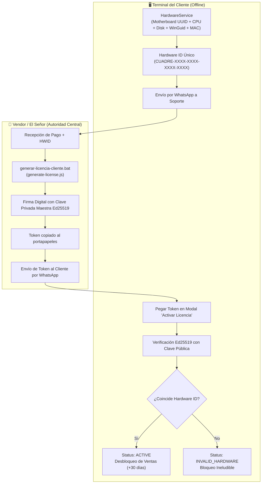

# 🔐 SOP: Gestión y Emisión de Licencias Mensuales — EL CUADRE POS

## 📌 Propósito y Alcance
Este Procedimiento Operativo Estándar (SOP) define el flujo técnico y administrativo para la **emisión, cobro, entrega y activación de licencias mensuales** de los clientes que operan con **EL CUADRE POS**.

El modelo de licenciamiento es **100% Offline-First**, basado en criptografía asimétrica **Ed25519 (256 bits)** y sellado **HMAC-SHA256**. El cliente puede operar sin acceso a internet; la licencia valida matemáticamente que la firma del Vendor es auténtica y que la huella física de hardware de la máquina coincide.

---

## 🏗️ Arquitectura de Seguridad (US-16)



---

## 🔄 Flujo Operativo Paso a Paso

### 1. El Cliente Solicita / Renueva su Mes
1. **Detección Previa (Aviso a los 7 días)**: El POS muestra un banner amarillo advirtiendo el vencimiento próximo con los días restantes.
2. **Envío de Hardware ID**: El cliente pulsa **"Copiar Hardware ID"** o hace clic en el enlace de **WhatsApp** integrado en el modal.
3. El cliente transfiere el valor de su mensualidad (Pago Móvil, Zelle o Efectivo) y le comparte su identificador único por chat (ej: `CUADRE-689F-54E5-D39A-EF90`).

### 2. El Señor Emite la Licencia Mensual
1. En la computadora de administración, abrir la carpeta raíz de `el-cuadre-pos`.
2. Ejecutar con doble clic el archivo:
   ```text
   generar-licencia-cliente.bat
   ```
3. Responder los campos del asistente:
   - **Hardware ID**: Pegar el ID del cliente (`Ctrl + V`).
   - **Nombre del Comercio**: Nombre del negocio (ej: `Bodegón Don Pedro`).
   - **RIF / Cédula**: Documento fiscal (ej: `J-12345678-0`).
   - **Meses de Vigencia**: `1` (por defecto) o `3`, `6`, `12` para paquetes trimestrales/anuales.
4. **Resultado**: El script emitirá el token y **lo copiará automáticamente al portapapeles de Windows**.

> Alternativa por terminal:
> ```bash
> node backend/scripts/generate-license.js -h CUADRE-XXXX-XXXX-XXXX-XXXX -n "Bodegón Don Pedro" -m 1
> ```

### 3. Entrega al Cliente
1. Ir al chat de WhatsApp del cliente.
2. Pegar el token con `Ctrl + V` y enviar.
3. Indicar al cliente:
   > *"Estimado cliente, copie este código y péguelo en la pantalla de su punto de venta en el campo 'Activar Licencia' y pulse el botón verde."*

### 4. Activación en el Mostrador
1. El cliente entra en EL CUADRE POS.
2. Pega la clave en la casilla de texto.
3. Presiona el botón verde **"Activar Licencia"**.
4. El sistema valida la firma, actualiza la fecha en la base de datos local SQLite con sellado HMAC y desbloquea el cobro inmediatamente.

---

## ⏱️ Estados de la Licencia y Períodos de Gracia

| Estado | Días Restantes | Comportamiento del POS |
| :--- | :--- | :--- |
| **`ACTIVE`** | > 7 días | Operación normal 100% transparente. Sin alertas. |
| **`WARNING`** | 1 a 7 días | Banner preventivo superior no invasivo con días restantes y botón de WhatsApp. Permite cobrar normalmente. |
| **`GRACE_PERIOD`** | 0 a -3 días | Período de gracia de **3 días de cortesía post-vencimiento**. Banner rojo urgente. **Permite cobrar** para no paralizar el mostrador si el fin de semana retrasó el pago. |
| **`EXPIRED`** | > 3 días vencida | **Bloqueo ineludible**. Modal modal bloqueante. Guardián de backend rechaza cobros con error `403 Forbidden`. |
| **`CLOCK_TAMPERED`** | N/A | Bloqueo de seguridad si el usuario atrasa el reloj de Windows respecto al último timestamp monotónico. |
| **`INVALID_HARDWARE`** | N/A | Bloqueo si la licencia fue emitida para otra máquina física distinta. |

---

## 🛠️ Herramientas y Archivos Clave

- **Asistente Vendor**: [`generar-licencia-cliente.bat`](file:///c:/Users/vmont/OneDrive/Desktop/el-cuadre-pos/generar-licencia-cliente.bat)
- **Motor Criptográfico CLI**: [`backend/scripts/generate-license.js`](file:///c:/Users/vmont/OneDrive/Desktop/el-cuadre-pos/backend/scripts/generate-license.js)
- **Servicio Backend**: [`backend/src/license/license.service.ts`](file:///c:/Users/vmont/OneDrive/Desktop/el-cuadre-pos/backend/src/license/license.service.ts)
- **Modal de Bloqueo Frontend**: [`frontend/src/components/license/LicenseLockModal.tsx`](file:///c:/Users/vmont/OneDrive/Desktop/el-cuadre-pos/frontend/src/components/license/LicenseLockModal.tsx)
- **Banner de Alerta Frontend**: [`frontend/src/components/license/LicenseBanner.tsx`](file:///c:/Users/vmont/OneDrive/Desktop/el-cuadre-pos/frontend/src/components/license/LicenseBanner.tsx)
